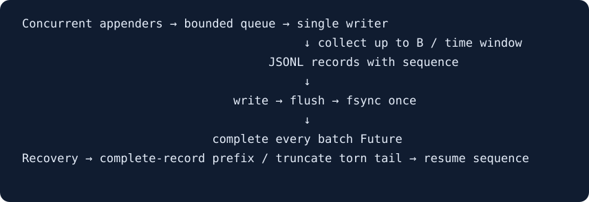

# W425. Event Logger with batching, fsync, and group commit follow-ups

**Priority group:** Fifth 100 — specialized practice

**Category:** Logs, metrics and observability

**Study position:** 425 of 547

[Group list](../FIFTH_100.md) · [All categories](../ALL_CATEGORIES.md) · [Chapter guide](../README.md)

<span class="practice-page"></span>

## Question

Problem: Event Logger

Design and implement an event logger that appends events to a durable log.

### Requirements

Support appending events to the log.
Support writing in-memory events to the underlying storage in batches.
Consider durability semantics: when to call fsync (or an equivalent forced flush).
Follow-up directions (conceptual)
How to do batching to improve throughput.
Trade-offs for fsync frequency (latency vs durability).
How group commit works in real databases: merging concurrent commits and notifying multiple waiters after a single flush.

Note: The original description does not specify exact I/O formats or constraints; this is commonly treated as a systems/design + implementable component question where you define interfaces, concurrency model, and durability guarantees.

```python
def solution():
    # Read data from standard input
    # Write your code here
    pass
```

```text
if __name__ == "__main__":
```

solution()

## Worked solution

### Define what append success means

`append(event)` returns a Future after bounded-queue acceptance. The event becomes **durably acknowledged only when that Future completes**, after the writer has written, flushed the language buffer and called fsync. Waiting for acceptance alone does not establish durability. This interface lets several concurrent callers share one physical flush.



[Open the architecture diagram](../diagrams/W425_review_architecture.svg).

### Runnable batched logger

[Download the implementation](../event_logger_425.py) and [behavior checks](../test_booking_logging_401_425.py). Create an existing durable parent directory, instantiate the logger and call `future.result()` when the caller needs a durability barrier. `close()` drains accepted work and reports failure; use it during orderly shutdown.

```python
"""W425: bounded asynchronous appends; Futures acknowledge fsync group commit."""

from concurrent.futures import Future
import json
import os
from pathlib import Path
import queue
import threading
import time


class EventLogger:
    def __init__(
        self, path, max_batch=100, flush_seconds=0.01, queue_size=10000, sync=os.fsync
    ):
        if max_batch < 1 or flush_seconds < 0 or queue_size < 1:
            raise ValueError("Invalid batching limits")
        self.path = Path(path)
        self.max_batch = max_batch
        self.delay = flush_seconds
        self.sync = sync
        self.queue = queue.Queue(queue_size)
        self.lock = threading.Lock()
        self.closed = False
        self.error = None
        if not self.path.parent.is_dir():
            raise ValueError("Create the durable parent directory first")
        self.file = open(self.path, "a+b")
        # Recovery accepts only a complete JSONL prefix, truncating a torn final line.
        self.file.seek(0)
        valid_end = 0
        self.next_sequence = 1
        while True:
            line = self.file.readline()
            if not line:
                break
            if not line.endswith(b"\n"):
                break
            record = json.loads(line)
            if record["sequence"] != self.next_sequence:
                raise ValueError("Corrupt sequence")
            self.next_sequence += 1
            valid_end = self.file.tell()
        self.file.truncate(valid_end)
        self.file.flush()
        os.fsync(self.file.fileno())
        directory = os.open(self.path.parent, os.O_RDONLY)
        try:
            os.fsync(directory)  # make a newly created log's directory entry durable
        finally:
            os.close(directory)
        self.worker = threading.Thread(target=self._run, daemon=True)
        self.worker.start()

    def append(self, event):
        # Snapshot/validate JSON at the API boundary; do not retain mutable caller objects.
        payload = json.loads(json.dumps(event, allow_nan=False))
        future = Future()
        future.set_running_or_notify_cancel()  # accepting an append is not cancellable
        with self.lock:
            if self.closed or self.error:
                raise RuntimeError("Logger unavailable") from self.error
            try:
                self.queue.put_nowait((payload, future))
            except queue.Full:
                raise BufferError("Log queue full; event not accepted")
        return future

    def _run(self):
        batch = []
        try:
            stop = False
            while not stop:
                item = self.queue.get()
                if item is None:
                    break
                batch = [item]
                deadline = time.monotonic() + self.delay
                while len(batch) < self.max_batch:
                    try:
                        item = self.queue.get(
                            timeout=max(0, deadline - time.monotonic())
                        )
                    except queue.Empty:
                        break
                    if item is None:
                        stop = True
                        break
                    batch.append(item)
                records = []
                sequences = []
                for payload, future in batch:
                    sequence = self.next_sequence
                    self.next_sequence += 1
                    sequences.append(sequence)
                    records.append(
                        json.dumps(
                            dict(sequence=sequence, event=payload), allow_nan=False
                        ).encode()
                        + b"\n"
                    )
                self.file.write(b"".join(records))
                self.file.flush()
                self.sync(self.file.fileno())
                for (_, future), sequence in zip(batch, sequences):
                    if not future.cancelled():
                        future.set_result(sequence)
                batch = []
        except BaseException as error:
            with self.lock:
                self.error = error
            for _, future in batch:
                if not future.done():
                    future.set_exception(error)
            while True:
                try:
                    item = self.queue.get_nowait()
                except queue.Empty:
                    break
                if item is not None and not item[1].done():
                    item[1].set_exception(error)
        finally:
            self.file.close()

    def close(self):
        with self.lock:
            first = not self.closed
            self.closed = True
        if first:
            while self.worker.is_alive():
                try:
                    self.queue.put(None, timeout=0.05)
                    break
                except queue.Full:
                    pass
        self.worker.join()
        if self.error:
            raise RuntimeError("Durable log write failed") from self.error
```

The writer owns file order and sequence numbers. It snapshots JSON input before enqueue so later caller mutation cannot change the stored event. A full queue rejects the new event explicitly instead of consuming unbounded memory. Accepted appends cannot be cancelled by cancelling their Future. Keep Future callbacks short because completion callbacks may execute on the writer thread.

### Why group commit helps

One fsync per event provides low batching delay but makes throughput depend heavily on sync latency. If fsync takes three milliseconds, a serialized one-event scheme tops out near333 syncs/s before other work. A100-event group could amortize that cost toward33,333 events/s, subject to encoding/write/device limits. Group members wait for batch accumulation plus write/sync; this is a throughput/latency trade-off, not free speed.

`flush()` moves Python-buffered bytes to the operating system; fsync requests persistence to the storage device under the filesystem/hardware contract. A background sync every interval can lose the unsynced suffix after a crash if callers were acknowledged earlier. The implementation avoids that particular lie by acknowledging only after the shared fsync. It also syncs the containing directory for the log's creation; rotating/renaming files requires its own file/directory durability steps. Host/device destruction still needs replication/backups—fsync is not geographic durability.

### Recovery and failure semantics

On startup, accept a contiguous complete JSONL prefix, truncate an incomplete final line, and reject complete malformed/corrupt sequence records. For stronger bit-corruption detection, add length/checksum framing and checkpoints/segments; JSON parsing alone is not a cryptographic integrity guarantee. A sync/write failure fails affected and queued Futures, stops accepting new events and surfaces on close. It must not return success then quietly discard a batch.

An unacknowledged event can nevertheless survive a crash if bytes reached storage before the process died. Callers retrying after an uncertain acknowledgement need stable event IDs and deduplication if exactly one logical record matters. A Future timeout does not remove the accepted event. Multiple processes must not append through separate copies of this in-memory sequencer; route to one writer/partition or add a proper cross-process protocol.

The tests verify ten waiters sharing one sync, sequence/order and torn-tail recovery, payload snapshotting, close draining and explicit fsync failure. They exercise local behavior, not physical power-loss reliability or production throughput. The generic `solution()` stub defines no stdin format, so the component API above is an explicit, testable interpretation of the task.
