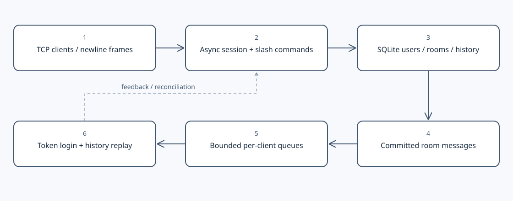

# W427. Build a Discord-like TCP Chat Server with Slash Commands, Rooms, Reconnection, and Persistence

**Priority group:** Fifth 100 — specialized practice

**Category:** Messaging and collaborative systems

**Study position:** 427 of 547

[Group list](../FIFTH_100.md) · [All categories](../ALL_CATEGORIES.md) · [Chapter guide](../README.md)

<span class="practice-page"></span>

## Question

Build a runnable multi-client TCP chat server with slash commands, chat rooms, per-room history, reconnection, and persistence across restarts.

### Requirements

1. Multi-client TCP server: listen on a configurable port, serve many clients at once, and read line-based input terminated by
. Each line is either a command (starts with /) or a chat message.
2. Slash commands, at least:
/help: list the available commands.
/nick &lt;name&gt;: set or change this user's nickname.
/users: list the users currently online.
/quit: disconnect gracefully.
3. Rooms: create a room (for example /create &lt;room&gt;), join a room (/join &lt;room&gt;), and list rooms (/rooms). A message sent to a room is broadcast to every user in it. A plain message from a user who is in no room gets a helpful error.
4. History: when a user joins a room, show that room's last 10 messages.
5. Reconnection: define a user identity (for example user id plus token). A user who disconnects can reconnect later, restore their identity, and rejoin the rooms they were in.
6. Persistence: users and nicknames, rooms, memberships and room history (at least a retained window) survive a server restart. Any storage is fine (SQLite, files, a key-value store); describe your data model.
7. Scalability: the server need not be distributed, but explain how the design would scale: the concurrency model for many connections, the storage bottleneck, broadcasting across several server instances, and slow clients.
Input
A port number on the command line.
Lines typed by clients connected with telnet, nc, or PuTTY.
Output / deliverable
A runnable server, a short description of the protocol and data model, and a manual test script showing two clients chatting in a room, history on join, and state restored after a server restart.
Example
client A: /nick alice        -&gt; id=&lt;id&gt; token=&lt;token&gt; nick=alice
client A: /create general
client A: /join general
client B: /nick bob
client B: /join general
client A: hello              -&gt; client B sees "[general] alice: hello"
(restart the server)
client A: /login &lt;id&gt; &lt;token&gt; -&gt; welcome back alice, rooms and last 10 messages restored

## Worked solution

### Protocol, identity and persistent state

The runnable server below uses one asyncio event loop for connections and SQLite/WAL for committed state. Start with `python review_w427_implementation.py 9000 --db /private/tmp/chat-demo.db`. It binds localhost for this demonstration. Each UTF-8 newline-terminated line is a slash command or a room message. `/nick NAME` creates an identity and returns a random token once; `/login ID TOKEN` restores it. Tokens are stored only as SHA-256 hashes and compared in constant time. Real remote deployment must add TLS, authentication recovery/rate limits and secret-safe client storage; the local demo sends a bearer token over its TCP connection.

Users(id,token_hash,nick) persists nickname/identity; Rooms(name), Memberships(user_id,room) and Messages(id,room,user_id,nick,body,time) persist room state/history. Memberships survive disconnect; one connection has a current sending room, selected by `/join`, and receives broadcasts for every joined room. Login restores memberships and chooses the lexicographically first as current (the response names it). Rename changes online identity while older messages retain the display name used at send time. History keeps 1,000 messages/room and replays the latest ten on join/login in chronological order. This is a retained-window contract, not indefinite offline delivery.

```python
"""Local TCP chat demo with SQLite identity/memberships/history and bounded writers."""

import argparse
import asyncio
import hashlib
import hmac
import re
import secrets
import sqlite3
import uuid


class Session:
    def __init__(self, writer):
        self.writer = writer
        self.queue = asyncio.Queue(maxsize=100)
        self.user = None
        self.nick = None
        self.rooms = set()
        self.current = None

    def emit(self, text):
        try:
            self.queue.put_nowait(text + "\n")
        except asyncio.QueueFull:
            self.writer.close()

    async def write_loop(self):
        while True:
            self.writer.write((await self.queue.get()).encode())
            await asyncio.wait_for(self.writer.drain(), 2.0)


class ChatServer:
    def __init__(self, path):
        self.db = sqlite3.connect(path)
        self.db.execute("PRAGMA journal_mode=WAL")
        self.db.execute("PRAGMA synchronous=FULL")
        self.db.executescript("""
        CREATE TABLE IF NOT EXISTS users(id TEXT PRIMARY KEY,token_hash TEXT NOT NULL,nick TEXT UNIQUE NOT NULL);
        CREATE TABLE IF NOT EXISTS rooms(name TEXT PRIMARY KEY);
        CREATE TABLE IF NOT EXISTS memberships(user_id TEXT,room TEXT,PRIMARY KEY(user_id,room));
        CREATE TABLE IF NOT EXISTS messages(id INTEGER PRIMARY KEY AUTOINCREMENT,room TEXT,user_id TEXT,nick TEXT,body TEXT,created_at TEXT DEFAULT CURRENT_TIMESTAMP);
        CREATE INDEX IF NOT EXISTS history ON messages(room,id DESC);
        """)
        self.sessions = set()

    @staticmethod
    def valid_name(name):
        return re.fullmatch(r"[A-Za-z0-9_-]{1,32}", name) is not None

    def history(self, session, room):
        rows = self.db.execute(
            "SELECT nick,body FROM messages WHERE room=? ORDER BY id DESC LIMIT 10",
            (room,),
        ).fetchall()
        session.emit(f"HISTORY {room}")
        for nick, body in reversed(rows):
            session.emit(f"[{room}] {nick}: {body}")
        session.emit(f"END_HISTORY {room}")

    def dispatch(self, s, line):
        if not line:
            return True
        command, *rest = line.split(maxsplit=1)
        arg = rest[0] if rest else ""
        if line.startswith("/"):
            if command == "/help":
                s.emit(
                    "/help /nick NAME /login ID TOKEN /users /create ROOM /join ROOM /rooms /quit"
                )
                return True
            if command == "/quit":
                s.emit("BYE")
                return False
            if command == "/nick":
                if not self.valid_name(arg):
                    s.emit("ERROR nickname must be 1-32 letters/digits/_/-")
                    return True
                try:
                    with self.db:
                        if s.user:
                            self.db.execute(
                                "UPDATE users SET nick=? WHERE id=?", (arg, s.user)
                            )
                            token = None
                        else:
                            ident = uuid.uuid4().hex
                            token = secrets.token_urlsafe(32)
                            self.db.execute(
                                "INSERT INTO users VALUES(?,?,?)",
                                (
                                    ident,
                                    hashlib.sha256(token.encode()).hexdigest(),
                                    arg,
                                ),
                            )
                            s.user = ident
                    s.nick = arg
                    for other in self.sessions:
                        if other.user == s.user:
                            other.nick = arg
                    s.emit(
                        f"id={s.user} token={token} nick={arg}"
                        if token
                        else f"nick={arg}"
                    )
                except sqlite3.IntegrityError:
                    s.emit("ERROR nickname already used")
                return True
            if command == "/login":
                if s.user:
                    s.emit("ERROR already authenticated")
                    return True
                fields = arg.split()
                if len(fields) != 2:
                    s.emit("ERROR /login ID TOKEN")
                    return True
                row = self.db.execute(
                    "SELECT token_hash,nick FROM users WHERE id=?", (fields[0],)
                ).fetchone()
                if row is None or not hmac.compare_digest(
                    row[0], hashlib.sha256(fields[1].encode()).hexdigest()
                ):
                    s.emit("ERROR login failed")
                    return True
                s.user, s.nick = fields[0], row[1]
                s.rooms = {
                    r[0]
                    for r in self.db.execute(
                        "SELECT room FROM memberships WHERE user_id=?", (s.user,)
                    )
                }
                s.current = sorted(s.rooms)[0] if s.rooms else None
                s.emit(f"welcome back {s.nick}; current={s.current}")
                for room in sorted(s.rooms):
                    self.history(s, room)
                return True
            if not s.user:
                s.emit("ERROR identify with /nick NAME or /login ID TOKEN")
                return True
            if command == "/users":
                s.emit(
                    "USERS "
                    + " ".join(sorted({p.nick for p in self.sessions if p.user}))
                )
            elif command == "/rooms":
                s.emit(
                    "ROOMS "
                    + " ".join(
                        r[0]
                        for r in self.db.execute("SELECT name FROM rooms ORDER BY name")
                    )
                )
            elif command == "/create":
                if not self.valid_name(arg):
                    s.emit("ERROR invalid room name")
                    return True
                with self.db:
                    self.db.execute("INSERT OR IGNORE INTO rooms VALUES(?)", (arg,))
                s.emit(f"ROOM {arg}")
            elif command == "/join":
                if (
                    self.db.execute(
                        "SELECT 1 FROM rooms WHERE name=?", (arg,)
                    ).fetchone()
                    is None
                ):
                    s.emit("ERROR no such room")
                    return True
                with self.db:
                    self.db.execute(
                        "INSERT OR IGNORE INTO memberships VALUES(?,?)", (s.user, arg)
                    )
                s.rooms.add(arg)
                s.current = arg
                self.history(s, arg)
            else:
                s.emit("ERROR unknown command; use /help")
            return True
        if not s.user:
            s.emit("ERROR identify with /nick NAME or /login ID TOKEN")
            return True
        if s.current is None:
            s.emit("ERROR join a room using /join ROOM")
            return True
        if len(line) > 4096:
            s.emit("ERROR message too long")
            return True
        with self.db:
            self.db.execute(
                "INSERT INTO messages(room,user_id,nick,body) VALUES(?,?,?,?)",
                (s.current, s.user, s.nick, line),
            )
            self.db.execute(
                "DELETE FROM messages WHERE room=? AND id NOT IN (SELECT id FROM messages WHERE room=? ORDER BY id DESC LIMIT 1000)",
                (s.current, s.current),
            )
        for peer in list(self.sessions):
            if s.current in peer.rooms:
                peer.emit(f"[{s.current}] {s.nick}: {line}")
        return True

    async def handle(self, reader, writer):
        s = Session(writer)
        self.sessions.add(s)
        output = asyncio.create_task(s.write_loop())
        output.add_done_callback(
            lambda task: (
                writer.close()
                if not task.cancelled() and task.exception() is not None
                else None
            )
        )
        s.emit("WELCOME /nick NAME or /login ID TOKEN; /help")
        try:
            while not writer.is_closing():
                data = await reader.readline()
                if not data:
                    break
                try:
                    line = data.decode("utf-8").rstrip("\r\n")
                except UnicodeDecodeError:
                    s.emit("ERROR invalid UTF-8")
                    continue
                try:
                    keep = self.dispatch(s, line)
                except sqlite3.Error:
                    s.emit("ERROR storage unavailable; not saved")
                    continue
                if not keep:
                    await asyncio.sleep(0.02)
                    break
        except (ValueError, ConnectionError, asyncio.IncompleteReadError):
            pass
        finally:
            self.sessions.discard(s)
            output.cancel()
            try:
                await output
            except (asyncio.CancelledError, Exception):
                pass
            writer.close()
            try:
                await writer.wait_closed()
            except ConnectionError:
                pass


async def run(port, path):
    chat = ChatServer(path)
    server = await asyncio.start_server(chat.handle, "127.0.0.1", port, limit=8192)
    try:
        async with server:
            await server.serve_forever()
    finally:
        chat.db.close()


def main():
    p = argparse.ArgumentParser()
    p.add_argument("port", type=int)
    p.add_argument("--db", default="chat_demo.sqlite3")
    a = p.parse_args()
    try:
        asyncio.run(run(a.port, a.db))
    except KeyboardInterrupt:
        pass


if __name__ == "__main__":
    main()
```

### Manual two-client and restart demonstration

Open two terminals with `nc 127.0.0.1 9000`. In A enter `/nick alice` and securely copy the returned id/token, then `/create general`, `/join general`, and `hello`. In B enter `/nick bob`, save its credentials and `/join general`: B sees `HISTORY general`, Alice's hello and `END_HISTORY general`. A then sends `second`; both receive `[general] alice: second`. `/users`, `/rooms` and `/help` inspect current state, while `/quit` closes gracefully. A plain message before joining returns a helpful error.

Stop/restart the server with the **same** database path. In a new A connection use `/login SAVED_ID SAVED_TOKEN`: it replies `welcome back alice`, restores general membership and its last ten messages. B can restore independently; wrong credentials fail without revealing the token. The automated socket test performs these operations against a real server process, restarts it and verifies identity/membership/history recovery.

### Concurrency, durability and scale

Dispatch contains no await between history snapshot/subscription change and enqueueing outputs, so one event-loop order determines messages; committed SQLite rows precede broadcasts. Slow clients have a 100-line bounded queue and a two-second drain timeout, then disconnect; they cannot hold every other client's broadcast. Reconnection replays history and may duplicate messages already seen, so this plain-text demo intentionally does not promise exactly-once UI display or unlimited backlog. A production protocol would expose sequence IDs/client message keys and per-device cursors.

SQLite work is synchronous and serialized here, appropriate for a local exercise but a measured event-loop/storage bottleneck. Offload a serialized database writer or use async database access, batch inserts and partition rooms at higher volume. Multiple gateway instances need shared durable history, a room-owner/sequence service and broker fanout to gateways holding members; the token/membership database cannot remain an uncoordinated local file. At an assumed 1,000 messages/s×200 bytes and 100 recipients/message, output is roughly 20 MB/s before protocol overhead. Restrict line length/names and parameterize SQL. Tests cover command errors, history limit, login/restart and broadcast; no internet-scale or encrypted transport claim is made.

<!-- architecture:W427:start -->


Read the numbered path as TCP clients / newline frames → Async session + slash commands → SQLite users / rooms / history → Committed room messages → Bounded per-client queues → Token login + history replay. The dashed return is the recovery/feedback path explained above, under the stated authorization, consistency and durability boundaries.
<!-- architecture:W427:end -->

[Runnable W427 implementation](../review_w427_implementation.py).

[Batch behavior checks](../test_review_426_450.py). Design sizing/SLOs are explicit calculations and targets, not measured production claims.

### Further study

- [F162: Design a durable work queue with retries and leases.](../17_distributed_systems_depth.md#f162)
- [F169: Explain backpressure in a multi-stage data pipeline.](../17_distributed_systems_depth.md#f169)
