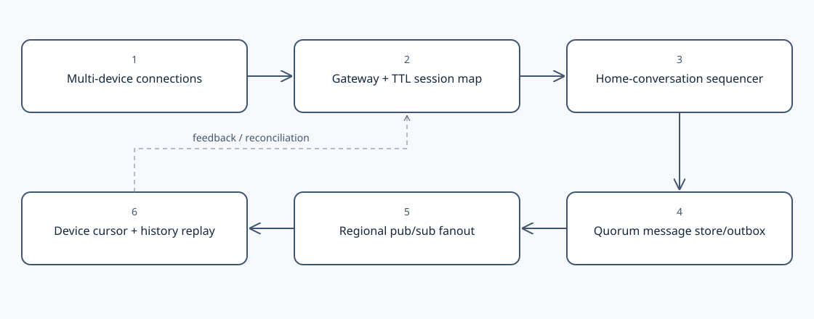

# W428. Design a 1:1 Chat System (Pub/Sub, Partitioning, Multi-Region)

**Priority group:** Fifth 100 — specialized practice

**Category:** Messaging and collaborative systems

**Study position:** 428 of 547

[Group list](../FIFTH_100.md) · [All categories](../ALL_CATEGORIES.md) · [Chapter guide](../README.md)

## Question

Design a one-on-one (1:1) chat system: two users exchange text messages in real time from phones, laptops and browsers, and each user may be logged in on several devices at once.

Scale and assumptions
1. Users: 100 million daily active users. Each sends about 50 messages per day. Peak traffic is 3 times the average.
2. Message: a sender, a recipient, a client-generated message id, a timestamp and a text body of up to 4 KB. The average encoded size is 300 bytes.
3. Presence: at peak, about 20% of daily active users hold an open connection.
4. Regions: users are spread over three geographic regions (for example US, EU and Asia-Pacific). Two users in a conversation may live in different regions.
5. History: messages are kept indefinitely, and a user can scroll back through any conversation.
Functional requirements
1. Send a message to one other user. When the recipient is online, every one of their connected devices receives it within about 500 ms in the same region.
2. When the recipient is offline, the message is stored and delivered when a device reconnects. Nothing is lost and nothing is shown twice, even when a client retries a send.
3. Messages within one conversation appear in the same order on every device of both users.
4. Delivery and read receipts are sent back to the sender.
5. Load the most recent page of a conversation's history, and page backwards.
Parts to address
1. Pub/sub and fan-out: how a message travels from the sender's connection to each of the recipient's live connections. Cover which component holds connections, how the system knows where a user is connected, and what happens when a device is offline or reconnects.
2. Partition key: how messages are partitioned in the message store and in any queue or topic. State the key, why it serves the read and write paths, and what alternatives you rejected.
3. Cross-region: what happens when sender and recipient are in different regions. Cover where the conversation's data lives, the latency a cross-region message pays, and what happens when a region fails.
4. Database scaling: how the message store grows to years of history, including sharding, replication, hot conversations and the split between recent and old data.
Deliverables
1. An architecture diagram (in words is fine) naming each component on the send and receive paths.
2. The data model for messages and conversations.
3. Capacity estimates: write rate, storage per day and per year, number of connection gateways, and number of storage shards.
4. The failure behaviour for a lost acknowledgement, a dropped connection, a gateway crash and a region outage.

### Constraints

Group chats, media attachments and end-to-end encryption are out of scope, but the design should not prevent adding them.
State every assumption you add beyond the numbers above.

## Worked solution

### Capacity and records

100 million DAU×50 messages gives **five billion messages/day**, about **57,870 writes/s average**, **173,611/s peak**. At 300 bytes average, content is **1.5 TB/day** and **547.5 TB/year** logical; three replicas are about 1.6425 PB/year before indexes/receipts/backups. Indefinite history is continuing growth, not one year's provision. Peak open users are 20 million. Assuming one connection/user and 20,000 connections/gateway, need 1,000 gateways before headroom; at an assumed 1.5 devices/connected user, 1,500. Real device count and tested per-gateway memory/output rate determine sizing.

Conversation(id,participants,home_region,next_seq,epoch), Message(conversation_id,seq,sender,client_msg_id,body,time), Dedup(sender,client_msg_id,request_hash,conversation,seq), DeviceCursor(user,device,conversation,delivered_seq,read_seq) and membership records define the model. Unique client identity binds sender/body/conversation and returns the original seq on retry. An ACK follows atomic dedup+sequence+message+outbox commit; timestamps are display metadata, not ordering authority.

### Send, fanout and partition key

The diagram is device→authenticated connection gateway→conversation owner/shard→replicated message log/outbox→regional pub/sub routers→all live recipient devices (and sender's other devices). A TTL session directory maps user to region/gateway/connection IDs; gateways own sockets and heartbeat directory entries. Offline users need no permanent socket/pubsub consumer because history persists. On reconnect a device fetches messages after its durable delivered cursor, deduplicates by conversation/seq and acknowledges only after local persistence; read receipts advance monotonically by max sequence and are distinct from gateway delivery.

Partition queue/message writes by conversation_id for one ordered stream and efficient history pages. Partition old storage by (conversation_id,time/sequence bucket) so one long conversation is not an unbounded physical partition. User partitioning would scatter one conversation across sender/recipient copies and complicate ordering; timestamp-only partitioning makes history fan out and creates hot time buckets. A conversation sequencer orders concurrent opposite-direction sends; idempotent retry never allocates another message. History pages use exclusive before_seq cursors. Pub/sub is a delivery hint/replay trigger, not the only durable copy.

### Regions, shards and failure behavior

Give each conversation one home ordering authority; gateways forward cross-region sends there, then deliver from nearby recipient gateways. Both parties pay the relevant WAN path and durability quorum latency; the same-region 500 ms target is not automatically a worldwide bound. Use three-region consensus replication if no acknowledged message may be lost through region failure, and fence the old leader before promoting a quorum survivor. During loss of quorum stop acknowledging new messages, while clients retain pending sends under the same ID. Async remote replication would lower latency but cannot promise RPO zero, so make that trade-off explicit.

For shard sizing, assume 2,000 safe writes/s per logical shard: peak needs at least 87, choose 128 for throughput headroom. Storage dominates yearly growth: at an assumed 2 TB usable logical recent data/shard, one year alone would need 274 shard-equivalents before replication, so tier old immutable buckets to object storage with indexed manifests and warm read caches. These are assumptions, not product facts. Hot 1:1 conversations get dedicated ownership/caches or rate limits; a globally ordered conversation cannot be parallelized arbitrarily without a sequencer.

Lost ACK returns the same committed seq on resend. Dropped socket/gateway crash leaves history intact and reconnect replays after cursor; duplicate pushes are suppressed by seq. A region outage reroutes connections, recovers consensus authority/directory and replays outbox/history; directory loss does not lose messages. Keep encryption/access checks, quotas and retention indexes ready for future media/groups/E2EE without claiming those features now. Monitor write/read tail latency, replication/delivery lag, cursor gaps, duplicate suppression and gateway pressure; test concurrent sends, ACK loss, device offline for years, gateway death and region failover with committed-prefix verification.

<!-- architecture:W428:start -->

Read the numbered path as Multi-device connections → Gateway + TTL session map → Home-conversation sequencer → Quorum message store/outbox → Regional pub/sub fanout → Device cursor + history replay. The dashed return is the recovery/feedback path explained above, under the stated authorization, consistency and durability boundaries.
<!-- architecture:W428:end -->

[Batch behavior checks](../test_review_426_450.py). Design sizing/SLOs are explicit calculations and targets, not measured production claims.

### Further study

- [F162: Design a durable work queue with retries and leases.](../17_distributed_systems_depth.md#f162)
- [F169: Explain backpressure in a multi-stage data pipeline.](../17_distributed_systems_depth.md#f169)
