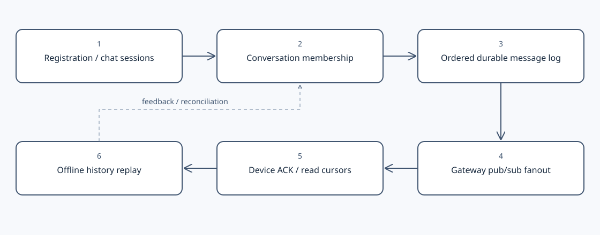

# W429. Design a Chat Application with Group and Offline Support

**Priority group:** Fifth 100 — specialized practice

**Category:** Messaging and collaborative systems

**Study position:** 429 of 547

[Group list](../FIFTH_100.md) · [All categories](../ALL_CATEGORIES.md) · [Chapter guide](../README.md)

## Question

Design a chat application that supports one-on-one and group messaging with user registration, real-time message delivery, and offline support (messages delivered when a recipient reconnects).

## Worked solution

### Durable conversations, not just open sockets

Assume text 1:1/groups, registration/login, near-realtime delivery and offline history; clarify group limits/retention because they drive fanout cost. Registration stores salted password hashes or uses an identity provider, sessions are short-lived/refreshable and every send/history request checks current conversation membership. `POST /conversations`, `/conversations/{id}/messages` with client message key, `GET /messages?after|before_seq=`, and receipt APIs form the contract.

Store User, Conversation(id,type,next_seq,epoch), Membership(conversation,user,role,joined_seq,left_seq), Message(conversation,seq,sender,client_id,body,time) and DeviceCursor(user,device,conversation,delivered,read). Decide whether new members see prejoin history; assume only from joined_seq unless a policy grants more. An owner/leader per conversation commits sequence+message+dedup+outbox atomically before ACK. Sender retries return the same seq; sequence, not device clock, orders messages across devices.

### Online and offline flow

The diagram's connection gateways authenticate sockets and publish TTL session mappings. Conversation outbox events flow through pub/sub to gateways serving online members, with per-device acknowledgments and UI deduplication. Offline members do not require one giant queue per device: durable conversation history plus membership/cursor supplies backlog on reconnect. Push notifications wake the app and carry minimal metadata, not authoritative delivery/read state. Read receipts advance by max seq and remain eventually consistent.

Groups multiply delivery work; push to each gateway once with its local recipient set, and bound per-group/member rates. Large groups can pull history from shared conversation storage rather than materialize message bodies per recipient. A removal/deletion event invalidates current access and stale queued delivery; cached media/extensions need the same policy. Use bounded socket queues, slow-client disconnect and after_seq replay rather than letting one stalled user block fanout.

### Estimate and failures

No scale is provided. Assume one million daily users×20 sends/day=20 million/day (~231/s average); if mean group delivery fanout is 15, output is ~3,472 deliveries/s before peak/device multiplication. At assumed 300 bytes/message, content storage is 6 GB/day logical. Separate connection count, storage writes and fanout throughput when sizing shards/gateways.

Lost ACK/dropped gateway is recovered by client key/cursor; an outbox crash replays without creating another message. Message-store outage leaves sends pending/failed explicitly, not socket-ACKed as saved. Region failover chooses quorum/fenced authority if acknowledged-message loss is forbidden; async replicas have a disclosed RPO trade-off. Partition by conversation for ordering/history and time-bucket long histories; cache recent pages. Test repeated sends, concurrent group membership removal, reconnect gap, slow consumer and receipt reordering. Monitor durable-ACK latency, commit-to-device delay, backlog age, unauthorized reads and duplicate-render rate. This covers registration, groups and offline recovery without mistaking presence for membership or delivery for read status.

<!-- architecture:W429:start -->

Read the numbered path as Registration / chat sessions → Conversation membership → Ordered durable message log → Gateway pub/sub fanout → Device ACK / read cursors → Offline history replay. The dashed return is the recovery/feedback path explained above, under the stated authorization, consistency and durability boundaries.
<!-- architecture:W429:end -->

[Batch behavior checks](../test_review_426_450.py). Design sizing/SLOs are explicit calculations and targets, not measured production claims.

### Further study

- [F162: Design a durable work queue with retries and leases.](../17_distributed_systems_depth.md#f162)
- [F169: Explain backpressure in a multi-stage data pipeline.](../17_distributed_systems_depth.md#f169)
