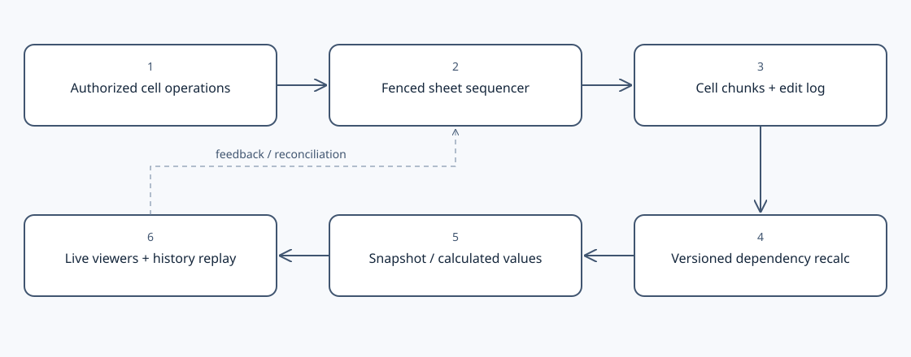

# W430. Design a Collaborative Spreadsheet (Google Sheets)

**Priority group:** Fifth 100 — specialized practice

**Category:** Messaging and collaborative systems

**Study position:** 430 of 547

[Group list](../FIFTH_100.md) · [All categories](../ALL_CATEGORIES.md) · [Chapter guide](../README.md)

## Question

Salesforce AI Engineer onsite system-design round. Design a web service like Google Sheets, with the interviewer steering focus onto the backend and data model — concurrency control for simultaneous editors, storage of large sheets, snapshot / version backup.

### Requirements

Web-based spreadsheet: rows x columns of cells, each cell holds a value or a formula referencing other cells.
Multi-user collaboration: many editors on the same sheet concurrently; edits propagate to all viewers in near-real-time.
Persistence: a sheet survives server restarts; full history accessible (versioning / snapshots).
Scale: very large sheets (millions of cells); some sheets are tiny.
Interviewer explicitly emphasises backend + data models — frontend rendering and offline sync are out of scope.

## Worked solution

### Backend model and concurrency rule

Store Workbook/Sheet(id,owner,ACL,head_version), RowID/ColumnID(order_key,deleted), Cell(sheet,row_id,col_id,raw_value_or_formula,last_version), Dependency(sheet,source_cell,target_cell), Operation(sheet,seq,op_id,actor,base_version,payload), Snapshot(sheet,version,manifest) and partitioned cell chunks. Use stable row/column IDs rather than physical offsets so inserting a row does not force rewriting every stored coordinate. Formula references retain stable identity plus relative/absolute semantics; structural edits define how display addresses and range expansion change. Sparse chunks avoid storing empty millions of cells, while range tiles support large scans.

Choose one fenced authoritative sequencer per sheet and online editing, since offline sync/frontend are out of scope. Operations include set-cell, batch/paste, insert/delete row/column and ACL changes. Each op_id is unique, and the server assigns an increasing seq in a durable transaction before broadcast. Concurrent writes to the same cell use declared **server-order last-write-wins**, retaining both in history; clients can optionally send expected_cell_version for conflict rejection instead of silent overwrite. Batch paste is atomic at an agreed size limit. Stable-ID structural operations against deleted rows/cells are rejected or reported as no-op according to a documented rule, not misapplied to a shifted neighbor.

### Formulas and coherent versions

The diagram's ordered edit service updates cells and dependency indexes, then a recalculation scheduler invalidates reachable dependents and evaluates a topological order. Cycles produce a deterministic cycle error (or a separately scoped iterative-calculation policy). Version volatile functions/time/random seeds per calculation epoch and restrict external-data functions so two replicas do not compute incompatible values. Derived values carry input sheet_version and are published as a calculation batch; a late calculation for v10 cannot overwrite v11. For expensive sheets expose CALCULATING/version lag rather than mix values from inconsistent inputs and claim a current snapshot.

`POST /sheets/{id}/operations`, `GET /cells?range=&version=`, `/changes?after_seq=`, `/history` and `/restore` provide backend APIs. Restore creates a new version from an old snapshot, preserving history, and needs authorization/version preconditions. Viewers receive a snapshot at v plus replay v+1 onward; register a replay boundary before switching to live events to avoid the snapshot/broadcast gap.

### Persistence, scale and failures

Append operations and outbox durably; periodically materialize immutable chunk snapshots with a complete manifest/checksum and version. Recovery loads a verified snapshot and replays the tail. Keep full history through logs+snapshots, compacting storage without deleting the only reconstructible prior version. Hot sheets may have dedicated owners; tiny sheets share workers. One globally ordered sheet has a per-sheet throughput ceiling, so chunk storage/parallel recalculation improves capacity without pretending arbitrary concurrent sequencing is free.

Assume one million nonempty cells at 100 encoded bytes: 100 MB logical/snapshot, excluding formulas/dependencies/history. A 1,000-cell edit should append a delta and rewrite affected chunks, not a 100 MB full file. At an assumed 1,000 edits/s×200 bytes, log growth is 17.28 GB/day for one very hot sheet; enforce limits and retention/cost policy while preserving the promised history. Multi-zone replicas, sequencer epochs and conditional writes prevent split-brain owners. Test two simultaneous same-cell writes, row insertion against formula references, duplicate op, cycle creation, stale recalculation and crash during snapshot publication. Monitor append lag, formula fanout/cost, snapshot age and replay time; no text-collaboration algorithm is necessary to define this centralized cell-operation contract.

<!-- architecture:W430:start -->

Read the numbered path as Authorized cell operations → Fenced sheet sequencer → Cell chunks + edit log → Versioned dependency recalc → Snapshot / calculated values → Live viewers + history replay. The dashed return is the recovery/feedback path explained above, under the stated authorization, consistency and durability boundaries.
<!-- architecture:W430:end -->

[Batch behavior checks](../test_review_426_450.py). Design sizing/SLOs are explicit calculations and targets, not measured production claims.

### Further study

- [F162: Design a durable work queue with retries and leases.](../17_distributed_systems_depth.md#f162)
- [F170: Design a cache without serving incorrect data.](../17_distributed_systems_depth.md#f170)
