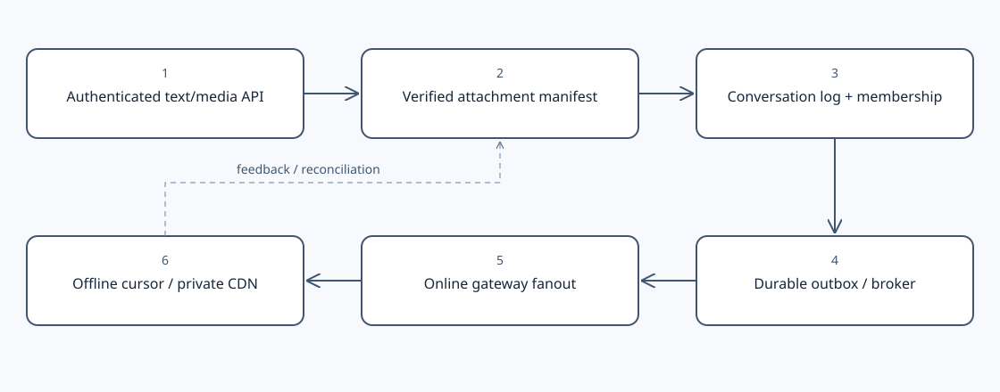

# W431. Design a Real-Time Instant Messaging Application with Media Support

**Priority group:** Fifth 100 — specialized practice

**Category:** Messaging and collaborative systems

**Study position:** 431 of 547

[Group list](../FIFTH_100.md) · [All categories](../ALL_CATEGORIES.md) · [Chapter guide](../README.md)

## Question

Design an instant messaging application. It should support one-on-one chats and group chats, allowing users to send text messages, images, and files. Consider user authentication, message storage, and real-time capability in your design.

Example scale
{'users': 1000, 'messagesPerSecond': 500}

## Worked solution

### A modest service with explicit media state

At the example 1,000 users and 500 messages/s, use a few WebSocket/API instances, a replicated SQL message store, a small durable event broker and object storage/CDN; the stated message rate matters more than user count alone. Assume 300 bytes/text message for illustration: 150 KB/s, 12.96 GB/day logical text if sustained, before replicas/indexes. Media bytes may dominate and need separate size/rate limits.

User/Session stores authenticated identity; Conversation/Membership owns 1:1/group access; Message(conversation,seq,sender,client_id,kind,body_or_attachment,time) and DeviceCursor support ordered history/reconnect. Attachment(id,owner,object_ref,size,digest,mime,state) is UPLOADING→SCANNING→READY/REJECTED. `POST /attachments` returns resumable signed upload URLs; finalize verifies content and scans before a message can reference READY media. Files are never streamed through every chat database write, and private download URLs are scoped/short-lived with current membership checks.

### Send and receive paths

`POST /conversations/{id}/messages` or an authenticated socket command includes a client ID; a transaction validates current membership, allocates conversation seq, writes message/dedup/outbox and then ACKs. Per-conversation order is consistent on all devices; unique (sender,client_id) prevents retries duplicating the message. The diagram's outbox→broker→gateway fanout reaches all online member devices. Presence directory entries expire; durable cursors/history deliver missed messages when a gateway dies or a user reconnects. Clients deduplicate by conversation/seq and page backwards with before_seq.

Group membership changes have versions and ordered authorization boundaries; removal prevents future sends/downloads and queued delivery. Clarify whether prejoin history is visible; assume membership-scoped history. Delivery means device ACK; read is a later monotonic cursor, neither equivalent to a successful socket write. Push notifications are wakeups, not the only retained message copy.

### Failures and evolution

A failed media upload remains private and can resume missing parts; unused uploads expire through a safe sweeper. A message commit followed by broker failure is repaired by outbox replay. A lost ACK returns the same message on resend; a storage outage produces pending/retry rather than false save. Slow clients have bounded queues and reconnect/replay, preventing one file/message recipient exhausting memory. File links are validated and downloads limited/scanned; enforce rate limits, encryption, tenant access and audit without storing credentials in message logs.

For an assumed 500 ms online latency target, reserve 100 ms durable write, 100 ms broker/gateway and 300 ms network/device headroom; test actual p99 and fanout distribution. Partition later by conversation and time bucket, with stateless gateways and shared connection directory; don't add global multi-region consensus solely because the product resembles a large messenger. Monitor ACK/delivery delay, attachment processing, cursor lag and access errors. Test corrupt uploads, duplicate finalize/message, group removal during download, offline reconnect and gateway failover.

<!-- architecture:W431:start -->

Read the numbered path as Authenticated text/media API → Verified attachment manifest → Conversation log + membership → Durable outbox / broker → Online gateway fanout → Offline cursor / private CDN. The dashed return is the recovery/feedback path explained above, under the stated authorization, consistency and durability boundaries.
<!-- architecture:W431:end -->

[Batch behavior checks](../test_review_426_450.py). Design sizing/SLOs are explicit calculations and targets, not measured production claims.

### Further study

- [F162: Design a durable work queue with retries and leases.](../17_distributed_systems_depth.md#f162)
- [F169: Explain backpressure in a multi-stage data pipeline.](../17_distributed_systems_depth.md#f169)
