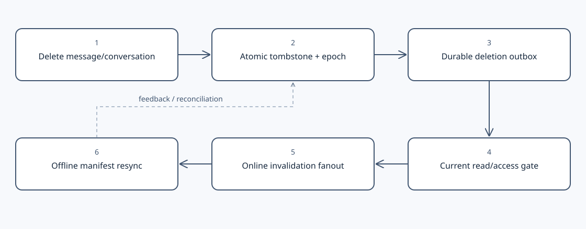

# W432. Design a Slack-like Chat System with Deletion Semantics

**Priority group:** Fifth 100 — specialized practice

**Category:** Messaging and collaborative systems

**Study position:** 432 of 547

[Group list](../FIFTH_100.md) · [All categories](../ALL_CATEGORIES.md) · [Chapter guide](../README.md)

## Question

Design a Slack-like chat system supporting messages within conversations and channels. Users can send and receive messages, delete specific messages, and delete whole conversations.

The main focus is correct deletion semantics:

Deleting a conversation must make it disappear for everyone — both online and offline users.
The system must work for users currently online and users who are offline (possibly for a long time).

Clarify early: latency needs (real-time vs. eventual consistency → WebSockets vs. polling), scale (users, messages/sec), whether deletion is a hard delete or keeps an audit log, how long deletion data is retained for offline users, and delivery guarantees.

## Worked solution

### Define global deletion and the offline limit

Clarify latency, group/channel size, retention/audit and hard versus logical deletion. Assume a global conversation delete becomes unavailable on server reads immediately after authoritative commit, online clients receive a deletion event within a proposed second, and reconnecting clients purge it before ordinary sync. No server can erase bytes from a permanently offline/untrusted device or someone's screenshot; if immediate offline disappearance is required, restrict cache lifetime/require online decryption authorization and state that even this cannot revoke already captured plaintext.

Store Conversation(id,state,epoch,deleted_at,delete_seq), Membership, Message(conversation,seq,id,body,deleted_at,version), UserConversation(user,conversation,visibility), and ChangeLog(user_or_conversation,seq,type,target,epoch). Message delete creates a tombstone/redaction; whole-conversation delete atomically sets DELETED/increments epoch and emits durable deletion events. All sends/reads/search/export/media checks reject that conversation epoch; physically deleting every message synchronously is unnecessary and would be expensive. Old retries/broker messages cannot recreate it; IDs are never reused.

### Online and reconnect protocol

The diagram's deletion transaction writes the authoritative state plus outbox. Pub/sub routes tombstones to every subscribed gateway; online clients remove the conversation and local search/cache immediately upon applying delete_seq. An ACK cursor records change progress. At reconnect, authenticate, sync authoritative membership/conversation manifests and tombstones **before** replaying old messages; a stale cached chat cannot render first and disappear later as an afterthought. If a client's cursor is older than retained change history, require full resync and clear local conversation state absent from the server manifest.

Arbitrarily long offline clients make finite tombstone-only retention insufficient. Keep a compact durable deleted-ID/epoch record indefinitely, or force full authoritative resync beyond a retention cutoff; message-body retention may be much shorter. Deleting offline users' materialized inbox copies is derived cleanup, not the source of truth. Search indexes, notifications, attachments and CDN authorization receive delete events and also enforce current conversation access, preventing delayed indexes from leaking content.

### Races, storage and scale

Serialize send/delete through the conversation authority. If send commits first, deletion hides it; if delete commits first, send fails. Late old-epoch delivery/ACK cannot reopen state. Audit requirements may retain encrypted restricted records separate from user-visible data; declare whether actual hard erasure/purge has a completion SLA and how backups age out. Do not promise both indefinite full audit plaintext and immediate physical erasure without a policy decision.

Scale is unspecified. Assume one million messages/day and 100 members/conversation: deletion may invalidate 100 membership views but a single durable conversation tombstone can gate all reads immediately. Large deletions enqueue partitioned cleanup, with per-user change streams and bounded gateway buffers. On notification outage reads still deny from authoritative state; when authority is unavailable do not serve uncertain cached deleted/private data as current. Monitor delete-to-client propagation, stale-epoch rejections, purge backlog and resync frequency. Test send/delete races, offline for longer than tombstone TTL, replayed create, cached history/search/media and backup restoration. Availability is deliberately constrained where it would defeat the global deletion contract.

<!-- architecture:W432:start -->

Read the numbered path as Delete message/conversation → Atomic tombstone + epoch → Durable deletion outbox → Current read/access gate → Online invalidation fanout → Offline manifest resync. The dashed return is the recovery/feedback path explained above, under the stated authorization, consistency and durability boundaries.
<!-- architecture:W432:end -->

[Batch behavior checks](../test_review_426_450.py). Design sizing/SLOs are explicit calculations and targets, not measured production claims.

### Further study

- [F162: Design a durable work queue with retries and leases.](../17_distributed_systems_depth.md#f162)
- [F169: Explain backpressure in a multi-stage data pipeline.](../17_distributed_systems_depth.md#f169)
