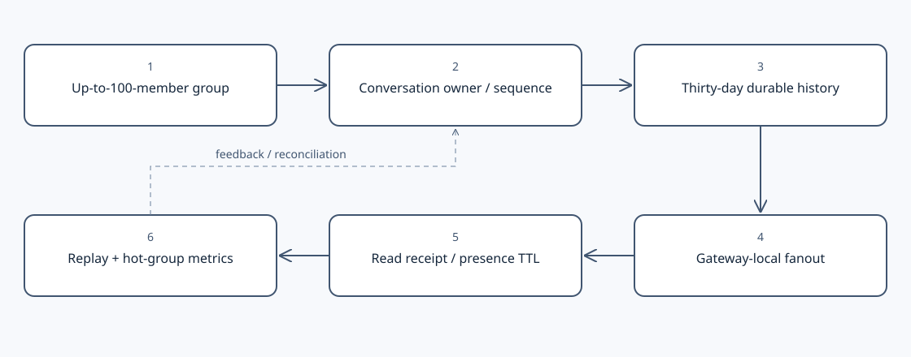

# W433. Group Chat / Messaging System Design

**Priority group:** Fifth 100 — specialized practice

**Category:** Messaging and collaborative systems

**Study position:** 433 of 547

[Group list](../FIFTH_100.md) · [All categories](../ALL_CATEGORIES.md) · [Chapter guide](../README.md)

## Question

Design a group-chat / messaging product that supports 1:1 and group conversations, real-time delivery, offline message retention, and read receipts. Asked at both the phone-screen-SD slot and onsite system-design slot; the deep-dive direction shifts toward top-N hottest groups, fan-out trade-offs, and message storage schema.

### Requirements

Functional
Send/receive text in 1:1 and group conversations (group size up to ~100 members).
Real-time delivery for online recipients, durable delivery for offline recipients.
Persist messages for ~30 days (clarify retention).
Read receipts and online / last-seen presence.
Optional: media attachments via blob storage.
Non-functional
Hundreds of millions of active users, tens of thousands of messages/sec at peak.
Sub-second end-to-end latency for online recipients.
High availability; eventual consistency acceptable for read receipts and presence.
Scoped out (confirm)
Voice/video calls, payments, business-account features, E2E encryption (some interviewers probe E2EE).

## Worked solution

### Ordered history and bounded groups

Assume text/groups≤100, thirty-day message retention, subsecond online delivery; exclude voice/video/payments/business features/E2EE, with media optional. Store Conversation(id,epoch,next_seq), Membership(conversation,user,role,joined_seq,left_seq), Message(conversation,seq,sender,client_id,body,time), DeviceCursor and Receipt(user,conversation,last_read_seq). Unique sender/client ID deduplicates send retries, and one conversation owner commits sequence+message+outbox before ACK. Partition by conversation plus sequence/time bucket; TTL/archive policy removes bodies after thirty days while cursors/tombstones retain enough context for explicit history-gap responses.

The diagram's durable stream fans once to each gateway with online group members, which sends to all their devices. Offline users read shared history from cursor, avoiding body copies per recipient. `POST /messages`, `GET /history?before_seq=`, and monotonic delivered/read updates make transport and receipt semantics explicit. For group receipts, per-user read_seq suffices; compute “seen by” as read_seq≥message_seq instead of storing 100 rows/message unnecessarily. Presence/last-seen comes from permissioned heartbeat+TTL and can lag without changing membership.

### Top-N hot groups and fanout

Count activity in an explicit rolling window, e.g. accepted messages or active participants, with idempotent event updates. Shard counters by group/time/hash and sum for ranking; merging only local top-N lists can miss a globally heavy distributed key unless candidate bounds or a validated heavy-hitter approximation are used. For a small group-cardinality set, merge exact counts and maintain a bounded global heap. Define the metric before claiming “hottest.”

At tens of thousands of sends/s, choose an illustrative 50,000/s and mean twenty recipients: one million recipient deliveries/s, multiplied by active devices. At assumed 300 bytes/message, raw history is 15 MB/s, 1.296 TB/day and 38.88 TB/30 days before replicas/indexes. A hottest group can saturate its sequencer/fanout despite modest total load; dedicate capacity, batch gateways, rate-limit senders and use pull/replay when socket queues overflow. Push reduces online latency; pulling shared history reduces write amplification and supplies offline recovery.

### Failure and correctness

A lost ACK returns the existing seq; duplicate fanout is suppressed by clients. A gateway crash rebuilds connections/cursors from durable history; pub/sub loss prompts replay. Membership/ban/deletion is rechecked at send/read and invalidates queued delivery. An offline user returning after thirty days gets a documented retention gap, not a fictional complete backlog. Optional attachments use private object storage with the same access/retention gates.

Use multi-zone replicated conversation storage and fenced owner failover; cross-region order would add WAN coordination and should be scoped separately. Monitor commit-to-device p99, outbox age, hot-group queue pressure, retention gaps and receipt freshness. Test two simultaneous sends, group removal during fanout, stale read receipts, day-thirty expiry and top-N skew. Delivery/read/presence can converge eventually where allowed; acknowledged message durability and conversation order have a stronger boundary.

<!-- architecture:W433:start -->

Read the numbered path as Up-to-100-member group → Conversation owner / sequence → Thirty-day durable history → Gateway-local fanout → Read receipt / presence TTL → Replay + hot-group metrics. The dashed return is the recovery/feedback path explained above, under the stated authorization, consistency and durability boundaries.
<!-- architecture:W433:end -->

[Batch behavior checks](../test_review_426_450.py). Design sizing/SLOs are explicit calculations and targets, not measured production claims.

### Further study

- [F162: Design a durable work queue with retries and leases.](../17_distributed_systems_depth.md#f162)
- [F169: Explain backpressure in a multi-stage data pipeline.](../17_distributed_systems_depth.md#f169)
