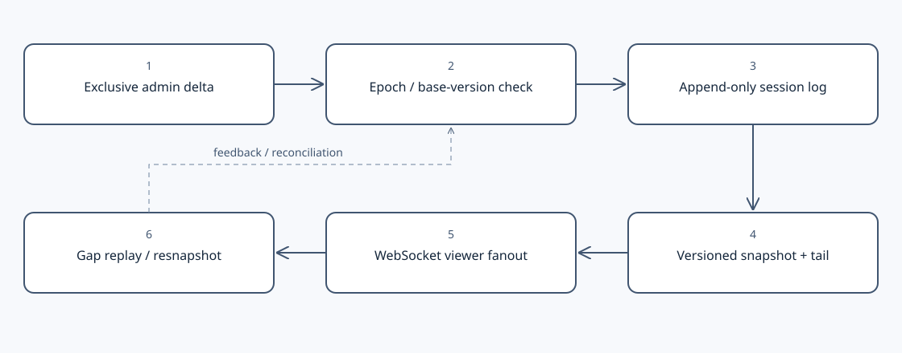

# W434. Real-Time Collaborative Code Editor

**Priority group:** Fifth 100 — specialized practice

**Category:** Messaging and collaborative systems

**Study position:** 434 of 547

[Group list](../FIFTH_100.md) · [All categories](../ALL_CATEGORIES.md) · [Chapter guide](../README.md)

## Question

Design a CoderPad-like session: one admin can edit, all viewers see real-time updates, new joiners catch up immediately, optional code execution. The interviewer explicitly forbids referring to operational-transform algorithms — derive the propagation model from scratch.

### Requirements

Functional:

Create a session; one user is admin (editor), others are viewers.
All viewers see admin edits in real time.
New users joining mid-session see the current state immediately.
Optional code execution (do not over-design — the interviewer signals this is not the focus).

Non-functional:

Latency for viewer-side update: tens of ms.
Session-level scale (10s of concurrent viewers); deployment-level scale (10k concurrent sessions).
Tolerate brief network blips on the viewer side.
Notes
The expected propagation model:
Admin client emits delta events (insert/delete with (position, length, payload)).
Server stages deltas in an append-only per-session log and broadcasts to subscribed viewers over WebSocket.
Viewers apply deltas locally.
New joiners receive a snapshot of the current document plus a tail of pending deltas after the snapshot version.
Because only one editor exists, the OT / CRDT complexity collapses — the canonical insight to articulate aloud. With multiple editors, OT or CRDT would be required.
For code execution, sandbox each session's runtime (Firecracker / lightweight container); rate-limit per session.

## Worked solution

### Derive propagation from the single editor

Only one authorized admin edits; viewers never submit mutations. Therefore the server can serialize a simple append-only delta stream without any concurrent-edit transformation algorithm. Session(id,admin_id,editor_epoch,head_version,snapshot_ref) and Delta(session,version,op_id,epoch,base_version,position,delete_length,insert_text) suffice. Define positions in a shared unit (assume Unicode code points) and validate ranges. A replacement is delete_length characters at position followed by insertion. Viewer presence is separate expiring state.

`POST /sessions` creates the session; the admin's authenticated WebSocket sends a unique op_id, current epoch and base_version. A per-session owner validates admin/epoch and base_version=head, applies the delta, appends it durably with version=head+1, then ACKs/broadcasts. Duplicate op_id returns the same version; a wrong base version gets the authoritative head/replay request. After an ACK loss the admin retries the same op, not another unversioned insertion. A reconnect/new admin connection increments an exclusive editor lease epoch so an old socket cannot remain a second writer.

### Snapshot plus log tail without gaps

The diagram is admin→versioned session log/state→socket fanout→viewers. On join, establish a stream/replay boundary, send a snapshot containing exact document text at version v, then deltas v+1..head, then live events. A viewer applies only its expected next version; duplicate old versions are ignored and a gap triggers `after_version` replay. If the log tail was compacted, send a newer snapshot. Build snapshots atomically at a committed version; serializing text while edits interleave without a version boundary can corrupt catch-up.

Example: text `cat` at v7 receives insert(position=3,text="s") at v8. A viewer at v7 applies once to get `cats`; a replay of v8 is ignored. A new viewer receiving snapshot v7 and a simultaneously broadcast v8 buffers/deduplicates by version and reaches the same text. No viewer is allowed to manufacture its own order from socket arrival time.

### Capacity and failures

With 10,000 sessions, assume twenty viewers/session: 200,000 viewer sockets. At an assumed ten edits/s/session and 100 bytes/delta, input is ten MB/s and fanout about 200 MB/s before framing/TLS. Regional gateways and per-session owner hashing keep a tens-of-ms local update target plausible; allocate, for example, 5 ms validation/append batching, 5 ms fanout and 20 ms network headroom, then benchmark durability latency. Don't store a full document copy on every keystroke; snapshots plus bounded deltas control cost.

A failed session owner recovers from committed snapshot/log under a new epoch; unacknowledged admin edits may be retried. Slow/offline viewers get bounded queues and replay/resnapshot rather than unlimited buffering. Access revocation closes subscriptions and replay endpoints enforce authorization. Optional execution captures document version and language, then runs in an isolated per-session sandbox with CPU/memory/time/network quotas; outputs are tagged with that version so later edits do not misattribute results. Execution is not needed to solve propagation. Test join during edit, duplicate/missing deltas, editor reconnect fencing and crash during snapshot. Introducing multiple independent writers changes the problem and requires a newly defined conflict protocol; it is not part of this single-admin design.

<!-- architecture:W434:start -->

Read the numbered path as Exclusive admin delta → Epoch / base-version check → Append-only session log → Versioned snapshot + tail → WebSocket viewer fanout → Gap replay / resnapshot. The dashed return is the recovery/feedback path explained above, under the stated authorization, consistency and durability boundaries.
<!-- architecture:W434:end -->

[Batch behavior checks](../test_review_426_450.py). Design sizing/SLOs are explicit calculations and targets, not measured production claims.

### Further study

- [F162: Design a durable work queue with retries and leases.](../17_distributed_systems_depth.md#f162)
- [F170: Design a cache without serving incorrect data.](../17_distributed_systems_depth.md#f170)
