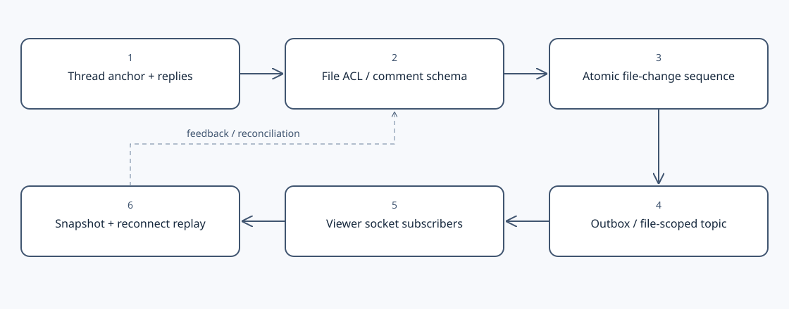

# W435. Real-Time Comment Threads (FigJam / Figma)

**Priority group:** Fifth 100 — specialized practice

**Category:** Messaging and collaborative systems

**Study position:** 435 of 547

[Group list](../FIFTH_100.md) · [All categories](../ALL_CATEGORIES.md) · [Chapter guide](../README.md)

<span class="practice-page"></span>

## Question

Real-Time Comment Threads (FigJam / Figma)

Design the feature where a user clicks anywhere on a Figma/FigJam canvas to start a comment thread, and comments update in real time for everyone viewing the file. Often framed as 'design the data model first, then the server architecture' — explicitly not 'design Google Docs'.

### Requirements

Design in-canvas commenting:

A user can click any point on the page to anchor a new comment thread; others can reply, forming threads.
Comments (new threads and replies) propagate to all current viewers of the file in real time.
Interviewers often structure it as: (1) design the data model, then (2) design the server architecture — so deliver a concrete schema before the distributed picture.
Notes
This is not "design Google Docs." Several candidates over-prepared a full collaborative-document/OT design and found it useless — the scope is comment threads anchored to canvas coordinates, nothing more. Go try the feature in FigJam before the interview.
Real scale is modest, so resist over-engineering. Nail the data model (thread anchored to a position, ordered replies, resolved state, author/timestamps) and a sane real-time path (WebSocket/SSE fan-out to file subscribers) before reaching for heavy distributed machinery.
Interviewers can interrupt and pivot the discussion anywhere mid-flow; keep your structure explicit so you can resume after a tangent.

## Worked solution

### Schema first: comments anchored to a canvas

```text
Thread(id PK, file_id, page_id, anchor_kind, x, y,
       object_id nullable, local_x nullable, local_y nullable,
       resolved, created_by, created_at, updated_at, version)
Comment(id PK, thread_id FK, author_id, body, created_at, edited_at,
        deleted_at nullable, version, client_op_id UNIQUE per author)
FileChange(file_id, seq, event_id UNIQUE, thread_id, comment_id,
           kind, payload_ref, PRIMARY KEY(file_id,seq))
Outbox(event_id PK, file_id, seq, delivery_state)
```

Use page/world coordinates in documented units for a free-space anchor, independent of viewport pan/zoom. If anchored to an object, store stable object ID plus local coordinates and resolve through the object's current transform; if the object is deleted, retain an orphaned-position indicator or last world position rather than attach the thread to an unrelated replacement. Replies order by server created sequence/id within a thread; resolution is thread state, not a comment-body convention. Existing file ACLs authorize viewing/commenting/resolving, with edit/delete rights explicit.

### API and realtime architecture

`POST /files/{id}/threads` supplies page/anchor/comment/client key; `POST /threads/{id}/comments`, `PATCH /comments/{id}` and `POST /threads/{id}:resolve` use idempotency/version preconditions. `GET /files/{id}/threads?page_id=` pages thread summaries; `/threads/{id}/comments?before=` loads replies. A transaction writes the thread/comment/state change, file change sequence and outbox, then ACKs. This modest feature can use one replicated SQL database and a few stateless API/socket servers before sharding is needed.

The diagram's SQL change/outbox→file-scoped pub/sub→WebSocket/SSE gateways broadcasts to authorized current viewers. A joining viewer loads a snapshot at file-comment version v then replays changes after v before live subscription; sequence gaps reconnect through the durable change log. Callbacks/broadcast completion do not define whether the comment saved. Duplicate event IDs are ignored, and a stale edit version conflicts instead of silently overwriting newer text. File access revocation closes subscriptions and blocks history fetch; presence is optional.

### Examples, scale and failure handling

A user clicks at world (100,200) while zoomed 200%; storing screen (200,400) would move the anchor for other viewers, so convert before writing. Two users reply concurrently: server sequences both, and all clients converge without a collaborative-document algorithm. Two users toggle resolved state from version 4: one conditional update wins and the other reloads/version-conflicts according to the API contract.

No fixed scale is given. Assume 1,000 active files×twenty viewers×two comment events/minute: about 33 writes/s and 667 deliveries/s, easily modest relative to large document editing. Partition later by file/thread and retain reply indexes; do not introduce heavy text-merging machinery. On socket/broker outage saved comments remain readable and replay after reconnect; outbox retry prevents lost notifications. Slow viewers get bounded buffers and resync. Monitor commit-to-viewer lag, missed sequence recovery, anchor orphaning and authorization failures. Test object move/delete, pan/zoom transforms, duplicate reply, resolve race, reconnect between snapshot and subscription and file permission change. The product is anchored threads, so full document editing/formula/OT design would miss its core deliverable.

<!-- architecture:W435:start -->


Read the numbered path as Thread anchor + replies → File ACL / comment schema → Atomic file-change sequence → Outbox / file-scoped topic → Viewer socket subscribers → Snapshot + reconnect replay. The dashed return is the recovery/feedback path explained above, under the stated authorization, consistency and durability boundaries.
<!-- architecture:W435:end -->

[Batch behavior checks](../test_review_426_450.py). Design sizing/SLOs are explicit calculations and targets, not measured production claims.

### Further study

- [F162: Design a durable work queue with retries and leases.](../17_distributed_systems_depth.md#f162)
- [F169: Explain backpressure in a multi-stage data pipeline.](../17_distributed_systems_depth.md#f169)
