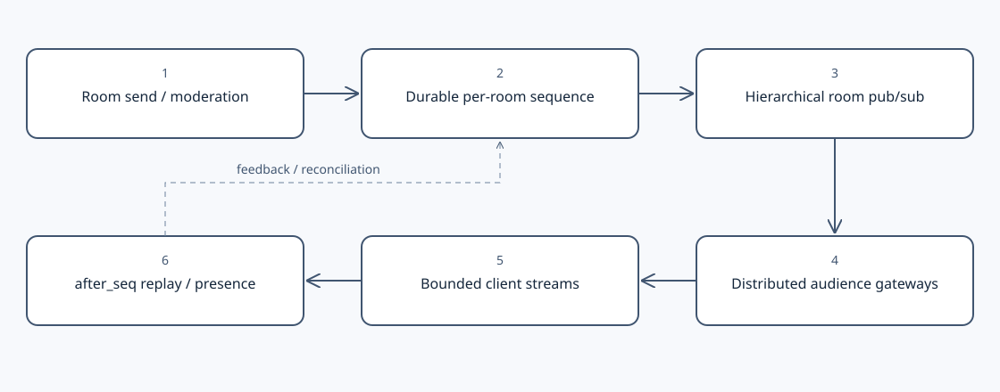

# W436. Subreddit Live Chat System

**Priority group:** Fifth 100 — specialized practice

**Category:** Messaging and collaborative systems

**Study position:** 436 of 547

[Group list](../FIFTH_100.md) · [All categories](../ALL_CATEGORIES.md) · [Chapter guide](../README.md)

## Question

Design Reddit's subreddit live-chat product (real-time chat anchored to a subreddit; rooms from tens to millions during live events). The Super Bowl scenario (~5M concurrent users in one subreddit chat) is the canonical scale follow-up.

### Requirements

Functional: send/receive in real time, recent history on open, presence / active-user count, moderation (delete/mute/ban), reconnect + backlog.
Scale: typical thousands per room; pivots to 5M concurrent, sub-second fan-out latency.
Decisions: transport (WebSocket vs SSE vs long-poll), fan-out (push vs pull at peak), chat-server topology (single shard-per-room vs distributed gateway + pub/sub), message ordering (logical sequence per room), storage, moderation latency.

Key answers: per-room pub/sub topic, room-scoped sharding across gateway nodes at 5M, logical per-room sequence for ordering, heartbeat+TTL presence, backpressure via drop-and-resync (after_seq replay).

## Worked solution

### Separate one room's order from millions of sockets

Store Room(id,subreddit,next_seq,epoch,policy), Message(room,seq,sender,client_id,body,time,moderation_version), Membership/Role/Ban and DeviceCursor. A room ordering owner validates rate limits/mutes/bans, deduplicates client IDs and durably appends sequence+message+outbox before ACK. `GET /rooms/{id}/history?before|after_seq=` serves recent/reconnect history; WebSocket handles bidirectional sends/events (SSE plus HTTP send is an alternative for simpler receive-only clients). A room-scoped pub/sub topic carries committed events to many gateways, not one server with five million sockets.

### The five-million-viewer calculation

At an assumed 20,000 sockets/gateway, five million viewers need at least 250 gateways, plus headroom and regional placement. If the room accepts an assumed 1,000 messages/s of 200 encoded bytes and every viewer receives every message, delivery is **one billion bytes/s per 5,000 viewers**, or **1 TB/s total** (8 Tbit/s), before protocol overhead. More directly 5M×1,000×200=10^12 bytes/s. Each viewer would also receive 1,000 messages/s, a poor human interface. A single pub/sub topic does not eliminate this fanout/UX limit.

Define a moderated/slow-mode accepted stream, e.g. an assumed ten messages/s, which still costs 10 GB/s total at 200 bytes. Gateways receive one upstream copy and locally fan out; hierarchical regional relays, batch frames and dedicated capacity help. If the product still insists on all raw messages at arbitrary send rate with subsecond fanout, reject that as an unbounded requirement rather than silently drop data. A highlighted/sampled view is a separately labeled product mode, not “complete chat.”

### Backpressure, moderation and recovery

The diagram's logical room sequencer remains one ordering authority while delivery partitions by gateway audience. Gateways process seq order and buffer bounded gaps; clients ignore duplicates and request after_seq replay on a gap. Slow clients get drop-and-resync with an explicit gap marker, not unlimited RAM growth; catch-up can be paged/pulled even while new live frames arrive. Recent history is stored independently of sockets, with a stated retention/gap policy. Quorum/fenced failover protects the sequence from two room owners; multi-region fanout adds network latency and doesn't create independent conflicting room sequences.

Moderation actions are ordered tombstone/ban events with increasing versions. Send validation checks current bans, and delete events propagate through priority/control lanes so moderation is not trapped behind a huge message backlog. History/current reads suppress deleted messages; replayed old content cannot reverse moderation. Presence is approximate connection/session heartbeats with TTL, deduplicated across devices as defined; do not broadcast five million individual joins/leaves to everyone.

Under a proposed subsecond local fanout budget, measure append, broker/relay, gateway and device lag separately. A gateway crash reconnects clients and replays from durable cursor; a broker outage retains committed messages and shows lag. Test celebrity/live-event ramps, sequencer failover, delayed delete, million-client slow queues and replay beyond retention. Monitor accepted send rate, room-seq lag, gateway egress, mute/delete delay, disconnect/resync and active-count uncertainty. These capacity limits determine the design before choosing transport acronyms.

<!-- architecture:W436:start -->

Read the numbered path as Room send / moderation → Durable per-room sequence → Hierarchical room pub/sub → Distributed audience gateways → Bounded client streams → after_seq replay / presence. The dashed return is the recovery/feedback path explained above, under the stated authorization, consistency and durability boundaries.
<!-- architecture:W436:end -->

[Batch behavior checks](../test_review_426_450.py). Design sizing/SLOs are explicit calculations and targets, not measured production claims.

### Further study

- [F162: Design a durable work queue with retries and leases.](../17_distributed_systems_depth.md#f162)
- [F169: Explain backpressure in a multi-stage data pipeline.](../17_distributed_systems_depth.md#f169)
