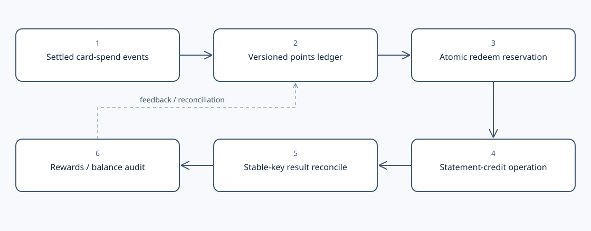

# W437. Credit Card Service with Points Earning and Redemption System

**Priority group:** Fifth 100 — specialized practice

**Category:** Payments, ledgers and billing

**Study position:** 437 of 547

[Group list](../FIFTH_100.md) · [All categories](../ALL_CATEGORIES.md) · [Chapter guide](../README.md)

<span class="practice-page"></span>

## Question

Design a credit card service that offers points as the customer spends on the card. The customer can redeem their points at any time, with 1 point equating to USD 0.01 in value. Please provide your design.

Example

### Input

customer1

```python
100
```

## Worked solution

### Define earning and redemption before accounting

The prompt fixes redemption value at one point=USD 0.01, but gives no earning rate, eligible spend/refund policy, expiry or redemption destination. Those inputs are necessary for numeric rewards on the stray `customer1 / 100` example. For illustration assume one point per settled dollar of eligible purchases, transaction-level floor rounding, no expiry, and redemption as statement credit. A USD 100 settled purchase then earns 100 points worth USD 1, not USD 100. This is a chosen demonstration rule, not supplied economics.

Store CardAccount/customer identity and card transaction states separately from RewardAccount and immutable PointsEntry(id,customer,source_event,rule_version,delta,kind,posted_at). A unique (source_event,entry_kind,rule_version) prevents duplicate earning/reversal. Record monetary entries in integer cents and rewards in integer points; never mix the two units. RewardBalance(customer,available,reserved,version) is a transactional projection of the points ledger, reconciled regularly. Earning happens on settlement, not each authorization/retry; a refund posts a linked compensating points reversal with an explicit policy for already-spent rewards/negative reward balance.

### API and atomic redemption

`GET /rewards` returns available/pending/reserved points and value; `POST /redemptions` takes customer, integer points, destination and idempotency key bound to body. Authenticate ownership, validate positive points, floor/minimum rules and balance, then lock the reward account and atomically reserve/debit points, create Redemption(id,key,state,cents=points,ledger_refs) and an outbox. Two concurrent 80-point redemptions against 100 cannot both commit. A matching retry returns the original result; changing the amount under the same key conflicts.

The diagram's spend-settlement events feed versioned earning postings, while redemption creates a durable state machine to a statement-credit/payment service. If statement credit shares the same database/ledger boundary, points and money postings can commit together. If external, use RESERVED→PROCESSING→SUCCEEDED or FAILED/UNKNOWN and a stable downstream operation ID. Timeout remains uncertain: query/retry that identity, not refund points then issue a second credit. Confirmed permanent failure releases the reservation through compensating entries once. No external transfer is made for zero redemption.

### Reconciliation and trade-offs

For a fictional starting 100 points, redeeming 80 creates an 80-cent credit and leaves 20; a duplicate request does not leave −60 or issue another credit. If the source purchase later refunds, append the policy-defined points reversal and expose any negative/recovery obligation rather than rewriting the original entry. Keep rule versions/effective dates so old transactions remain explainable.

Scale is absent. Assume ten million settled purchases/day: about 116 earning events/s average; store an assumed 100-byte points entry yields 1 GB/day logical before indexes/replicas. Shard by customer, use transactional outbox/inbox dedup, reserve retry capacity and reconcile points sum, balance projection and linked monetary credits daily. Monitor earn/redeem lag, negative balances, duplicate rejections, uncertain credits and drift. Protect card data through token references and audited access. Test refund-after-redemption, parallel redeem, duplicate settlement, rule changes and a lost credit ACK. The fixed point value alone cannot determine earning rules, solvency or all product policies; make those decisions explicit.

<!-- architecture:W437:start -->


Read the numbered path as Settled card-spend events → Versioned points ledger → Atomic redeem reservation → Statement-credit operation → Stable-key result reconcile → Rewards / balance audit. The dashed return is the recovery/feedback path explained above, under the stated authorization, consistency and durability boundaries.
<!-- architecture:W437:end -->

[Batch behavior checks](../test_review_426_450.py). Design sizing/SLOs are explicit calculations and targets, not measured production claims.

### Further study

- [F165: Design idempotency for an order or booking API.](../17_distributed_systems_depth.md#f165)
- [F162: Design a durable work queue with retries and leases.](../17_distributed_systems_depth.md#f162)
