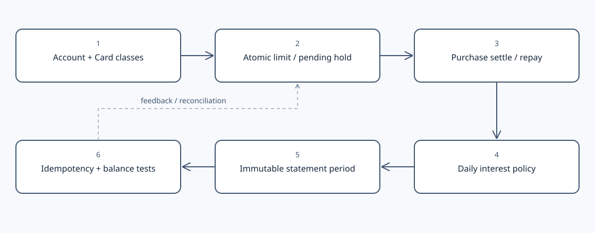

# W438. Credit Card System Design (OOD)

**Priority group:** Fifth 100 — specialized practice

**Category:** Payments, ledgers and billing

**Study position:** 438 of 547

[Group list](../FIFTH_100.md) · [All categories](../ALL_CATEGORIES.md) · [Chapter guide](../README.md)

<span class="practice-page"></span>

## Question

Lightweight OOD design of a credit card system — card issuance, swipe/authorize transactions, repayment, statement generation, and minimal business rules.

Entities: Card, Account, Transaction, Statement (with explicit class definitions).

Operations: issueCard(account), authorize(card, amount), settle(transaction), repay(card, amount), generateStatement(card, period).

Business rules: credit-limit enforcement, pending vs settled balances, interest accrual on unpaid balance. Be explicit about pre-/post-conditions for each operation.

## Worked solution

### Objects, units and chosen business policy

`Account` owns credit_limit, settled debt and pending authorization holds in integer cents; multiple `Card`s may reference it, sharing the limit. `Transaction` records purchase/repayment/interest state and posting date. `Statement` is an immutable [start,end) snapshot of posted activity and closing debt. No card numbers/CVV are needed for this OOD model. Real issuance/token vault/network integrations are outside the toy class.

The prompt does not specify APR/grace/minimum-payment/rounding rules. The implementation explicitly assumes immediate daily simple accrual on nonnegative settled unpaid debt, a supplied integer parts-per-million daily rate, half-up cent rounding, no grace period and no overpayments. This is demonstration policy, not a claim about any real credit product. New accounts start at zero or need an explicit opening ledger posting; do not initialize an unexplained nonzero balance and expect statements to reconcile.

```python
"""Educational OOD model, integer cents; simplified daily interest and statement policy."""

from __future__ import annotations
from dataclasses import dataclass
from datetime import date
from threading import RLock
import uuid


@dataclass
class Card:
    id: str
    account_id: str
    active: bool = True


@dataclass
class Account:
    id: str
    credit_limit: int
    settled: int = 0
    pending: int = 0


@dataclass
class Transaction:
    id: str
    account_id: str
    card_id: str
    amount: int
    state: str
    posted_on: date | None = None
    kind: str = "PURCHASE"


@dataclass(frozen=True)
class Statement:
    id: str
    account_id: str
    start: date
    end: date
    transaction_ids: tuple
    net_activity: int
    closing_balance: int


class CreditCardService:
    def __init__(self):
        self.accounts = {}
        self.cards = {}
        self.transactions = {}
        self.statements = {}
        self.keys = {}
        self.lock = RLock()

    def _once(self, key, signature, action):
        if key in self.keys:
            old, result = self.keys[key]
            if old != signature:
                raise ValueError("idempotency key reused with different parameters")
            return result
        result = action()
        self.keys[key] = (signature, result)
        return result

    @staticmethod
    def _amount(value):
        if type(value) is not int or value <= 0:
            raise ValueError("positive integer cents required")

    def issueCard(self, account):
        with self.lock:
            if account.credit_limit < 0:
                raise ValueError("invalid credit limit")
            if account.id in self.accounts and self.accounts[account.id] is not account:
                raise ValueError("conflicting account")
            self.accounts[account.id] = account
            card = Card(uuid.uuid4().hex, account.id)
            self.cards[card.id] = card
            return card

    def authorize(self, card, amount, key):
        self._amount(amount)
        with self.lock:

            def apply():
                if self.cards.get(card.id) is not card or not card.active:
                    raise ValueError("inactive or unknown card")
                account = self.accounts[card.account_id]
                if account.settled + account.pending + amount > account.credit_limit:
                    raise ValueError("credit limit exceeded")
                tx = Transaction(
                    uuid.uuid4().hex, account.id, card.id, amount, "PENDING"
                )
                self.transactions[tx.id] = tx
                account.pending += amount
                return tx

            return self._once(("authorize", key), (card.id, amount), apply)

    def _posting_allowed(self, account_id, day):
        if any(
            s.account_id == account_id and day < s.end for s in self.statements.values()
        ):
            raise ValueError("posting date belongs to a closed statement period")

    def settle(self, transaction, today):
        with self.lock:
            tx = self.transactions[transaction.id]
            if tx.state == "SETTLED":
                return tx
            if tx.state != "PENDING":
                raise ValueError("not pending")
            self._posting_allowed(tx.account_id, today)
            account = self.accounts[tx.account_id]
            account.pending -= tx.amount
            account.settled += tx.amount
            tx.state = "SETTLED"
            tx.posted_on = today
            return tx

    def void(self, transaction):
        with self.lock:
            tx = self.transactions[transaction.id]
            if tx.state == "VOID":
                return
            if tx.state != "PENDING":
                raise ValueError("only pending authorization may be voided")
            self.accounts[tx.account_id].pending -= tx.amount
            tx.state = "VOID"

    def repay(self, card, amount, key, today):
        self._amount(amount)
        with self.lock:

            def apply():
                if self.cards.get(card.id) is not card:
                    raise ValueError("unknown card")
                self._posting_allowed(card.account_id, today)
                account = self.accounts[card.account_id]
                if amount > account.settled:
                    raise ValueError("overpayment not supported in this demo")
                account.settled -= amount
                tx = Transaction(
                    uuid.uuid4().hex,
                    account.id,
                    card.id,
                    -amount,
                    "SETTLED",
                    today,
                    "REPAYMENT",
                )
                self.transactions[tx.id] = tx
                return tx

            return self._once(
                ("repay", key), (card.id, amount, today.isoformat()), apply
            )

    def accrue_interest(self, account_id, day, daily_rate_ppm):
        # Assumption: all unpaid settled principal immediately accrues, no grace; half-up cents.
        if type(daily_rate_ppm) is not int or daily_rate_ppm < 0:
            raise ValueError("invalid rate")
        with self.lock:

            def apply():
                self._posting_allowed(account_id, day)
                account = self.accounts[account_id]
                interest = (
                    max(0, account.settled) * daily_rate_ppm + 500000
                ) // 1000000
                account.settled += interest
                tx = Transaction(
                    uuid.uuid4().hex,
                    account_id,
                    "",
                    interest,
                    "SETTLED",
                    day,
                    "INTEREST",
                )
                self.transactions[tx.id] = tx
                return tx

            return self._once(("interest", account_id, day), (daily_rate_ppm,), apply)

    def generateStatement(self, card, period):
        start, end = period
        if not start < end:
            raise ValueError("period must be nonempty [start,end)")
        with self.lock:
            if self.cards.get(card.id) is not card:
                raise ValueError("unknown card")
            key = (card.account_id, start, end)
            if key in self.statements:
                return self.statements[key]
            txs = [
                t
                for t in self.transactions.values()
                if t.account_id == card.account_id
                and t.state == "SETTLED"
                and start <= t.posted_on < end
            ]
            closing = sum(
                t.amount
                for t in self.transactions.values()
                if t.account_id == card.account_id
                and t.state == "SETTLED"
                and t.posted_on < end
            )
            result = Statement(
                uuid.uuid4().hex,
                card.account_id,
                start,
                end,
                tuple(t.id for t in txs),
                sum(t.amount for t in txs),
                closing,
            )
            self.statements[key] = result
            return result
```

### Operation preconditions and postconditions

* `issueCard(account)` requires a valid nonnegative credit limit and a known/consistent account identity; returns an active card sharing that account's capacity.
* `authorize(card,amount,key)` requires a known active card and positive integer amount; atomically checks settled+pending+amount≤limit, reserves the hold and returns PENDING. Same key/parameters returns the original transaction; differing parameters conflict. It never adds settled debt yet.
* `settle(transaction,date)` requires its PENDING purchase and an open posting period; it moves amount from pending to settled once. Duplicate settlement returns the same record. `void` releases only a pending hold; settled refunds require separate compensating postings in a fuller model.
* `repay(card,amount,key,date)` requires a known card/account, positive cents≤settled debt and an open posting day; it reduces settled debt and creates one negative repayment transaction. In reality an external repayment is not credited as cleared until the provider contract permits; this local operation assumes funds have already been confirmed.
* `accrue_interest(account,day,rate)` posts once per day under a stable key and the declared rate/rounding; it may take settled debt above the limit and must not be silently dropped by purchase-limit checks.
* `generateStatement(card,(start,end))` returns the same immutable statement on retry, includes only SETTLED postings in the interval and computes closing from all postings before end. Pending holds are excluded; backdated new postings into a closed period are rejected, preventing silent rewrite of a prior statement.

### Worked behavior and limits

With an assumed USD 100 limit, authorizing USD 60 reserves 6,000 cents; another USD 50 is declined. Settling the USD 60 changes pending 6,000→0 and settled 0→6,000. Repaying USD 20 leaves 4,000. At assumed daily rate 100 ppm, daily interest is round_half_up(4,000×100/1,000,000)=0 cents, showing why rate/rounding policy matters; a larger balance/rate fixture tests nonzero accrual. Statement net activity/closing derive from those posted records, not current pending holds.

The in-memory service uses an RLock to serialize account mutations and an operation-result map for retries; it is a working OOD exercise, not restart-durable banking storage. Production replaces dictionaries/locks with transactional durable tables, append-only balanced postings, expiry of holds, reconciliation, authenticated authorization and a complete contractual interest engine. Tests cover shared-limit races, duplicate settlement/repayment, void, interest/day dedup and immutable statements/backdating. This makes the requested classes and operation boundaries concrete without inventing financial terms.

<!-- architecture:W438:start -->


Read the numbered path as Account + Card classes → Atomic limit / pending hold → Purchase settle / repay → Daily interest policy → Immutable statement period → Idempotency + balance tests. The dashed return is the recovery/feedback path explained above, under the stated authorization, consistency and durability boundaries.
<!-- architecture:W438:end -->

[Runnable W438 implementation](../review_w438_implementation.py).

[Batch behavior checks](../test_review_426_450.py). Design sizing/SLOs are explicit calculations and targets, not measured production claims.

### Further study

- [F165: Design idempotency for an order or booking API.](../17_distributed_systems_depth.md#f165)
- [F162: Design a durable work queue with retries and leases.](../17_distributed_systems_depth.md#f162)
