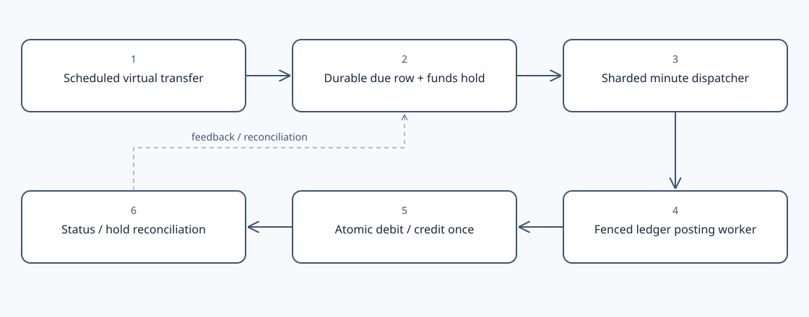

# W439. Design a Delayed Virtual-Currency Payment Scheduler

**Priority group:** Fifth 100 — specialized practice

**Category:** Payments, ledgers and billing

**Study position:** 439 of 547

[Group list](../FIFTH_100.md) · [All categories](../ALL_CATEGORIES.md) · [Chapter guide](../README.md)

## Question

Design a system that lets a user schedule a virtual-currency transfer (e.g. Robux) from one account to another, to be executed automatically at a specified future time. The deep-dive is on durable scheduling under failure, exactly-once execution despite retries, and keeping the scheduler accurate when millions of payments are queued for the same wall-clock minute.

## Worked solution

### Durable schedule, atomic transfer

`POST /scheduled-transfers` accepts sender, recipient, positive integer virtual units, due_at UTC and idempotency key; status/cancel APIs expose the exact transfer state. Validate account/permission/currency/limits and clarify funds policy. Assume funds are **reserved at schedule time**, reducing spendable balance, so a valid due transfer is not later defeated by unrelated spending; if the product chooses execution-time funds checks instead, insufficient funds becomes a terminal/retryable policy decision. Never describe these choices interchangeably.

Store Schedule(id,key,hash,sender,recipient,amount,currency,due_at,state,version), Hold(schedule,account,amount,state), Attempt(schedule,n,token,lease_expiry), LedgerTransaction(id,transfer_id UNIQUE,currency) and balanced LedgerEntry rows, plus outbox. Scheduling commits the reservation and due row atomically. Cancellation locks the same schedule/hold, changes to CANCELED and releases once if not committed. Due scanners use time-bucket+hash partitions and database time, claim due READY rows and publish work transactionally; timer memory is only an acceleration layer.

The diagram's worker rechecks current schedule/lease and posts sender debit, recipient credit, hold consumption and SUCCEEDED in **one ledger transaction** where possible. Unique transfer_id is the exactly-once committed-effect guard. A worker retry after an ACK loss reads the same posting; it does not debit again. A lease alone cannot prevent an old physical process from still running, so downstream posting verifies token/state or deduplicates the logical transfer. Cross-shard accounts require a transactional ledger supporting atomic transfer or a reserved/pending saga with explicit exposure states, not two independent balance updates pretending to be atomic.

### Millions due in one minute

One million due transfers/minute is 16,667/s; five million is 83,333/s. If all are due at its first instant, minute-average capacity does not deliver zero lateness. Define an acceptable execution window, pre-stage eligible IDs, reserve processing capacity, hash shards within the time bucket and spread dispatch within the permitted minute. Early **execution** is forbidden even if prefetch/validation is early. At assumed 5,000 safe postings/s per shard, five million/minute needs at least seventeen shard-equivalents before headroom, and hot single senders still serialize on funds/limits.

Retry transient storage/worker faults with capped backoff while preserving the same transfer identity; invalid accounts/frozen state surface actionable failure and release/rescind holds under policy. A crash after reservation but before queue publish is repaired by the outbox; a crash after commit returns the existing transfer. Region promotion requires no acknowledged reservation/posting loss and fencing of the old scheduler/ledger authority. Reconcile holds against schedules and balanced postings, report stuck/overdue transfers and alert on clock skew. Test due/cancel races, repeated scheduling, worker death before/after commit, insufficient funds under the alternative policy and a same-minute million-item burst. “Exactly once” refers to the committed virtual-currency transfer, not once-only execution of worker instructions.

<!-- architecture:W439:start -->

Read the numbered path as Scheduled virtual transfer → Durable due row + funds hold → Sharded minute dispatcher → Fenced ledger posting worker → Atomic debit / credit once → Status / hold reconciliation. The dashed return is the recovery/feedback path explained above, under the stated authorization, consistency and durability boundaries.
<!-- architecture:W439:end -->

[Batch behavior checks](../test_review_426_450.py). Design sizing/SLOs are explicit calculations and targets, not measured production claims.

### Further study

- [F165: Design idempotency for an order or booking API.](../17_distributed_systems_depth.md#f165)
- [F162: Design a durable work queue with retries and leases.](../17_distributed_systems_depth.md#f162)
