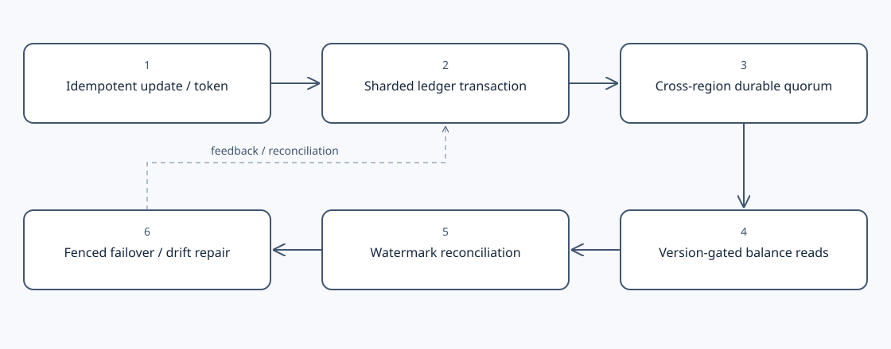

# W440. Design a Highly Reliable Account Balance System

**Priority group:** Fifth 100 — specialized practice

**Category:** Payments, ledgers and billing

**Study position:** 440 of 547

[Group list](../FIFTH_100.md) · [All categories](../ALL_CATEGORIES.md) · [Chapter guide](../README.md)

## Question

Design the backend that tells a bank customer their current account balance and records every change to it. Customers must never see money lost or counted twice, even when a whole cloud region fails. The ledger of transactions is the authoritative record, and the balance shown to customers must stay consistent with it.

### Requirements

Functional:
1. Read the current balance of an account.
2. Apply a balance update (credit or debit) with a client-supplied idempotency key. A retried request with the same key must take effect once.
3. Reconcile displayed balances against the authoritative ledger and surface any account where they differ (drift).

Non-functional, with the targets to design for:

Scale: 50 million accounts, up to 20,000 balance updates per second and 100,000 balance reads per second at peak.
Latency: 99th-percentile read at most 100 ms; 99th-percentile write at most 500 ms.
Consistency: writes are strongly consistent. A customer who has just made an update sees it in the next read (read-your-writes); other readers may see a balance at most 5 seconds old.
Durability and availability: after a single-region outage, RPO is 0 (no acknowledged update is lost or duplicated) and RTO is at most 5 minutes.
Reconciliation: drift for any account is detected within 24 hours, and within 1 hour for the 1% of accounts with the highest balances.
What to deliver
1. The API, covering the read, the idempotent update and the reconciliation report.
2. The data model for the ledger and the balance, and which one is the source of truth.
3. A high-level design with the write path, the read path and the replication between regions.
4. Failover: what happens to in-flight updates when the primary region fails, and what balance a customer sees afterwards.
5. The reconciliation design: how drift is found, how often, and what happens when it is found.
6. Capacity estimates for storage and throughput, using the scale above.
7. Trade-offs and failure modes you accepted, for example the cost of RPO 0 on write latency.

## Worked solution

### API and authoritative invariant

`GET /accounts/{id}/balance?min_version=` returns ledger/available balance, currency, account_version and as_of. A writer receives a consistency token/version; its next read is routed to a replica at least that version or the leader, giving read-your-writes. Other readers may use replicas only while lag≤five seconds; otherwise route to authority or fail rather than serve older data. `POST /accounts/{id}/updates` takes signed integer cents, currency, counteraccount/reference and idempotency key; store a request hash and reject conflicting reuse. `GET /reconciliation/reports?status=&from=` exposes authorized drift cases/actions.

LedgerTransaction(id,client_scope,key UNIQUE,request_hash,status,time), LedgerEntry(txn,line,account,currency,signed_amount), AccountBalance(account,currency,ledger_balance,holds,version,last_txn), Hold and ReconciliationCase make the model. Per-currency entry sums equal zero (external updates use designated clearing/counteraccounts), and the append-only ledger is authoritative. In one serializable/conditional transaction lock affected accounts in stable order, validate limits, append postings, update materialized balances/version, record idempotency response and outbox. Duplicate key returns the same version/result. Correct errors with new compensating entries, never edit historical money records.

### Replication, latency and failover

The diagram's write authority is a sharded consensus-replicated database/log spanning at least three independent regions/failure domains. Acknowledgment requires a durable cross-region quorum, so a single region cannot contain the only acknowledged copy. Async disaster-recovery replication cannot provide RPO zero. Place shard leaders near account traffic while ensuring WAN round-trip/durable commit fits the p99≤500 ms budget; actual regional geography and quorum performance must be measured. This trades partition availability and WAN cost for durability/consistency. Read caches contain version/as_of and cannot invent a current balance.

On primary loss, stop/fence its epochs, elect/promote only an up-to-date quorum and reroute gateways within a tested RTO≤five minutes. A request without ACK may already be committed; retry/query the same key, returning the preserved result or completing once. Never replay it as a fresh update. Customers after failover see the committed ledger-derived balance at/after their token; if authority cannot meet consistency, show unavailable/pending rather than an older post-write balance. No quorum means safe write unavailability. Failover drills must test routing, keys, dependencies and surviving-region capacity, not just database election.

### Reconciliation cadence and correction

At a consistent ledger watermark, independently sum postings per account/currency from a trusted opening checkpoint and compare with the balance projection **at that same version**. Comparing current balances to a yesterday-cutoff sum creates false drift. Incremental partition checks/checksums plus rotating full account coverage detect projection/processing corruption; periodically verify checkpoints against earlier immutable history. Track coverage explicitly for every account, not only changed ones.

Fifty million accounts/day is about **579 account checks/s** average. The highest-balance 1%=500,000 accounts/hour adds about **139/s** checks; maintain the high-balance set from authoritative values with conservative inclusion/re-ranking so newly large accounts enter promptly. These counts exclude underlying ledger I/O: incremental checkpoints and batch scans make it tractable, and sizing must use transaction history. A mismatch opens a case, flags the account, protects risky debit operations if warranted, investigates source corruption and repairs the projection through an audited version-checked rebuild. A valid ledger is not changed merely to match a wrong cache; uncertain ledger evidence requires escalation/reconstruction.

### Throughput and storage

Peak is 20,000 writes/s and 100,000 reads/s. Assuming a balance row of 100 bytes, 50 million rows are 5 GB logical before indexes/replicas. At an assumed **sustained peak** 20,000 updates/s, 1.728 billion updates/day; with a chosen 300-byte transaction plus two 100-byte entries, logical ledger growth is **864 GB/day** (~315.36 TB/year), excluding indexes/replicas/audit. Real average may be lower and must be measured. At an assumed safe 2,000 writes/s/shard, ten is a throughput lower bound; use substantially more for growth/hot accounts/failover and storage distribution. Read replicas/caches meet read load within version/lag constraints.

Monitor quorum commit/read p99, replication lag, unknown requests, token violations, per-account reconciliation deadlines, drift/repair age and failover time. Test concurrent debits, duplicate/conflicting keys, commit-then-ACK loss, stale read after own write, region death at every commit phase and reconciliation during concurrent updates. Availability is deliberately sacrificed where RPO zero and linearizable writes cannot otherwise be maintained.

<!-- architecture:W440:start -->

Read the numbered path as Idempotent update / token → Sharded ledger transaction → Cross-region durable quorum → Version-gated balance reads → Watermark reconciliation → Fenced failover / drift repair. The dashed return is the recovery/feedback path explained above, under the stated authorization, consistency and durability boundaries.
<!-- architecture:W440:end -->

[Batch behavior checks](../test_review_426_450.py). Design sizing/SLOs are explicit calculations and targets, not measured production claims.

### Further study

- [F165: Design idempotency for an order or booking API.](../17_distributed_systems_depth.md#f165)
- [F162: Design a durable work queue with retries and leases.](../17_distributed_systems_depth.md#f162)
