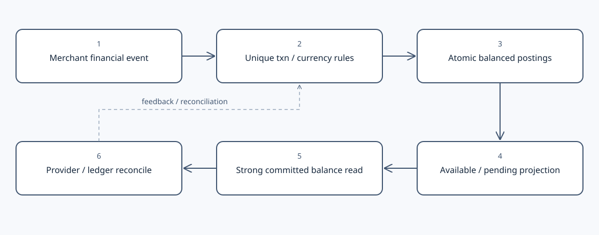

# W441. Design a Ledger Service with Merchant Balance

**Priority group:** Fifth 100 — specialized practice

**Category:** Payments, ledgers and billing

**Study position:** 441 of 547

[Group list](../FIFTH_100.md) · [All categories](../ALL_CATEGORIES.md) · [Chapter guide](../README.md)

## Question

Onsite system design. Build a ledger with a record_transaction API and a merchant_balance query API. The interviewer drills heavily on money modeling and consistency under concurrent writes.

API:

recordTransaction(merchantId, Transaction) — append-only financial event. Transaction(txnId, amountCents, type, occurredAt), type ∈ {payment_received, payout, refund, ...}, amount in integer minor units (cents, never a float).
getBalance(merchantId) -&gt; Balance{ available, pending } — settled/withdrawable vs recorded-but-not-cleared.

Constraints: balance reads must reflect all acknowledged writes; double-recording a txnId is forbidden; thousands of TPS, millions of txns/day; reads outnumber writes; money in integer minor units, currencies tracked separately.

## Worked solution

### Money and clearing states

Track each currency separately in integer minor units. A transaction ID is unique in the declared merchant/platform scope and bound to merchant/type/amount/currency/reference; a duplicate identical record returns its original result, while conflicting reuse is rejected. `recordTransaction` must include currency even if omitted from the abbreviated signature. `getBalance(merchant,currency)` returns available, pending and ledger_version; a default currency is an explicit product configuration, never a cross-currency sum.

Store FinancialEvent(txn_id,merchant,currency,amount_cents,type,occurred_at,posted_at,parent_txn_id,state), LedgerTransaction/Entry, MerchantBalance(merchant,currency,available,pending,version), ExternalOperation(provider_id,key,state) and Outbox. Payment receipt initially credits pending against a clearing receivable; a separate settlement event moves pending→available. Payout initiation reserves/debits available, confirmation moves it to payout clearing/settled; failure reverses/resolves the reservation. Refunds/chargebacks are linked compensating events, not negative overwrites of the original payment. State transitions and the available/pending deltas are defined per event type.

### Atomic append and balance query

The diagram's posting transaction locks the merchant/currency balance, verifies event uniqueness and sufficient spendable funds for payouts, appends balanced entries and updates the balance/version in one database commit. Event and outbox share that transaction. Acknowledge only after durable commit, and make `getBalance` a leader/quorum read or a replica read gated by the latest committed version. Plain eventually consistent caches cannot meet **all acknowledged writes** even for other readers. If the balance table is asynchronous, the API must wait for a commit watermark or calculate from authority; declaring it a cache does not weaken the requirement.

Example: record a $100 payment as 10,000 pending cents, then settlement moves 10,000 pending to available. Two simultaneous $80 payouts lock/condition the same balance: only one reserves 8,000, leaving 2,000 available. Re-delivering either event cannot add another $100 or subtract another $80. A provider timeout leaves payout UNKNOWN and its reservation in place until queried/reconciled, not released and resent with a new identity.

### Capacity, failure and audit

At an assumed five million events/day, average is about 58/s despite a stated thousands-TPS peak; provision shards and burst queue for peak. With chosen 300-byte events plus two 100-byte entries, about 2.5 GB/day logical precedes replicas/indexes. Partition by merchant/currency for local balance serialization and append transaction history by time; exceptionally hot merchants need dedicated shards or a carefully designed escrow/subledger model, not an unsafe split of one available balance.

Use multi-zone durable storage, scoped auth/RBAC, immutable audit history and idempotent provider adapters. Reconciliation compares balance at ledger watermark with summed postings and provider settlement statements, opening actionable cases and rebuilding projections under version checks. OccurredAt can be late but must not reorder already committed balance history ambiguously; retain both event/posting time and correction linkage. Test conflicting txn IDs, duplicate settlement, out-of-order provider status, concurrent payout, stale balance replica and currency crossover. Monitor posting p99, lock contention, pending age, unknown operations and drift; no queue retry is a new financial event by itself.

<!-- architecture:W441:start -->

Read the numbered path as Merchant financial event → Unique txn / currency rules → Atomic balanced postings → Available / pending projection → Strong committed balance read → Provider / ledger reconcile. The dashed return is the recovery/feedback path explained above, under the stated authorization, consistency and durability boundaries.
<!-- architecture:W441:end -->

[Batch behavior checks](../test_review_426_450.py). Design sizing/SLOs are explicit calculations and targets, not measured production claims.

### Further study

- [F165: Design idempotency for an order or booking API.](../17_distributed_systems_depth.md#f165)
- [F162: Design a durable work queue with retries and leases.](../17_distributed_systems_depth.md#f162)
