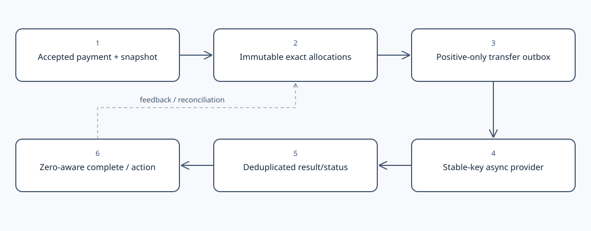

# W442. Design a Loan Payment Distribution System

**Priority group:** Fifth 100 — specialized practice

**Category:** Payments, ledgers and billing

**Study position:** 442 of 547

[Group list](../FIFTH_100.md) · [All categories](../ALL_CATEGORIES.md) · [Chapter guide](../README.md)

<span class="practice-page"></span>

## Question

Design a simplified loan-payment distribution service. When a borrower payment is accepted, the service must create and track the payouts owed to the investors entitled to that payment. A third-party payment provider performs the actual movement of money; your system coordinates it and keeps an auditable record of the result.

What to design

Describe the APIs, data model, components, and end-to-end workflow for these inputs and outputs:

AcceptedPayment: a stable payment id, loan id, amount in an integer minor currency unit, currency, and acceptance time.
EntitlementSnapshot: the investor recipients and the amount each is owed from that accepted payment. This is supplied to your service; deriving investor ownership is outside the design.
ProviderUpdate: the third-party provider's acknowledgement or terminal result for a requested transfer.
Output: one durable distribution record per payment, transfer requests for entitled investors with positive allocations, and a queryable final or actionable status for every allocation, including those that require no transfer.

### Rules

1. Each distribution must durably reference the authoritative entitlement snapshot supplied for its accepted payment. The snapshot and the resulting allocations become immutable before transfer commands are created.
2. The allocation amounts must use the same currency as the payment, be non-negative, and sum exactly to the accepted payment amount. Retain zero-cent allocations as part of the rounding and audit record, but mark them NO_TRANSFER_REQUIRED: do not create an outbox command or provider request for them. Invalid input must not initiate money movement.
3. Re-delivery of an input event, a client retry, a timeout, or a repeated provider update must not create an extra payout.
4. The provider executes transfers asynchronously. A timeout is an unknown outcome, not proof of failure, so the design must resolve it without blindly creating a replacement transfer.
5. Preserve enough durable history to explain which payment, snapshot, allocation, request, and provider result produced every state transition.

### Examples

Example 1: successful distribution

A 100-dollar payment arrives as 10,000 cents with an entitlement snapshot assigning 7,000 cents to Investor A and 3,000 cents to Investor B. The service creates two allocations, requests two transfers through the provider, and marks the distribution complete only after both transfers have terminal success results.

Example 2: retry after an uncertain response

A 50-dollar payment has one entitled investor. The transfer request reaches the provider, but the response times out. The request is retried with the same stable idempotency identity or queried by that identity; the system records one provider transfer, not a second payout, and eventually converges to the provider's terminal result.

Example 3: zero-cent audit allocation

A 100-dollar payment has allocations of 10,000 cents and 0 cents. The positive allocation requires a transfer and must reach terminal success. The zero-cent allocation is retained as NO_TRANSFER_REQUIRED and is never submitted. The distribution completes when both conditions hold.

### Constraints

Interest, fees, principal accounting, amortization, delinquency, and other loan-accounting rules are out of scope.
Choosing investors, originating the loan, and computing investor ownership are out of scope; the entitlement snapshot is authoritative input.
Holding bank funds and executing money movement are out of scope; those actions belong to the third-party provider.
Monetary amounts use integer minor units. A payment can have one or more entitled investors.
No traffic volume or latency target is fixed. State explicit scale and availability assumptions, show how they affect partitioning and capacity, and avoid relying on a single global worker.
Explain consistency boundaries, idempotency, failure recovery, reconciliation, observability, privacy, and access control.

## Worked solution

### Immutable allocation plan before any transfer

The supplied entitlement snapshot is authoritative; do not derive investor ownership, principal/interest/fees or amortization. `POST /distributions` takes AcceptedPayment plus snapshot ID/digest and allocations; `GET /distributions/{payment_id}` returns the immutable plan and each allocation's status/history. An authenticated provider webhook and a reconciliation poller deliver ProviderUpdate. Idempotency is payment-scoped and binds the complete payment/snapshot hash; a replay matches the existing plan, while conflicting same-payment inputs are quarantined/rejected before money moves.

```text
Distribution(id PK, payment_id UNIQUE, loan_id, amount_minor, currency,
             accepted_at, snapshot_id, snapshot_digest, plan_hash, state)
EntitlementSnapshot(id PK, immutable_ref, digest, currency, source_version)
Allocation(id PK, distribution_id FK, snapshot_recipient_id, investor_id,
           amount_minor, currency, state, UNIQUE(distribution_id,snapshot_recipient_id))
TransferRequest(id PK, allocation_id UNIQUE, provider_key UNIQUE,
                request_hash, provider_transfer_id nullable, state)
TransferAttempt(request_id, attempt_no, sent_at, response, error)
ProviderInbox(provider,event_id UNIQUE,payload_hash,received_at,applied_at)
AllocationTransition(id,allocation_id,from_state,to_state,evidence_ref,time)
Outbox(command_id PK, request_id UNIQUE, next_attempt_at, lease_token, state)
```

Validate stable IDs, same currency, nonnegative integer amounts and **exact sum=payment amount**. Persist/restrict the referenced authoritative snapshot and plan in the same acceptance transaction, rejecting invalid inputs with no outbox entries. Freeze all allocation amounts/recipients before creating commands. Zero-cent rows are retained with NO_TRANSFER_REQUIRED and **never** get TransferRequest/outbox/provider calls. Positive rows enter PLANNED with one stable transfer identity. Snapshot changes require a distinct audited correction/business process, not mutation of an already paying plan.

### Asynchronous transfer state machine

The diagram's immutable plan feeds partitioned transfer outboxes, provider adapters, signed result intake and reconciliation. Workers claim durable commands with leases, send provider_key and record attempt history. Acknowledgment/request acceptance yields SUBMITTED/PROCESSING, not success. Only explicit terminal provider success yields SUCCEEDED; definitive terminal failure becomes FAILED_ACTION_REQUIRED or another named actionable state. Timeout/connection loss yields UNKNOWN, retains the **same** request identity and schedules status lookup or idempotent resend. If a provider offers neither idempotency nor lookup by stable identity, one cannot safely guarantee automatic no-duplicate payout after timeout; stop for manual reconciliation rather than invent a replacement transfer.

ProviderInbox deduplicates callback events. Apply state transitions conditionally under an allocation/request lock, matching provider identity, amount, currency and recipient. Late PROCESSING cannot downgrade SUCCEEDED, duplicate success is a no-op, and contradictory terminal evidence opens an exception. Polling and webhook processing converge on the same state machine. A failed worker after provider success is repaired by querying/resending the original key. Lease expiry permits another **messenger**, not a second logical payout. Store enough request/response/evidence references to trace every transition without exposing bank details in ordinary logs.

### Completion, recovery and scale

Distribution COMPLETE means every positive allocation SUCCEEDED and every zero allocation NO_TRANSFER_REQUIRED. A terminal failed allocation makes the distribution actionable/partially failed; never report complete merely because all requests were sent. For 10,000 cents split 7,000/3,000, both provider successes are required. For 10,000/0, exactly one command is created and the zero row remains visible/auditable. Sum/count invariants validate the plan independently of delivery status.

Assume 100,000 payments/day×twenty recipients=two million allocations/day, about 23.1/s average; assume a 100× burst (~2,315/s) for queue/provider capacity. At 300 bytes/allocation this is 600 MB/day logical before history/indexes. Hash by payment/distribution for plan consistency, distribute transfer workers by provider/tenant and cap concurrent requests/rates; no global worker serializes every investor. Multi-zone database/queue replication, outbox replay, lease reconciliation and provider circuit breakers retain accepted plans through failure. Backpressure leaves commands pending with next_attempt_at rather than losing them.

Reconcile every nonterminal/unknown request against provider statements/status and compare successful amounts to immutable allocations. Maintain original idempotency keys beyond provider retry windows or stop before unsafe reuse. APIs enforce loan/tenant ownership and operator roles; encrypt recipient identifiers, authenticate webhooks and audit manual repair with dual review where configured. Monitor plan rejection/sum mismatch, zero-command violations, oldest pending/unknown, provider error/rate limits, partial distributions and reconciliation discrepancies. Test duplicate input, changed snapshot under same payment, zero allocation, worker crash before/after send, duplicate/reordered callback and provider success after timeout. Your service coordinates records and requests; it does not claim to hold funds or execute the provider's money movement.

<!-- architecture:W442:start -->


Read the numbered path as Accepted payment + snapshot → Immutable exact allocations → Positive-only transfer outbox → Stable-key async provider → Deduplicated result/status → Zero-aware complete / action. The dashed return is the recovery/feedback path explained above, under the stated authorization, consistency and durability boundaries.
<!-- architecture:W442:end -->

[Batch behavior checks](../test_review_426_450.py). Design sizing/SLOs are explicit calculations and targets, not measured production claims.

### Further study

- [F165: Design idempotency for an order or booking API.](../17_distributed_systems_depth.md#f165)
- [F162: Design a durable work queue with retries and leases.](../17_distributed_systems_depth.md#f162)
