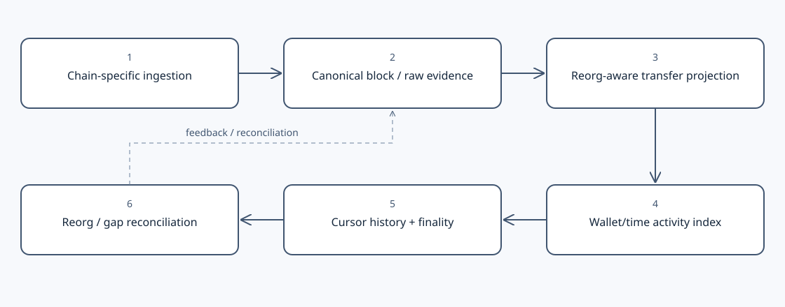

# W443. Design a Multi-Chain Crypto Ledger & Wallet History

**Priority group:** Fifth 100 — specialized practice

**Category:** Payments, ledgers and billing

**Study position:** 443 of 547

[Group list](../FIFTH_100.md) · [All categories](../ALL_CATEGORIES.md) · [Chapter guide](../README.md)

## Question

Design a crypto-asset ledger that tracks every transaction across chains and supports a 'wallet history' query: given a wallet address, return all transactions touching it, paginated and ordered by time. Requirements reported thinly:

Track multi-chain transactions in a single ledger surface.
Support per-wallet history queries (paginated, time-ordered).
Reasonable freshness — recent transactions appear within seconds.

Scale and durability targets were not fully specified in the source. The prompt mirrors an early internal Coinbase project.

## Worked solution

### Chain identity and wallet-oriented projection

Scope is transaction/transfer history, not private-key custody or trading. Ask which chains/assets, whether token/internal transfers count, retention, throughput and finality semantics; source gives no fixed scale. Store Chain(chain_id,adapter,finality_policy), Block(chain_id,height,hash,parent_hash,canonical,status), Transaction(chain_id,tx_hash,block_hash,index,raw_ref), Transfer(chain_id,tx_hash,event_index,block_hash,asset_id,from,to,amount_base_units,status), and WalletActivity(chain_id,address,block_time,block_height,tx_index,event_index,transfer_id,canonical). Native amounts/token quantities use integer base units plus asset/decimals metadata; the same address string on two chains is not one identity.

The diagram's chain adapters consume new blocks/mempool if supported, verify parent continuity and persist raw evidence, then a reorg-aware projector creates wallet activity rows for all touched addresses. Deduplicate event identity including chain and event/log/trace index: one transaction can contain multiple token transfers. Normalize addresses according to **that chain's** rules; don't lowercase every chain blindly. For an “all chains wallet” UI, require explicit verified address mappings instead of assuming identical strings belong to the same person.

### Query, order and freshness

`GET /wallets/{chain}/{address}/history?before=&limit=&status=` returns transaction/transfer grouping, amounts, confirmation/finality status and source freshness. Partition by (chain,address,time bucket) with a descending ordered activity index and hydrate transaction details in batch. A common chronological display uses (block_time,chain,height,tx_index,event_index,tx_hash) as deterministic tie-breaks; cross-chain timestamps are not one causal/consensus order. Cursor binds filters and canonical-view epoch; a reorg can invalidate the view, so return a refresh/resync marker or pin an old snapshot with its status rather than silently skip/duplicate activity.

Recent unconfirmed/canonical-but-not-final entries can appear within seconds, while finality may take longer and differs by chain. Never label “seconds fresh” as irreversible. On a parent-hash mismatch, find the common ancestor, mark orphaned records noncanonical, undo/rebuild affected projections and ingest the replacement branch. Keep raw orphan evidence for audit and reorg-depth alerts; an old ingestion replay must not make an orphan canonical again. Cross-chain bridges are linked observations with independent settlement/failure states, not atomic one-chain transfers.

### Capacity and failure choices

Assume 10,000 transfers/s and two wallet-index rows/transfer: 20,000 index writes/s. At chosen 250 bytes/transfer plus two 80-byte index rows, sustained logical growth is about 354.24 GB/day before raw receipts/index overhead/replicas. Shard by wallet hash/time with special handling for exchange/contract hot wallets; bucket and paginate them rather than create one unbounded partition. Recent data stays indexed/replicated, old immutable blocks/history move to cheaper storage with a query catalog, preserving the requested history.

Indexer offsets commit with canonical block/application state or replay idempotently after crashes. Redundant providers catch missing/contradictory blocks; verify data consistency rather than treating one RPC response as unquestionable. API failure serves marked stale confirmed history or retries; it never invents missing transactions. Monitor chain-head lag, reorg depth, gap detection, projection counts/checksums and wallet query p99. Test duplicate logs, deep reorg, identical tx hashes on different chains, wallet hot keys and pagination during canonical changes. Finality, data rights and upstream reliability remain explicit chain-specific dependencies.

<!-- architecture:W443:start -->

Read the numbered path as Chain-specific ingestion → Canonical block / raw evidence → Reorg-aware transfer projection → Wallet/time activity index → Cursor history + finality → Reorg / gap reconciliation. The dashed return is the recovery/feedback path explained above, under the stated authorization, consistency and durability boundaries.
<!-- architecture:W443:end -->

[Batch behavior checks](../test_review_426_450.py). Design sizing/SLOs are explicit calculations and targets, not measured production claims.

### Further study

- [F165: Design idempotency for an order or booking API.](../17_distributed_systems_depth.md#f165)
- [F162: Design a durable work queue with retries and leases.](../17_distributed_systems_depth.md#f162)
