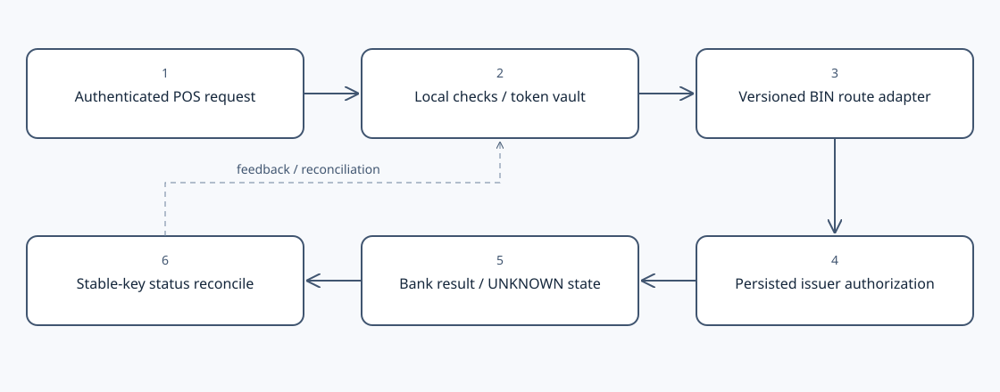

# W444. Design a Payment Gateway System

**Priority group:** Fifth 100 — specialized practice

**Category:** Payments, ledgers and billing

**Study position:** 444 of 547

[Group list](../FIFTH_100.md) · [All categories](../ALL_CATEGORIES.md) · [Chapter guide](../README.md)

## Question

Design a payment gateway for merchants using POS machines. The POS scans a card and calls your API to validate the payment. Focus on card validation/authorization — not the full settlement/money-movement flow.

Requirements: support many card types (Visa, Mastercard, Amex, Discover, local), receive validation requests from POS machines, route each request to the correct bank based on the card number, and be highly available and low-latency.

Assumptions: ~10,000 merchants, ~10M transactions/day (~115 TPS avg, ~575 TPS peak), p95 &lt; 200ms, 99.99% uptime.

Address: BIN-based bank routing, failure handling when a bank API is down/slow (retries + circuit breaker), PCI-DSS compliance (tokenization, encryption), rate limiting, idempotency (double-scan / double-click), monitoring, multi-region latency, local validation (Luhn / expiry) before calling the bank, Black-Friday spikes, and integrating hundreds of banks with different API formats.

## Worked solution

### Authorization state before routing

Scope is validation/authorization, not settlement. `POST /authorizations` takes merchant/terminal identity, card token or protected card data, amount/currency and idempotency key; return APPROVED, DECLINED or PROCESSING/UNKNOWN plus authorization_id and issuer reference when present. “Luhn/expiry valid” is only local format plausibility, not available funds or issuer approval. Validate merchant/terminal credentials, positive integer money, supported card range/expiry and risk/rate limits before issuer calls.

Ten million/day is **115.7/s average**; use the supplied ~575/s peak. At an assumed 1 KB authorization audit record, raw intent/audit is 10 GB/day before replicas/indexes. A proposed p95<200 ms budget is 15 ms ingress/local checks, 5 ms BIN/adapter selection, 150 ms issuer path and 30 ms durable transition/network headroom. An issuer whose response p95 is already 300 ms makes the aggregate target infeasible for that route; negotiate SLO/timeouts and report PROCESSING rather than fabricate an approval. 99.99% gateway availability is distinct from every bank/network's approval availability.

### Routing and adapters

The diagram's secure ingress/token vault leads to a versioned BIN/IIN range table and network/issuer adapter layer. Use current authoritative range metadata supporting varying prefix lengths; longest applicable range plus network/co-brand rules determines the configured route. Card prefix identifies routing metadata, not necessarily a direct public issuer API: real integrations may go through an acquirer/network. Hundreds of bank adapters implement a common authorize/status/reversal contract, with protocol/error mapping, deadlines, credentials and capability flags separated from core orchestration. Update route tables atomically with validation/canary and last-known-good recovery.

Store Authorization(id,merchant,key,request_hash,amount,currency,token_ref,route_version,state), Attempt(id,authorization,downstream_key,issuer_ref,result) and outbox/audit. Commit intent before calling the bank, then persist explicit result. A double scan is safe only if the POS reuses the same logical purchase key; similar amount/time heuristics alone cannot prove identity. Timeout after send is UNKNOWN. Query/status or retry the **same downstream identity** when supported; do not reroute/re-authorize with a new identity that might create a second hold. Any compensating reversal is itself tracked/idempotent.

### Resilience and protected data

Per-bank circuit breakers, bulkheads and bounded queues contain slow routes. Retry only classified transient errors with a remaining latency budget and jitter; hard declines require customer/payment-method action. Active-active regional ingress routes each intent to one authoritative idempotency partition; synchronously replicate/fence failover if no acknowledged intent may be lost. Black Friday capacity uses prewarmed adapters/connections, merchant quotas and bank-specific rate limits; passing extra traffic to an already failing bank worsens success rate.

Tokenize/minimize PAN exposure, encrypt transport/storage, use managed keys/HSM boundaries and strict audited access/network segmentation. Sensitive authentication data such as CVV must not be stored after authorization even encrypted, as explained by the [PCI SSC guidance](https://www.pcisecuritystandards.org/faqs/1533/); tokenization is not a blanket exemption from assessment scope. Never log full card data. Monitor p95 by bank/network, approval/decline/unknown, circuit state, duplicate prevention and aged authorizations. Test malformed card/expiry, stale BIN configuration, issuer timeout after approval, lost ACK, double scan and regional failover. No settlement ledger is invented for this narrower prompt.

<!-- architecture:W444:start -->

Read the numbered path as Authenticated POS request → Local checks / token vault → Versioned BIN route adapter → Persisted issuer authorization → Bank result / UNKNOWN state → Stable-key status reconcile. The dashed return is the recovery/feedback path explained above, under the stated authorization, consistency and durability boundaries.
<!-- architecture:W444:end -->

[Batch behavior checks](../test_review_426_450.py). Design sizing/SLOs are explicit calculations and targets, not measured production claims.

### Further study

- [F165: Design idempotency for an order or booking API.](../17_distributed_systems_depth.md#f165)
- [F162: Design a durable work queue with retries and leases.](../17_distributed_systems_depth.md#f162)
