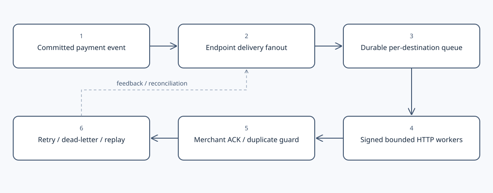

# W445. Design a Payment Webhook Delivery System

**Priority group:** Fifth 100 — specialized practice

**Category:** Payments, ledgers and billing

**Study position:** 445 of 547

[Group list](../FIFTH_100.md) · [All categories](../ALL_CATEGORIES.md) · [Chapter guide](../README.md)

## Question

Design a webhook delivery service for a payments platform that notifies merchants when payment events occur (payment success, refund, dispute). Emphasis is on reliability: at-least-once delivery, retries, idempotency, and signature verification.

The system must:
1. Merchant registration — save a webhook URL and chosen event types (e.g., payment.success, refund.created).
2. Send events — on a payment event, POST the data to all registered webhooks; the merchant replies HTTP 200 to confirm.
3. Reliability — deliver even if the merchant's server is briefly down.

Discuss: delivery guarantees & duplicate handling, retry strategy, latency (merchants may take 10–15s to reply), signature verification (HMAC vs RSA), circuit breaking, event ordering, endpoint validation, SSRF prevention, observability, and backpressure/isolation.

## Worked solution

### Durable event-to-delivery model

`POST /webhook-endpoints` stores merchant URL, event-type subscriptions, signing key version and enabled state; send a validation challenge and require authenticated merchant control. Committed payment changes create immutable Event(id,type,resource_id,resource_version,created_at,payload_schema) plus outbox atomically. Fanout snapshots applicable subscriptions into Delivery(event_id,endpoint_id UNIQUE,state,next_attempt_at,attempt_count,lease), with DeliveryAttempt(request,response,times,error) retained for debugging/replay. An event is distinct from each destination delivery.

The diagram is business outbox→durable fanout/scheduler→per-endpoint queues→HTTP workers→merchant ACK, with retries/reconciliation. The requested success condition is HTTP 200; other responses follow documented policy (common APIs accept other 2xx only if agreed). A timeout, even after the merchant committed the effect, leaves delivery unacknowledged and will be retried. Stable event_id/delivery_id let the merchant atomically deduplicate **and apply** its business effect; no network system can promise once-only callbacks through lost acknowledgments.

### Slow endpoints, order and signing

Workers use asynchronous I/O, bounded connections and endpoint-specific concurrency so a 10–15-second receiver does not consume every thread. At an assumed 10,000 deliveries/s×15 seconds, up to 150,000 HTTP requests are in flight before headroom; batch dispatch/rate limits/circuit breakers matter. Retry network/timeout/429/5xx with capped exponential backoff+jitter and bounded Retry-After; classify permanent errors, disable/alert on persistently broken endpoints and provide retained dead-letter/manual replay. At-least-once eventual delivery requires an eventually reachable accepting endpoint within retention; an indefinitely down endpoint cannot be guaranteed delivery by finite buffers.

Sign exact raw body bytes with timestamp, event/delivery ID and key ID. HMAC is efficient with a per-endpoint shared secret; RSA/asymmetric signatures let merchants verify using a public key without holding the signing secret, at greater key/crypto overhead. Constant-time verification, replay-window checks and event-ID dedup are all needed; timestamp checks alone don't stop in-window duplication. Retry keeps logical event identity but can use a fresh attempt timestamp/signature. Support overlapping key versions for rotation.

Ordering is normally not global. Include resource_version and provide a resource-fetch API so receivers ignore stale updates/refetch canonical state. If strict per-object/endpoint order is required, serialize that key and block later delivery behind retries, trading freshness for head-of-line blocking. A failed old callback must not downgrade a newer successful payment state.

### Endpoint safety and recovery

Validate HTTPS URLs, prohibit credentials and unsafe ports, resolve/check all IPs against private/link-local/metadata ranges, and enforce those checks on the actual outbound connection and every redirect/DNS refresh. Disable redirects or revalidate every hop; registration-only DNS validation is vulnerable to rebinding. Use a restricted egress proxy, allowlisted destinations where feasible, response/body size limits and no internal network access. Endpoint configuration changes are versioned; define whether old pending deliveries use old or new URL, and audit the choice.

Shard by merchant/endpoint, keep per-tenant budgets and protect healthy endpoints from retry floods. Lease expiration reoffers the same Delivery; outbox/inbox dedup prevents fanout duplication. Monitor oldest undelivered age, attempt reasons, ACK latency, per-endpoint circuit/backlog and signature errors with redacted payloads. Test merchant success followed by lost response, 15-second latency, bad HMAC/key rotation, reordered resource events, DNS rebinding/redirect SSRF and worker crash after send. Manual replay preserves original event identity so it cannot silently request a new financial effect.

<!-- architecture:W445:start -->

Read the numbered path as Committed payment event → Endpoint delivery fanout → Durable per-destination queue → Signed bounded HTTP workers → Merchant ACK / duplicate guard → Retry / dead-letter / replay. The dashed return is the recovery/feedback path explained above, under the stated authorization, consistency and durability boundaries.
<!-- architecture:W445:end -->

[Batch behavior checks](../test_review_426_450.py). Design sizing/SLOs are explicit calculations and targets, not measured production claims.

### Further study

- [F162: Design a durable work queue with retries and leases.](../17_distributed_systems_depth.md#f162)
- [F165: Design idempotency for an order or booking API.](../17_distributed_systems_depth.md#f165)
