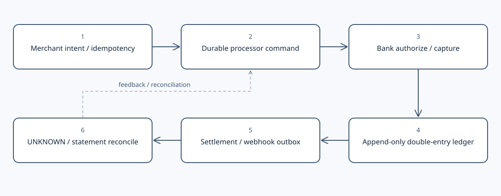

# W446. Design a Stripe-like Payment Platform

**Priority group:** Fifth 100 — specialized practice

**Category:** Payments, ledgers and billing

**Study position:** 446 of 547

[Group list](../FIFTH_100.md) · [All categories](../ALL_CATEGORIES.md) · [Chapter guide](../README.md)

## Question

Open-ended payment-platform system design for an SRE candidate: payment intent lifecycle, idempotency, transactional integrity, retry semantics under partial failure.

### Requirements

Design a payment platform similar to Stripe. Interviewer expects discussion of:

Functional: merchant integrates via SDK / REST; payer initiates a charge; system authorizes against the bank network; settles funds asynchronously; surfaces webhook events for both success and failure.
Idempotency: charge requests carry an idempotency key; same key replayed must not double-charge.
Transactional integrity: a single charge spans charge service + ledger + bank-network call; partial failure must be recoverable, not result in lost or duplicated debits.
Scale: 1M+ TPS at peak (flash sales); 99.99% availability SLA; PCI-DSS-shaped data handling.
Reliability: handle bank-network timeout (reconcile asynchronously), payment-method failures (retry policies), and chargebacks (event replay).
Notes
The canonical decomposition: API gateway → payment-intent service (creates and tracks intent state) → payment-processor service (calls bank network) → ledger service (double-entry bookkeeping) → webhook dispatcher.
Idempotency is implemented via a per-key write-once record (status: pending / completed / failed); the second call to the same key returns the stored result.
For partial-failure handling, persist intent state at each transition; on retry, drive forward from last persisted state rather than restarting. Use a saga pattern with compensating actions, not 2PC.
Ledger should be append-only and double-entry; never mutate past entries. Reconciliation runs nightly against bank-network statements.
For bank-network timeout, mark intent unknown, schedule a reconciliation job, and surface to the merchant as processing; commit final state only after explicit confirmation.
Common pitfall: candidates dive into sharding the database before establishing the intent state machine. Sequence the discussion: state machine → durability → idempotency → scaling.

## Worked solution

### State machine and durable identity first

PaymentIntent(id,merchant,key,request_hash,amount,currency,method_token,state,version) moves CREATED→REQUIRES_ACTION/PROCESSING→AUTHORIZED→CAPTURE_PENDING→CAPTURED/SETTLING→SETTLED, with DECLINED/CANCELED and explicit UNKNOWN states at uncertain network boundaries. Refund/dispute/chargeback are linked new operations with their own state/ledger entries, not edits erasing the original charge. `POST /payment-intents`, `/confirm`, `/capture`, `/refund`, `GET /payment-intents/{id}` and event/webhook APIs expose this lifecycle. A payment-method change requires an explicit versioned action, never reuse one idempotency key with new money parameters.

A tenant/operation-scoped idempotency record stores request hash, pending/completed result and operation ID in the same transaction as intent creation/state changes. A concurrent matching request returns in-progress/the same result; a mismatching body conflicts. Persisted pending work is reconciled after crashes rather than lock forever or start another charge. The diagram follows gateway→intent authority→processor adapters→bank network, with an append-only double-entry ledger and independent webhook outbox.

### Recoverable partial failures

Commit an intent/processor command before the bank call. Use one stable downstream operation key and record every attempt. Bank timeout means PROCESSING/UNKNOWN: poll/query by that identity, process authenticated deduplicated callbacks and reconcile provider statements. Do not fail it and start a fresh charge. Hard declines need payment-method/customer action; transient transport/issuer errors get bounded backoff only when duplicate-safe. Circuit breakers and route bulkheads protect other banks; a possible second route must first resolve/reverse the first uncertain authorization safely.

A database transaction cannot atomically include an arbitrary bank network. Use a durable saga: conditional state transitions plus outbox/inbox and idempotent participants. Ledger posting and intent reference share one transactional boundary where possible; otherwise an idempotent ledger command plus reconciliation holds intent pending until posted. Balanced integer-minor-unit entries per currency record receivable/clearing/cash/merchant obligations. A capture/settlement mismatch opens an actionable case, and compensation is a new reversal/refund request, not pretend rollback of a bank's external transfer. Chargeback replay deduplicates by provider case/event version.

### Million-TPS implications

The **one-million+ TPS peak** cannot be waved away by a single relational database. At an assumed 1 KB command/audit ingress per request it is 1 GB/s; sustained all day would be 86.4 billion requests/day, so peak duration/average must be clarified. At assumed 5,000 safe transactional writes/s per shard, at least 200 write shards are a lower bound before multiple intent/ledger writes, replicas and hot merchants. Partition intents/idempotency by merchant+hashed operation, route ledger accounts/settlement partitions carefully and reserve global merchant-limit coordination. Internal transfer atomicity across shards needs a ledger transaction service or explicit pending/escrow protocol, not independent rows.

The synchronous request can durably accept and return PROCESSING; it cannot promise every bank finishes at a million TPS if downstream quotas are lower. Rate-limit/admit by bank/merchant, prewarm connections, queue asynchronously and expose backlog/expected completion. 99.99% platform availability means valid lifecycle/status responses under dependencies, not universal approved settlement. Cross-region quorum replication/fencing preserves acknowledged financial intent at WAN-latency cost; failover replays only uncommitted commands under the original IDs.

### Security, reconciliation and evidence

Use tokenized payment methods, isolated PCI-scoped vault/processor paths, encryption/key management, least privilege and redacted logs. Do not retain sensitive authentication data after authorization; the [PCI SSC explanation](https://www.pcisecuritystandards.org/faqs/1533/) applies even to encrypted storage. Signed webhooks carry stable event/resource versions and retry independently. Reconcile UNKNOWNs continuously and compare nightly bank/settlement statements with ledger/intent state, with manual exception tools and audited compensation.

Monitor state age, bank error/unknown rates, duplicate conflicts, ledger imbalance/drift, outbox lag, p99 and per-merchant fairness. Test crashes before/after each bank/local commit, duplicated callbacks, region loss, ledger-service outage, hot-merchant flash sale and chargeback replay. Correctness follows from recoverable identities and evidence-backed transitions; sharding comes after those invariants.

<!-- architecture:W446:start -->

Read the numbered path as Merchant intent / idempotency → Durable processor command → Bank authorize / capture → Append-only double-entry ledger → Settlement / webhook outbox → UNKNOWN / statement reconcile. The dashed return is the recovery/feedback path explained above, under the stated authorization, consistency and durability boundaries.
<!-- architecture:W446:end -->

[Batch behavior checks](../test_review_426_450.py). Design sizing/SLOs are explicit calculations and targets, not measured production claims.

### Further study

- [F165: Design idempotency for an order or booking API.](../17_distributed_systems_depth.md#f165)
- [F162: Design a durable work queue with retries and leases.](../17_distributed_systems_depth.md#f162)
