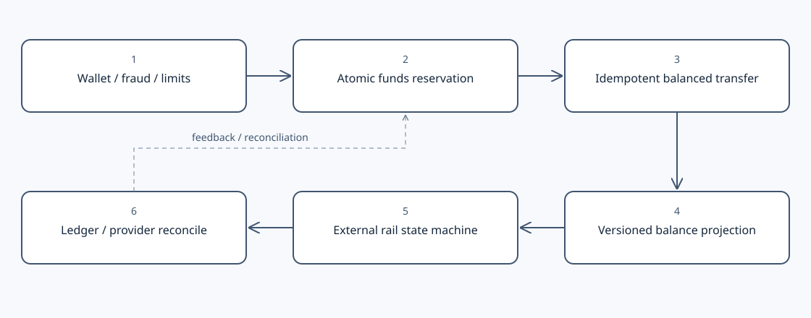

# W447. Design a Wallet with Ledger and Idempotent Transfers

**Priority group:** Fifth 100 — specialized practice

**Category:** Payments, ledgers and billing

**Study position:** 447 of 547

[Group list](../FIFTH_100.md) · [All categories](../ALL_CATEGORIES.md) · [Chapter guide](../README.md)

## Question

Design a wallet with balances, ledger entries, idempotent transfers, reconciliation, and fraud controls.

## Worked solution

### Atomic internal wallet contract

`GET /wallets/{id}/balance` returns currency, ledger/available/pending/holds and version. `POST /transfers` accepts source/destination, positive integer amount, currency and tenant-scoped idempotency key bound to the request; status/cancel APIs expose pending external operations separately. Wallet(id,owner,currency,status), Transfer(id,key,hash,state), LedgerTransaction/Entry, Balance(wallet,currency,posted,pending,held,version), Hold and Outbox form the model. Append-only balanced postings are authority; balance rows are transactionally maintained projections.

For same-currency internal transfer, lock source/destination in deterministic ID order, check authorization/status/available funds/limits, insert unique transfer key, debit source/credit destination and update both versions atomically. Return only after durable commit. The duplicate same key returns the original result; conflicting key reuse fails. If two withdrawals each need 80 from 100, only one succeeds. Do not read a cached 100 twice then write two independent balances. Multi-currency requires explicit FX quote, rounding, clearing accounts and per-currency balanced entries, not silently subtracting dollars from euros.

### Fraud, external rails and uncertainty

The diagram's authenticated transfer request passes fraud/limits before authoritative reserve/post. Risk policy returns ACCEPT, HOLD or DECLINE; HOLD creates a durable reservation/review case, not an untracked pending HTTP request. Signals use time-valid device/account/velocity information, and risk-service outage follows an explicit value/risk policy rather than universal fail-open. Idempotent event IDs prevent request retries inflating fraud velocity counts.

Bank deposits/withdrawals are separate state machines: REQUESTED→SUBMITTED→UNKNOWN/PROCESSING→SETTLED or FAILED/RETURNED. Reserve outgoing funds before provider call, send a stable provider identity and apply terminal results once through authenticated inbox processing. Timeout never releases and resends as a new withdrawal. Pending inbound money is not spendable unless an explicit risk/credit-advance product funds it; later failure cannot be “fixed” by deleting an already paid recipient entry. Compensations/recovery receivables preserve history.

### Capacity, recovery and reconciliation

Scale is unspecified. Assume ten million transfers/day, about 116/s average and 2,000/s peak. At a chosen 500 bytes/transfer including a header/two entries, ledger growth is 5 GB/day logical before replicas/indexes. Partition accounts by wallet/currency; cross-shard transfer needs distributed transactional posting or reserved escrow/saga states whose user-visible atomicity is defined. A broker/outbox is for derived notifications, not the only ledger copy. Synchronously replicate/fence if region loss must not lose acknowledged money.

Reconcile account projection to postings at matching ledger version, transfer debit/credit sums, hold/schedule state and external provider statements. A mismatch opens a case and can restrict risky spending; repair projections through a versioned audited rebuild rather than mutate original entries. Monitor pending/unknown age, ledger balance invariants, fraud false positives, duplicate rejections and reconciliation coverage. Test same-key races, insufficient funds, out-of-order return after settlement, unknown provider outcome, region failover and unauthorized source wallet. Exactly-once **posting effect** is achievable within those idempotent/transactional boundaries, not once-only arbitrary network execution.

<!-- architecture:W447:start -->

Read the numbered path as Wallet / fraud / limits → Atomic funds reservation → Idempotent balanced transfer → Versioned balance projection → External rail state machine → Ledger / provider reconcile. The dashed return is the recovery/feedback path explained above, under the stated authorization, consistency and durability boundaries.
<!-- architecture:W447:end -->

[Batch behavior checks](../test_review_426_450.py). Design sizing/SLOs are explicit calculations and targets, not measured production claims.

### Further study

- [F165: Design idempotency for an order or booking API.](../17_distributed_systems_depth.md#f165)
- [F162: Design a durable work queue with retries and leases.](../17_distributed_systems_depth.md#f162)
