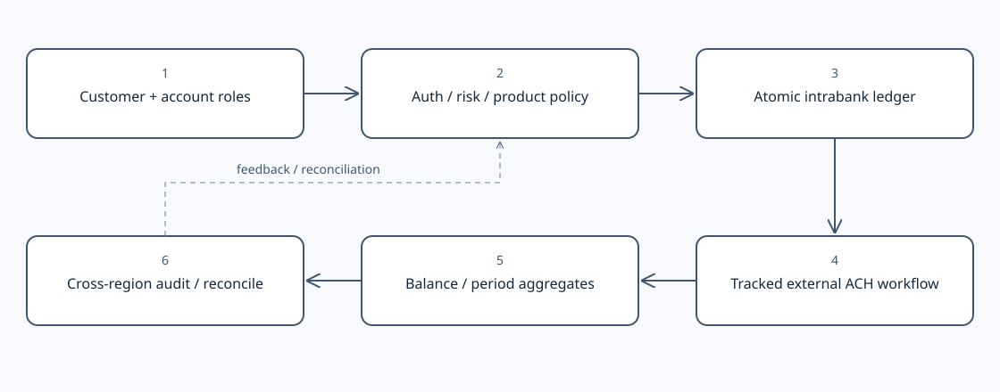

# W448. Design Capital One's Online Banking Application

**Priority group:** Fifth 100 — specialized practice

**Category:** Payments, ledgers and billing

**Study position:** 448 of 547

[Group list](../FIFTH_100.md) · [All categories](../ALL_CATEGORIES.md) · [Chapter guide](../README.md)

## Question

Design Capital One's online banking application. Requirements:

Multiple account types: 360 Checking, 360 Savings, Mortgage, Auto Loan (open/close).
User authentication and per-account authorization (joint accounts, beneficiary access).
Money movement: deposit, withdraw, transfer between Capital One accounts (intra-bank), and at least one external rail (Zelle, ACH, or wire).
Per-account statistics: daily / weekly / monthly totals and balances.
Cross-cutting: fraud detection on outbound transactions (accept / hold / decline), an authorization pipeline, audit and regulatory reporting.
Senior variants extend to cross-region replication, multi-currency, and reconciliation flows.

## Worked solution

### Account ownership is a relationship

Treat the named products as examples in the prompt, not claims about their current real implementation. Store Customer, Credential/Session, Account(id,type,currency,state,product_terms_version), AccountParty(account,customer,role,effective_dates), LedgerTransaction/Entry, Balance/Hold, Transfer, ExternalRailOperation and AuditEvent. Joint ownership, authorized signer and beneficiary are distinct roles: beneficiary designation alone does not automatically grant present withdrawal/API access. Enforce per-account/action authorization at every read/write/export, with step-up authentication for sensitive changes and high-risk transfers.

Account opening runs identity/product eligibility and approval workflows, then creates durable account/ledger state. Closing rejects new debits, resolves holds/pending transfers and requires the product's remaining-balance/liability conditions; mortgages/auto loans cannot use the same close rule as an empty deposit account. Keep product behavior behind type-specific policies, with mortgage/loan balances modeled as obligations rather than positive spendable deposits. No current legal/product eligibility terms are invented here.

### Money movement and authorization pipeline

APIs include account application/open/close, balance/history, `POST /transfers`, deposits/withdrawals and aggregate statistics. Pipeline: authenticate→account-role check→validate money/destination→limits/compliance/fraud→reserve→durable posting/workflow→notify/audit. Fraud returns ACCEPT/HOLD/DECLINE with policy/version; a hold reserves funds and opens an actionable case. Bound dependency timeouts and choose conservative explicit fallback by risk, preserving service without bypassing money authorization.

The diagram's ledger handles intra-bank same-currency transfers atomically: stable idempotency key, ordered account locks, sufficient available funds and balanced debit/credit commit together. External ACH is a separately tracked example rail: reserve outgoing funds, issue one stable provider operation, show PENDING/UNKNOWN until evidence, settle or compensate through new entries; handle late returns distinctly. A deposit is pending until funds are available under the product policy, not an unconditional instant credit. No database transaction encompasses an arbitrary rail API, so outbox/inbox, saga and statement reconciliation close partial failures.

### Statistics, regions and operations

Daily/weekly/monthly totals come from ledger-derived event-time/posting-time aggregates with a documented timezone and inclusion rule. Store sum inflow/outflow/count and opening/closing versions; pending holds are separate from posted spending. User dashboards can use read models with freshness metadata, but read-your-writes routes by account version or authority. Historical corrections update aggregate revisions while retaining original audit events.

Scale is unspecified. Assume ten million active customers, 10,000 peak ledger updates/s and 50,000 reads/s. At a chosen 500-byte posting bundle, sustained peak is 432 GB/day logical, so actual average, retention and peak duration matter. Partition by account/currency with a transactional transfer boundary; shared joint accounts serialize balance changes. Multi-zone replicated stores support base availability. A senior cross-region RPO-zero design requires synchronous remote quorum and fenced failover, paying WAN latency/unavailability without quorum. Multi-currency uses explicit FX quote/version, integer minor units, rounding and per-currency clearing postings rather than one summed balance.

Reconcile ledger/projection and external statements at matching cutoffs, track exceptions and auditable repair, and build regulatory reports from approved versioned definitions with restricted access. Redact personal/payment secrets and audit operator actions. Test joint-owner permission races, beneficiary denial, closing with pending ACH, duplicate transfer, fraud hold, late return, stale balance/statistics and region failover. Monitor authorization errors, transfer state age, balance drift, audit completeness, risk false positives and customer-visible availability. This covers deposit and credit products under one customer view while preserving their different financial rules.

<!-- architecture:W448:start -->

Read the numbered path as Customer + account roles → Auth / risk / product policy → Atomic intrabank ledger → Tracked external ACH workflow → Balance / period aggregates → Cross-region audit / reconcile. The dashed return is the recovery/feedback path explained above, under the stated authorization, consistency and durability boundaries.
<!-- architecture:W448:end -->

[Batch behavior checks](../test_review_426_450.py). Design sizing/SLOs are explicit calculations and targets, not measured production claims.

### Further study

- [F165: Design idempotency for an order or booking API.](../17_distributed_systems_depth.md#f165)
- [F162: Design a durable work queue with retries and leases.](../17_distributed_systems_depth.md#f162)
