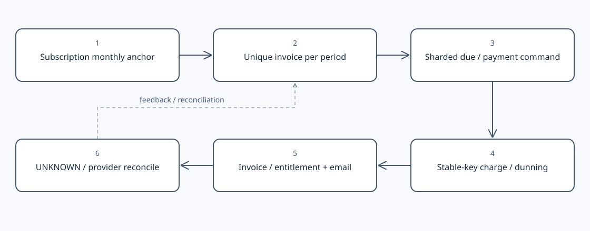

# W449. Subscription Billing System for 300M Subscribers

**Priority group:** Fifth 100 — specialized practice

**Category:** Payments, ledgers and billing

**Study position:** 449 of 547

[Group list](../FIFTH_100.md) · [All categories](../ALL_CATEGORIES.md) · [Chapter guide](../README.md)

## Question

Design a monthly subscription billing system for Netflix (300M subscribers).

Functional requirements
1. Users subscribe to a plan and are charged automatically each month on the correct date.
2. Users can update their card / payment method.
3. Users can view past bills and upcoming charges.
4. The system automatically retries failed payments (dunning).
5. Send emails for upcoming charges and payment status.

Non-goals: discounts, plan changes.

Goals

Correctness over speed: never miss a charge, never double-charge (exactly-once).
Handle external payment-gateway/bank failures gracefully.
Scale: 300M users, ~10M bills/day (~116 TPS avg, ~250–350 peak).
It is fine for a charge to be a few minutes late, but never wrong.

Design the schema, scheduling, idempotency, and failure/retry handling.

## Worked solution

### Unique billing periods, not merely timers

Store Subscription(id,customer,plan_version,amount_minor,currency,billing_anchor,timezone,next_due,state,payment_method_version), Invoice(id,subscription,period_start,period_end,amount,state,UNIQUE(subscription,period_start)), PaymentAttempt(invoice,n,provider_key,state,provider_id,next_retry_at), PaymentMethod(token,version), Ledger entries and EmailOutbox. Plans are fixed—discounts/plan changes are non-goals. Define anchor behavior explicitly: assume monthly anniversary in a chosen billing timezone, with day31 clamped to month end while preserving the original day31 anchor for later months. Leap/DST/cutoff behavior is tested.

`POST /subscriptions` creates the plan/anchor under a client key; payment-method update replaces a token/version for future unsubmitted attempts without mutating an in-flight provider request. Invoice/history/upcoming APIs read immutable period amounts and next_due. A scheduler scans indexed time buckets, locks a due subscription, creates the unique invoice and payment command/outbox and advances next_due **in one transaction**. Duplicate scans/failover cannot create another period invoice, and missed scans are caught up within the allowed minutes.

### Payment, dunning and email

The diagram's invoice command drives a durable payment state machine. Use one provider idempotency identity per logical charge attempt and query/retry that same identity after timeouts. A provider-UNKNOWN response remains PROCESSING and cannot trigger a fresh attempt with a new key; first establish a definitive failure or success. After a confirmed retryable decline/failure, a new numbered dunning attempt is legitimate under explicit policy. Hard failures require customer action, and rate-limit retry dates/maximum attempts. A card update may trigger a new allowed attempt only after resolving prior uncertainty.

Authenticated provider events deduplicate in an inbox, conditionally mark invoice PAID once and append balanced monetary postings/outbox. Do not mark paid from a mere HTTP request acceptance. Upcoming-charge and status emails are durable intents keyed by subscription/period/event kind; separate workers retry with stable message IDs and redacted content. Email failure cannot roll back a successful charge or block future billing. Service-entitlement grace/suspension after dunning must be defined independently; do not silently cancel a subscriber because one network call timed out.

### Capacity and recovery

The given 300 million subscribers/month implies about ten million bills/day (~115.7/s), with specified ~250–350 peak. At assumed 1 KB invoice/attempt summary, 300 GB/month logical precedes ledger, retries and replicas. Subscription rows at an assumed 200 bytes are 60 GB logical. Partition by subscription hash plus due-time bucket; millions sharing an anchor cannot all be handled by a single midnight worker. If one million are due in a minute, even 350/s takes about 47.6 minutes, contradicting a few-minute lateness target. Spread billing within an explicitly allowed window, reserve burst capacity or admit a higher peak; average TPS is insufficient.

Use replicated durable SQL/conditional state, sharded timer ownership, outbox retry and reconciliation against provider statements. Worker death after charge but before update is resolved by provider identity, not another charge. Region failover fences old schedulers and preserves invoice/key records; exactly-once committed charging requires provider deduplication/status support. Without that, automatic recovery from unknown external outcomes is impossible and must become a manual exception rather than a duplicate risk. Monitor due-to-charge delay, invoices missed/duplicated, UNKNOWN age, dunning success, email backlog and period coverage. Test day31/leap/DST anchors, lost ACK, double webhook, card update mid-request, scheduler restart and large same-minute cohorts.

<!-- architecture:W449:start -->

Read the numbered path as Subscription monthly anchor → Unique invoice per period → Sharded due / payment command → Stable-key charge / dunning → Invoice / entitlement + email → UNKNOWN / provider reconcile. The dashed return is the recovery/feedback path explained above, under the stated authorization, consistency and durability boundaries.
<!-- architecture:W449:end -->

[Batch behavior checks](../test_review_426_450.py). Design sizing/SLOs are explicit calculations and targets, not measured production claims.

### Further study

- [F165: Design idempotency for an order or booking API.](../17_distributed_systems_depth.md#f165)
- [F162: Design a durable work queue with retries and leases.](../17_distributed_systems_depth.md#f162)
