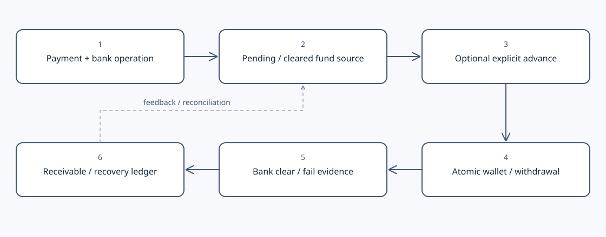

# W450. Venmo-Style P2P Payment Data Model

**Priority group:** Fifth 100 — specialized practice

**Category:** Payments, ledgers and billing

**Study position:** 450 of 547

[Group list](../FIFTH_100.md) · [All categories](../ALL_CATEGORIES.md) · [Chapter guide](../README.md)

<span class="practice-page"></span>

## Question

Venmo-Style P2P Payment Data Model

Design the data model for a Venmo-style P2P payments system, with table schemas that correctly support balance transfers and bank-funded transfers including the pending / clearing window and failure handling.

### Requirements

Design the database / table schema for a Venmo-like peer-to-peer payments product. The model must correctly support these flows:
1. A pays B from account balance, then B withdraws to their bank.
2. A pays B funded from bank, B withdraws before the bank transfer clears, and the bank transfer ultimately succeeds.
3. Same as (2), but the bank transfer ultimately fails.
The focus is the data model (tables, states, relationships) and guaranteeing correctness / consistency across the pending → cleared / failed lifecycle.
Notes
A staff-level round (two design / coding rounds back-to-back); the prompt is long and detailed.
Clarify early whether the interviewer wants a pure data model or also consistency / architecture—expectations have differed between rounds.
The crux is modeling pending bank transfers and reconciling balances when a transfer later succeeds or fails (don't let B spend unsettled funds incorrectly).

## Worked solution

### Schema separates source, clearing and credit exposure

The focus is a data model. Clarify whether unsettled bank-funded payments may be withdrawn. If funds must never be spent before clearing, flow2's early withdrawal is rejected/pending; no honest schema can both prohibit unsettled spending and allow it without another funding source. To **support** the stated early-withdrawal flows, choose an explicitly risk-approved platform advance backed by platform liquidity and a recoverable receivable. Keep this optional policy visible rather than relabel pending bank funds as cleared cash.

```text
User(id PK)
Wallet(id PK, user_id FK, currency, status)
BankInstrument(id PK, user_id, provider_token, verified_state)
Payment(id PK, sender_wallet, recipient_wallet, amount_minor, currency,
        funding_kind, funding_operation_id, state, client_key UNIQUE, request_hash)
BankOperation(id PK, payment_or_withdrawal_id, direction, instrument_id,
              provider_key UNIQUE, provider_id, state, amount_minor, currency)
Withdrawal(id PK, wallet_id, amount_minor, currency, state, bank_operation_id,
           client_key UNIQUE, request_hash)
Journal(id PK, business_operation_id, posting_kind, currency,
        UNIQUE(business_operation_id,posting_kind))
Entry(journal_id,line_no,ledger_account_id,signed_amount_minor,
      PRIMARY KEY(journal_id,line_no))
WalletProjection(wallet_id,currency,posted,pending,held,version,
                 PRIMARY KEY(wallet_id,currency))
Advance(id PK, payment_id, liable_user, amount_minor, outstanding,state,risk_decision)
OperationLink(parent_id,child_id,kind)   -- funding/payment/advance/withdrawal/reversal
ProviderInbox(provider,event_id UNIQUE,payload_hash)
Outbox(command_id PK, operation_id, provider_key, state, next_attempt_at)
```

Ledger accounts distinguish customer wallet liabilities, platform cash, bank-clearing receivables/payables, advance receivables and loss/recovery accounts. Every journal balances signed amounts to zero **within one currency**; all units are integers. Projections are updated in the same posting transaction and reconciled to entries. Pending/available/held are defined views, not independent editable money fields. Keys are appropriately scoped by customer/operation if not globally unique, and conflicting-body reuse is rejected.

### Walk all three required flows

1. **A balance pays B, then B withdraws.** Atomically reduce A's available wallet liability and increase B's, unique by payment_id, while checking A's funds under ordered account locks. B's withdrawal atomically reserves/debits its spendable balance and creates bank-payment outbox. Provider success clears the payable/cash; failure restores B through a linked compensation once. A repeated payment/withdrawal key never creates more value.
2. **A bank funds, B withdraws early, funding succeeds.** Create an inbound BankOperation PENDING and an explicitly pending B payment; it is not yet ordinary spendable cash. If risk approves an advance, post the advance-backed amount from platform-funded liquidity/receivable to B's available liability (moving/releasing the corresponding pending claim exactly once). Record which party legally/product-contractually owes recovery. B can now withdraw that **advance-backed** available amount, consuming real platform liquidity. When A's bank funding clears, apply the receipt to extinguish the linked advance/clearing receivable and finalize the payment; do **not** credit B a second time. If advances are disabled/denied, the early withdrawal waits until clearing instead.
3. **Same early withdrawal, funding fails.** The bank-out withdrawal already paid B cannot be erased or declared reversed by editing a row. The failed inbound operation resolves pending clearing evidence, but the outstanding advance receivable remains owed by the policy-defined liable party; open recovery/fraud restrictions or a loss posting if unrecoverable. Do not silently take funds from unrelated customers or make B's historical withdrawal disappear. If no advance was granted, B never withdrew unsettled money and the pending incoming payment is canceled/reversed once with no cash loss.

### Atomicity, uncertain results and checks

Each local state/posting/idempotency/outbox transition is transactional. External bank calls are async, idempotent by stable provider_key and return PROCESSING/UNKNOWN on timeout. Only confirmed results trigger success/failure postings; duplicated/reordered callbacks cannot double-credit or downgrade terminal success without a separate explicit return event. Late bank returns after initial settlement are new linked financial events, not edits rewriting clearance history. Withdrawal reservation versus incoming clearance is serialized through wallet version/funds locks, and risk approval/Advance has one unique identity to prevent duplicate advance credit.

Assume ten million payments/day at 500 bytes of journal/header/entries each: 5 GB/day logical before attempts/indexes/replicas. Partition by wallet/currency and use a transactional ledger boundary or explicit escrow protocol for cross-shard postings; the data model does not justify nonatomic balance writes. Reconcile all journal sums, wallet projections, bank status/statements and outstanding advances; restrict access to bank tokens/PII and audit manual recovery. Test all three flows with numeric USD 10 fixtures, lost provider ACKs, duplicate clearing, concurrent withdrawal, failed early-funded payment and late return. The crucial invariant is that every spendable dollar has a posted source—settled funds or an explicitly recorded credit advance—and every external failure leaves a visible, balanced obligation rather than vanished money.

<!-- architecture:W450:start -->


Read the numbered path as Payment + bank operation → Pending / cleared fund source → Optional explicit advance → Atomic wallet / withdrawal → Bank clear / fail evidence → Receivable / recovery ledger. The dashed return is the recovery/feedback path explained above, under the stated authorization, consistency and durability boundaries.
<!-- architecture:W450:end -->

[Batch behavior checks](../test_review_426_450.py). Design sizing/SLOs are explicit calculations and targets, not measured production claims.

### Further study

- [F165: Design idempotency for an order or booking API.](../17_distributed_systems_depth.md#f165)
- [F162: Design a durable work queue with retries and leases.](../17_distributed_systems_depth.md#f162)
