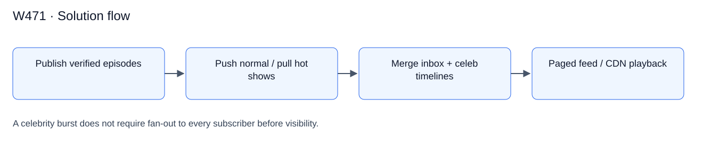

# W471. Design a podcast publishing and feed system

**Priority group:** Fifth 100 — specialized practice

**Category:** Search and retrieval systems

**Study position:** 471 of 547

[Group list](../FIFTH_100.md) · [All categories](../ALL_CATEGORIES.md) · [Chapter guide](../README.md)

<span class="practice-page"></span>

## Question

Design a podcast publishing platform in which creators release episodes and listeners follow shows and read a personalized feed of new episodes.

Product
1. A creator owns one or more shows and publishes episodes to them: audio file, title, description, optional scheduled release time. Some shows are imported from an external RSS feed instead of being uploaded.
2. A listener subscribes to shows, and opens a feed that lists new episodes from the subscribed shows, newest first, with an unread marker. The listener can then play an episode.
Assumptions to design against

State and use these figures (or adjust them and say so):

```text
1,000,000 shows, of which the 1,000 most popular ("celebrity" shows) hold 40% of all subscriptions.
50 million listeners with 1.5 billion subscriptions in total (30 per listener on average); 20 million daily active listeners opening the feed 5 times a day, with a 5x peak over the daily average.
```

A normal show releases about one episode a week, a celebrity show about three.
An episode is about 40 minutes of audio at 64 kbps; 100 million episodes are stored in total.
Goals
1. Feed read latency: p99 under 200 ms.
2. Publish-to-feed freshness: a new episode appears in subscribers' feeds within 60 seconds at p99, including during bursts when many celebrity shows release at once.
3. Cost: keep write amplification, feed storage and audio delivery cost in check.
Required in your answer
1. A capacity estimate: read and write rates, feed storage, audio storage and delivery bandwidth.
2. A walk through the design space: computing the feed when it is read, computing it when an episode is published, and a hybrid; with the numbers that decide between them.
3. Storage of episodes, metadata and audio, and delivery through a CDN.
4. Ingestion of external RSS feeds, if you include them.
5. Unread state and the subscribe and unsubscribe paths.
6. Failure handling: a failed or delayed fan-out, a CDN or origin outage, a bad upload, and duplicate or deleted episodes.
Output

A written design: components, data model, the read and write paths, the numbers, and the trade-offs you chose.

## Worked solution

### Use hybrid fan-out because celebrity bursts dominate writes

Assume each active listener opens five one-page feed sessions/day. 100M reads/day is 1,157/s average and 5,787/s peak. Normal shows publish 999K/7 ≈ 142,714 episodes/day; celebrities 1000×3/7 ≈ 429/day. The 600M celebrity subscriptions average 600K/show, while 900M normal subscriptions average 901/show. Push-everything creates about 128.6M normal plus 257.1M celebrity feed inserts/day ≈ 4,464/s average. But 1,000 celebrity releases together can require 600M inserts: 10M/s to finish within 60 seconds. Average write rate hides the freshness problem.

Pull-everything avoids inbox fan-out but reads up to 30 show timelines/user, roughly 174K timeline lookups/s at peak before batching/cache. Choose **push normal shows to bounded user inboxes; pull celebrity/hot shows at read time**. A typical listener follows 12 celebrity shows and 18 normal shows. The read service multi-gets cached recent celebrity timelines, merges them with the materialized inbox by `(release_time,episode_id)` and deduplicates IDs. Classify a show as pull when follower count/fan-out backlog crosses a threshold, not only by a static celebrity label. On delayed normal fan-out, a recent-timeline catch-up merge protects the 60-second freshness objective.

Store `Show(id,owner,rss_url,version)`, `Episode(id,show,external_guid,title,description,release_at,state,audio_manifest,version)`, `Subscription(user,show,created_at)`, `Inbox(user,release_time,episode_id)` and `Read(user,episode_id,read_at)`. Index reverse show → subscribers for push and `(show,release_time,id)` for pull. `POST /shows/{id}/uploads`, multipart complete, schedule/publish, `GET /feed?cursor`, subscribe/unsubscribe and mark-read APIs enforce creator/listener identity. Publish only verified/transcoded audio and metadata in a transaction with an outbox; scheduled release uses an idempotent due-job. A stable snapshot/search-after cursor defines page traversal; “new since” can be a separate refresh.

A 40-minute 64-kbps episode is 19.2 MB, so 100M stored episodes need 1.92 PB raw audio before replicas/transcodes. If 20M DAU each play one whole episode/day, delivery is 384 TB/day ≈ 4.44 GB/s average or 22.2 GB/s at 5× peak. Serve range-capable audio through CDN/origin replicas, not feed servers. A 500-entry inbox cap for 50M listeners at 24 packed bytes/entry is 600 GB raw before indexes/replicas; cap by history/time and regenerate from timelines when needed.

RSS polling stores ETag/Last-Modified, GUID/content hash and per-publisher backoff/cursor; repeated fetches do not republish unchanged episodes. Check feed ownership and treat remote URLs/media as untrusted fetches with network/size limits. Upload failures remain unpublished; duplicate completion keys return the existing episode. A deleted episode gets a tombstone checked in merge/cache and its audio access revoked under the CDN policy.

Subscribe acknowledges a durable edge and makes recent history eligible immediately through pull until backfill completes; unsubscribe filters the show at read even if inbox cleanup lags. Per-episode read state is authoritative; a simple “last opened feed” timestamp does not prove every episode was read. A failed fan-out resumes by chunk/checkpoint with unique `(user,episode)` inserts; track oldest lag and switch to pull before violating freshness. CDN failure uses alternate edge/origin capacity with bounded retries; origin failure does not hide metadata but playback reports unavailable. Benchmark p99 merge latency and burst freshness with hot shows, not just average throughput.

### Follow the diagram



Read left to right: Publish verified episodes → Push normal / pull hot shows → Merge inbox + celeb timelines → Paged feed / CDN playback. A celebrity burst does not require fan-out to every subscriber before visibility.

### Further study

- [F073: When should you combine lexical retrieval, embeddings and reranking?](../08_rag_and_agents.md#f073)
- [F170: Design a cache without serving incorrect data.](../17_distributed_systems_depth.md#f170)
