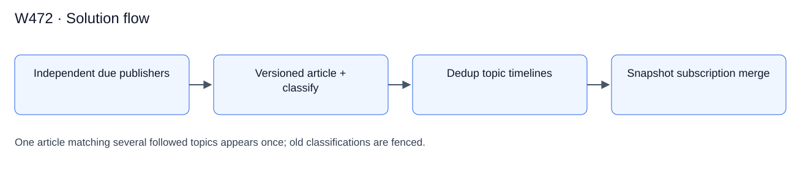

# W472. Design a Topic-Based News Aggregator

**Priority group:** Fifth 100 — specialized practice

**Category:** Search and retrieval systems

**Study position:** 472 of 547

[Group list](../FIFTH_100.md) · [All categories](../ALL_CATEGORIES.md) · [Chapter guide](../README.md)

## Question

Design a topic-based news aggregation service. It periodically retrieves articles from publisher APIs, assigns topics through an existing classifier, and gives each user a feed drawn from followed topics. The design must support tens of thousands of publishers. Each user may follow hundreds of topics.

What to design

Describe the APIs, data model, components, and end-to-end data flow for these inputs and outputs:

Publisher: a publisher id, API endpoint, retrieval credentials, and polling configuration.
Article: a publisher-scoped external id or canonical URL, title, body or summary, publication time, and source metadata.
Classification: one or more topic ids returned for an article by a black-box classifier. Designing or training the classifier is out of scope.
TopicSubscription: a user id and the set of topics that user follows, potentially hundreds per user.
Output: a queryable feed containing articles that match at least one topic followed by the requesting user.

### Rules

1. Poll publisher APIs periodically without allowing one slow, failing, or rate-limited publisher to block unrelated publishers.
2. Repeated retrieval of the same article, repeated classifier results, and retries at any internal boundary must not create duplicate article records or duplicate copies of an article in one user's feed.
3. An article assigned to several followed topics appears only once in that user's feed, while retaining all of its topic assignments.
4. Define and justify the feed ordering, pagination, freshness, and consistency contracts. The prompt does not prescribe a personalized ranking model.
5. Subscription changes must take effect according to a stated contract. Explain what happens to already-ingested articles when a user follows or unfollows a topic.
6. Preserve enough state to retry failed fetches and classifications, recover from partial failures, and determine why an article is missing or duplicated.

### Examples

Example 1: overlapping topic matches

An article is classified with the topics technology and business. A user follows both topics. The feed returns one copy of the article, not one copy per matching subscription. Its metadata can show both topic assignments.

Example 2: repeated publisher response

A publisher returns the same external article id on several polls. The service recognizes the stable article identity, avoids reclassifying unchanged content unnecessarily, and does not create additional feed entries.

Example 3: isolated publisher failure

One publisher times out while other publishers respond normally. Work for the failed publisher is retried with backoff, while successful responses continue through classification and become available to eligible readers.

### Constraints

There are tens of thousands of publisher APIs, with independent schedules, quotas, latency, and failure behavior.
A classifier can return one or more topics for each article and is treated as an external black box.
A user follows multiple topics and may follow hundreds of them.
Publisher APIs may return overlapping pages, late articles, corrected content, or repeated records.
Use the planning assumptions below as this problem's own terms. Derive capacity from them, and explain how the design scales when they change.
Cover ingestion scheduling, article identity, classification, subscription storage, feed generation, pagination, caching, partitioning, backpressure, observability, security, and recovery.
Planning assumptions
There are 50,000 publishers, each polled every 300 seconds on average. Each response returns 10 articles, and 10 percent of returned articles are new or changed.
The classifier assigns at most 5 topics per article and takes 2 seconds per call.
There are 20,000,000 registered users and 5,000,000 daily active users. A typical user follows 100 topics and opens 5 feed sessions per day. Peak traffic is 3 times the average. A feed page holds 50 items.
At least 99 percent of eligible operations meet each objective below. An eligible operation has healthy internal services and an external dependency that answers within its budget.
A poll job starts within 30 seconds of its due time. A changed article is feed-visible within 120 seconds of that same due time.
An acknowledged subscription change is visible to a new feed traversal within 5 seconds. A feed cursor stays valid for 15 minutes.

## Worked solution

### Poll independently; classify only changed content

Store `Publisher(id,endpoint,secret_ref,quota,next_due,etag,cursor,lease)`, `Article(id,publisher,external_id,canonical_url,content_hash,published_at,ingest_seq,version,state)`, `Classification(article,content_version,classifier_version,state,attempt,error)` and `ArticleTopic(article,topic,content_version)`. Unique `(publisher,external_id)` plus canonical-URL aliases defines identity; cross-publisher syndication dedup is an optional separate policy. Topic IDs are stable. `Subscription(user,topic)` plus a user subscription revision supports hundreds of follows.

A partitioned due-time scheduler leases poll jobs and sends them to bounded per-publisher worker pools. Use independent timeouts, quota budgets, circuit breakers and jittered backoff; one slow publisher never holds a global loop. Fetch pages with ETag/cursors, atomically upsert article versions and page progress, and emit classification jobs through an outbox. Content-hash equality skips redundant classification. Classifier calls are idempotent by `(article,content_version,classifier_version)`; a result atomically replaces the topic set for that version, so removed classifications do not persist and duplicate results do not add duplicate edges. An older result cannot overwrite newer content. Keep raw fetch/error provenance and a replayable job state/DLQ.

**Sizing from the given terms.**50K/300 ≈ 166.7 polls/s, 1,667 returned articles/s and 166.7 changed articles/s. A two-second classifier needs at least 334 concurrent calls at steady rate, plus headroom/retries; at five topics each, at most 833 new assignment edges/s. 25M feed sessions/day ≈ 289/s average, 868/s peak, assuming one 50-item page/session; multiply for deeper scrolling. 20M users×100 follows means 2B subscription edges. Global per-user fan-out can become enormous, so prefer topic timelines plus cached/pull merges for this read volume rather than pushing every article into every follower inbox.

`GET /feed?limit=50&cursor` reads the authenticated user's subscription revision, batch-fetches top items from followed topic timelines and performs a k-way merge by `(published_at DESC,article_id)`. Dedup by article ID while retaining all topic labels.100 topic calls/request would be 86.8K calls/s at peak; co-locate/batch timeline reads and cache hot topic heads/user results. Bound candidate refill work for heavy overlaps instead of taking 50/topic and assuming it always yields 50 distinct visible articles.

A new traversal pins subscription revision plus an ingestion/snapshot watermark. Its signed/server-side cursor stores global last sort key and enough continuation state, expires in 15 minutes and is query/user-bound. The watermark excludes later backdated articles; security deletions override snapshots. Acknowledged follow/unfollow becomes visible to a **new** traversal within 5 seconds via versioned cache invalidation/authoritative revision check. A follow includes retained already-ingested history; an unfollow filters immediately for new traversals. Existing cursors deliberately keep their pinned subscription set until expiry, except removed content; state this consistency contract.

For eligible dependencies, budget due → start<=30 s, fetch<=20 s, classification queue<=30 s, classifier ≈ 2 s, index publish<=10 s and margin 28 s to fit 120 s from due time. Measure queue age, not just processing speed. Failures beyond the external budget are surfaced separately and do not count as healthy-latency success. Backpressure limits publisher/classifier queues and prioritizes due eligible work; recovery replays content-version jobs, not duplicate article creation. Secrets stay in a vault, outbound endpoints are SSRF-restricted, and traces explain each article's fetch/classify/index status. Track poll lateness, changed ratio, classifier lag/error, duplicate suppression, topic/index version and subscription visibility; test all three prompt examples and a stale classification race.

### Follow the diagram

Read left to right: Independent due publishers → Versioned article + classify → Dedup topic timelines → Snapshot subscription merge. One article matching several followed topics appears once; old classifications are fenced.

### Further study

- [F073: When should you combine lexical retrieval, embeddings and reranking?](../08_rag_and_agents.md#f073)
- [F170: Design a cache without serving incorrect data.](../17_distributed_systems_depth.md#f170)
