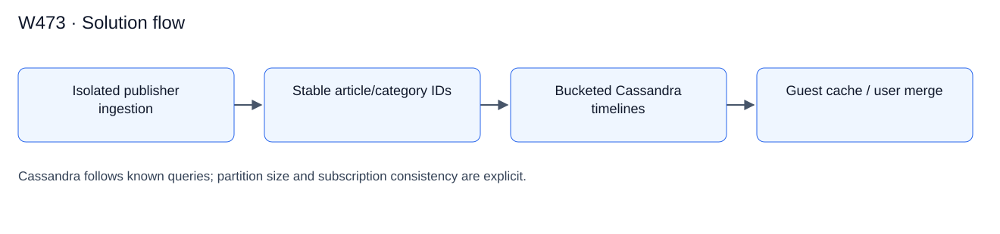

# W473. Designing a Scalable News Aggregator System with Cassandra

**Priority group:** Fifth 100 — specialized practice

**Category:** Search and retrieval systems

**Study position:** 473 of 547

[Group list](../FIFTH_100.md) · [All categories](../ALL_CATEGORIES.md) · [Chapter guide](../README.md)

## Question

System Design: News Aggregator

You are tasked with designing a news aggregator system, similar to Dog News. The system will aggregate news articles from multiple websites and display the most relevant articles to each user based on their subscriptions or certain categories on the platform.

System Requirements:

Provide a list of news for unregistered users.
Provide a list of news for registered users and allow users to subscribe to channels and categories.

Technical Requirements:

The system should be able to tolerate delays in terms of minutes.
The system must support one million monthly readers and a peak of one hundred thousand concurrent online readers.
Need to integrate five hundred thousand news stations, each releasing one hundred articles daily.

### Questions

Why choose Cassandra as the database?
Should each news category have its own unique ID?

## Worked solution

### Cassandra fits query-shaped timelines, not every part of the system

500K sources×100 articles/day means 50M articles/day ≈ 579/s average; at 2 KB normalized article metadata/text that is 100 GB/day before indexes/replicas, or 3 TB for 30 days. 100K concurrent readers is not a QPS: if each refreshes every 30 seconds, about 3,333 feed reads/s; if each scrolls every 5 seconds, 20K/s. State the behavioral assumption separately from 1M monthly readers and size peaks accordingly. Minutes of delay permits batched polling/classification/materialized timelines.

Use independent scheduled source workers with cursors/ETags, timeouts and backoff → deduplicated article log → existing category tagging/ranking → query tables. `Article(id,source,external_id,canonical_url,published_at,content_hash,version)` has stable identity; `Category(id,name,parent_id,status)` uses unique immutable IDs because names change, localize and can collide. `Subscription(user,kind,id)` supports source/channel and category follows. Guests read a cached public editorial/popularity feed; registered users merge recent category/source timelines, deduping articles present in several follows.

Cassandra-style tables such as `articles_by_topic_day((topic_id,day),published_at,article_id,...)` and `articles_by_source_day` distribute append-heavy writes, provide bounded time-ordered reads and replicate across failure domains. Bucket hot topics/day further when partition size/write rate requires it. Cassandra is justified by known access patterns, horizontal write throughput and available eventually consistent regional reads. It does not provide arbitrary joins, global ordering or free strong cross-partition transactions; primary identities/subscriptions may instead use a relational store or carefully chosen lightweight transactions. Replication/quorum settings must match the stated staleness/durability choice.

`GET /feed?cursor` pins a time/index watermark and merges a bounded set of followed timelines; use per-topic continuation/search-after and a 15-minute cursor policy, for example. Guest caches refresh every minute, while user cache keys include subscription version. Subscribe makes retained history eligible under a declared minutes-level freshness; unsubscribe filters reads even while derived caches expire. Retain raw ingestion for replay and write `(article,version)` idempotently, so repeated polls or worker retries cannot duplicate entries. Node/source outages preserve old feeds with timestamps, and lag/error metrics distinguish stale from empty. A giant unbounded category partition or “Cassandra because NoSQL scales” would miss the storage/query trade-off.

### Follow the diagram

Read left to right: Isolated publisher ingestion → Stable article/category IDs → Bucketed Cassandra timelines → Guest cache / user merge. Cassandra follows known queries; partition size and subscription consistency are explicit.

### Further study

- [F073: When should you combine lexical retrieval, embeddings and reranking?](../08_rag_and_agents.md#f073)
- [F170: Design a cache without serving incorrect data.](../17_distributed_systems_depth.md#f170)
