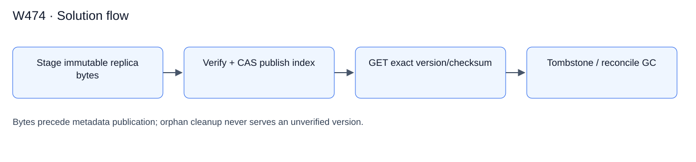

# W474. Design a Distributed Blob Cache With a Separate Metadata Index

**Priority group:** Fifth 100 — specialized practice

**Category:** Storage, indexes and caching

**Study position:** 474 of 547

[Group list](../FIFTH_100.md) · [All categories](../ALL_CATEGORIES.md) · [Chapter guide](../README.md)

## Question

Large binary objects such as images or model files are slow to fetch from where they are stored, so a shared cache keeps copies close to the clients that read them. Design such a cache in which the small lookup record of each object lives in a database-like index and the object bytes live on a separate tier of cache nodes. The two stores must not disagree in a way that serves wrong data, even when a node crashes partway through a write.

### Requirements

1. Cache operations: clients can put an object under a key, get it by key, delete it, and optionally set a time to live. Reads are much more frequent than writes.
2. Two kinds of state: the index holds one small metadata record per object (key, size, checksum, version, expiry, and which cache nodes hold the bytes). The cache tier holds the object bytes. The two stores have different consistency and durability needs, and the design must say what each one guarantees.
3. Lookup path: a get first consults the index, then fetches the bytes from a cache node. A key that is not in the index is a miss.
4. Capacity management: when the cache tier is full, objects are evicted. The index must never keep pointing at bytes that are gone for long, and the cache tier must not keep bytes that the index no longer knows about.
5. Availability: the loss of one cache node or one index replica must not take the service down.
Inputs and scale (state your own assumptions)
1. Number of objects, average and maximum object size, and the read and write request rates.
2. A target hit ratio, and the latency target for a hit and for a miss.
3. Whether a stale read after an overwrite or a delete is acceptable, and for how long.
Deliverables
1. The architecture: components, the data stored in each, and the request path for put, get and delete.
2. The index schema and how the index is partitioned and replicated.
3. How objects are placed on cache nodes, and what happens when nodes are added or removed.
4. The write ordering between the cache tier and the index, so that a crash in the middle never serves wrong data.
5. The eviction and expiry design, including cleanup of orphaned bytes and dangling index entries.
6. Back-of-envelope sizing with every assumption stated, plus failure behaviour and what you would monitor.
Follow-ups
Follow-up 1: why the metadata lives in a database

Why keep metadata in a database instead of in the cache nodes?

Follow-up 2: a crash between the bytes and the index record

What happens if a node crashes between writing the bytes and writing the index record?

Follow-up 3: one popular key overloading a node

How do you stop a popular key from overloading a single node?

Follow-up 4: a stampede when a hot key expires

How do you avoid a stampede of misses when a hot key expires?

## Worked solution

### Publish metadata only after immutable bytes are verified

Assume 10M objects averaging 1 MB (max 1 GB), 10K reads/s and 100 writes/s, 80% hit target, regional hit p99<20 ms and origin miss p99<300 ms for typical 1 MB objects. Raw bytes are 10 TB; two cache replicas require 20 TB plus headroom, while 200-byte metadata rows are 2 GB before indexes/replicas. A 1 GB hit cannot satisfy the same end-to-end transfer latency as 1 MB; quote metadata/first-byte and bandwidth separately. Choose strong metadata read-after-overwrite/delete, while in-flight readers may finish the version they already authorized.

Index schema: `Object(key,version,size,checksum,expires_at,state,locations,placement_epoch)` partitioned by hash(key), replicated by consensus within a region. Cache bytes use immutable `(key,version,checksum)` names on SSD/RAM nodes with per-node manifests and leases. `PUT /objects/{key}` streams to temporary replicas, verifies length/checksum, finalizes immutable bytes, then CAS-publishes the index version/locations. A retry uses a request key/version. Crash before index publication leaves orphan bytes for grace-period GC; crash after publication may cause a replica miss, but checksums/version prevent wrong bytes from being returned. Do not overwrite bytes in place before changing the index.

GET first reads the current live/unexpired metadata, chooses a healthy replica and requests the exact version/checksum. A miss/bad checksum tries another replica or origin and repairs metadata; no fallback to an unversioned stale object. DELETE writes a metadata tombstone/increments version before asynchronous byte removal, so new reads cannot discover deleted bytes. Origin fill uses an admission-controlled single-flight lease by key/version, TTL jitter and optional stale-while-revalidate only if the chosen staleness contract permits it; here stale overwritten/deleted data is not allowed.

Place replicas by rendezvous/consistent hashing with failure-domain separation; membership epochs coordinate moving replicas when nodes change. Existing metadata remains authoritative during gradual copying and CAS location updates. Hot objects gain read replicas/edge caching and load-aware routing instead of hashing all traffic to one node. Never split a mutable object's bytes inconsistently across versions.

For eviction, the node marks a replica evicting and conditionally removes its `(node,version)` location before freeing bytes; index failure delays eviction or causes bounded misses repaired by lease expiry. Periodic node/index inventory reconciliation removes dangling locations and orphan bytes after a grace period, checking generation so it cannot delete a newly published version. Index TTL hides expired objects immediately even if physical cleanup lags. Loss of one cache node/metadata replica is served by another; loss of metadata quorum fails/misses safely instead of inventing a location. Monitor hit bytes/requests, checksum mismatches, dangling/orphan age, per-node capacity, repair/eviction lag, hot-key load and origin stampedes. A database-like index provides atomic version publication and searchable lifecycle state independent of replaceable cache nodes.

### Follow the diagram

Read left to right: Stage immutable replica bytes → Verify + CAS publish index → GET exact version/checksum → Tombstone / reconcile GC. Bytes precede metadata publication; orphan cleanup never serves an unverified version.

### Further study

- [F161: Explain CAP during a real network partition.](../17_distributed_systems_depth.md#f161)
- [F162: Design a durable work queue with retries and leases.](../17_distributed_systems_depth.md#f162)
- [F170: Design a cache without serving incorrect data.](../17_distributed_systems_depth.md#f170)
