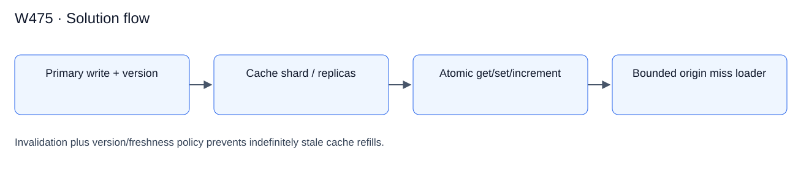

# W475. Design a High-Throughput Distributed Cache

**Priority group:** Fifth 100 — specialized practice

**Category:** Storage, indexes and caching

**Study position:** 475 of 547

[Group list](../FIFTH_100.md) · [All categories](../ALL_CATEGORIES.md) · [Chapter guide](../README.md)

## Question

Second system-design round in the Salesforce LMTS onsite — distinct from the service-design round earlier in the loop. Design an in-memory caching layer (Redis-class) that fronts a primary database, with explicit attention to eviction, consistency, hot keys, and sharding under high concurrent load.

### Requirements

Workload: read-heavy, very-high-throughput cache layer fronting an RDBMS / NoSQL store. Tens to hundreds of K ops/sec.
Operations: get(key), set(key, value, ttl?), delete(key), optional mget / mset for batching.
Eviction: bounded memory per node; admin chooses policy.
Consistency: cache must not return arbitrarily stale data on writes to the primary store.
Multi-node: scale horizontally; tolerate a node loss without losing the whole cache.
Concurrent reads and writes from many clients; no read-modify-write should corrupt counters.

## Worked solution

### A cache outage must not become a database outage

Assume 200K peak operations/s, 95% reads, 10M hot keys at 1 KB/value and 100-byte key/metadata overhead. Logical hot state is about 11 GB; with 1.5× allocator/headroom and two replicas, plan about 33 GB before extra indexes. Shard via rendezvous/consistent hashing with virtual partitions and replicate across failure domains. Benchmark per-shard throughput and network for hot keys; average evenly divided QPS is not a capacity proof.

GET routes to the owner, checks expiry, updates approximate LRU/LFU recency and returns value/version. MGET groups keys by shard in parallel and restores original order. SET/DELETE and atomic INCR/CAS run in a shard critical section/event loop; a client-side get+set does not make a counter safe. Admin policy selects LRU, LFU or TTL-aware eviction under a byte budget; approximate sampling reduces per-hit lock/list overhead. Large values have item/byte limits and optional bypass.

For a cache-aside database update, commit the authoritative row with version and an outbox invalidation, then evict/update cache. A concurrent stale read can refill after invalidation, so require version-aware conditional fills plus an invalidation watermark/short TTL; merely “delete after write” is not a proof of bounded staleness. Choose, for example, read-your-writes through a minimum-version token and ordinary reads bounded by a five-second TTL/propagation lease. Strong reads must route to authority if cache freshness is unknown. Do not claim strong consistency from async invalidation alone.

Protect origin on misses with per-key single-flight, jittered TTLs, bounded loader concurrency, negative-cache TTLs and retry budgets. A hot key can be replicated/read-cached with versioned invalidation; blindly adding shards does not split one key's load. Node loss uses replicas or controlled cache misses; failed membership epochs prevent split ownership for mutable counters, or counters move to an authoritative durable service. Cache persistence can reduce cold starts but does not replace the primary database.

Control-plane config is versioned and separate from data traffic. Warm hot keys gradually during rebalance, throttle migrations/repairs and prevent an entire fleet expiring simultaneously. Monitor p99, hits by bytes, eviction, fragmentation, key cardinality, load amplification and primary database saturation. Serve a declared stale value only for endpoints that permit it; otherwise shed with a clear error when the origin budget is exhausted. Tens/hundreds ofK ops/s is a load-test target, not justification for unsafely dropping atomicity or unlimited queues.

### Follow the diagram

Read left to right: Primary write + version → Cache shard / replicas → Atomic get/set/increment → Bounded origin miss loader. Invalidation plus version/freshness policy prevents indefinitely stale cache refills.

### Further study

- [F161: Explain CAP during a real network partition.](../17_distributed_systems_depth.md#f161)
- [F162: Design a durable work queue with retries and leases.](../17_distributed_systems_depth.md#f162)
- [F170: Design a cache without serving incorrect data.](../17_distributed_systems_depth.md#f170)
