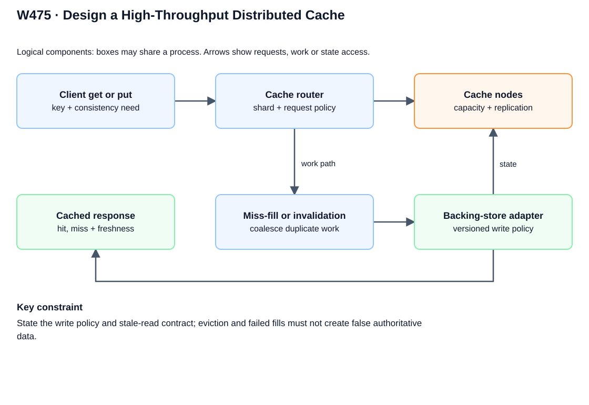

# W475. Design a High-Throughput Distributed Cache

**Priority group:** Fifth 100 — specialized practice

**Category:** Storage, indexes and caching

**Study position:** 475 of 547

[Group list](../FIFTH_100.md) · [All categories](../ALL_CATEGORIES.md) · [Chapter guide](../README.md)

## Question

Second system-design round in the Salesforce LMTS onsite — distinct from the service-design round earlier in the loop. Design an in-memory caching layer (Redis-class) that fronts a primary database, with explicit attention to eviction, consistency, hot keys, and sharding under high concurrent load.

### Requirements

Workload: read-heavy, very-high-throughput cache layer fronting an RDBMS / NoSQL store. Tens to hundreds of K ops/sec.
Operations: get(key), set(key, value, ttl?), delete(key), optional mget / mset for batching.
Eviction: bounded memory per node; admin chooses policy.
Consistency: cache must not return arbitrarily stale data on writes to the primary store.
Multi-node: scale horizontally; tolerate a node loss without losing the whole cache.
Concurrent reads and writes from many clients; no read-modify-write should corrupt counters.

## Worked solution

<!-- architecture:W475:start -->
### Architecture and request flow

[Open the diagram at full size](../diagrams/W475_architecture.svg). This is a baseline component diagram for this question. The boxes describe responsibilities; they do not require a separate microservice for every box.

- **Request and state:** Client get or put — key + consistency need → Cache router — shard + request policy. That component consults or updates **Cache nodes — capacity + replication** under the required access and consistency rules.
- **Work and result:** the work path passes through **Miss-fill or invalidation — coalesce duplicate work** and **Backing-store adapter — versioned write policy**, producing **Cached response — hit, miss + freshness**. Bound waiting and retries where a slow dependency can stall this path.
- **Correctness point:** State the write policy and stale-read contract; eviction and failed fills must not create false authoritative data.

When explaining the drawing, trace one normal request first, then a duplicate request, an unavailable dependency and recovery from saved state. If the question requires stricter guarantees or a different scope, state the change explicitly rather than treating this baseline as the only possible design.
<!-- architecture:W475:end -->

### Solution outline

1. State the consistency and durability contract for get/put/delete, version conflicts and expiration. Partition keys for scale, but use a replicated log/leader or quorum protocol when stronger consistency is required.
2. On a durable write, append an ordered WAL record and meet the promised flush/replication condition before acknowledgment. Apply records to memory and periodically create checkpoints or sorted on-disk segments.
3. Recovery loads a valid checkpoint and replays committed WAL records exactly once by sequence number. For filesystem spill, maintain an index to on-disk values and a clear eviction policy.
4. A separate metadata index needs atomic versioned publication so it never points to absent data. Test crashes between each persistence step, stale readers, tombstones and shard rebalancing.

### Understand why the approach works

#### Separate the authoritative record from an acceleration layer

State whether losing a cache entry is acceptable and whether a successful write must survive a crash. If durability is promised, define the exact write-ahead-log and flush/replication boundary. Memory state can be rebuilt only from information that was actually committed.

For large objects, upload and verify chunks before atomically publishing a manifest. A manifest is a versioned list of complete referenced objects, not a record that merely says an upload started. Keep incomplete/unreferenced uploads separate for later cleanup. Deduplication by content hash does not grant a caller permission to another tenant's object.

An index has its own consistency contract with the base data. Versioned publication can stop a metadata row from pointing to an absent blob; recovery and reconciliation detect remaining gaps. For a KV store, replay WAL entries after a valid checkpoint and preserve tombstones until safe compaction.

Walk through a crash before data write, after data write but before index publication, and after success acknowledgment. Then explain eviction, replication loss and stale reads. Naming a storage engine does not answer these questions, and sharding alone neither provides durability nor makes conflicting writes linearizable.

### Work a small example

A cache hit can be served from memory, but after a crash an acknowledged durable put must reappear from checkpoint plus WAL. A non-durable cache should explicitly permit its loss.

### Edge cases and common mistakes

Claiming strong consistency from sharding alone, or deleting WAL segments before a durable checkpoint covers them.

### Check your reasoning on related cases

**Explain CAP during a real network partition.** A ledger and a reaction counter can reasonably choose different policies because the consequences of conflicts differ.

Why mention PACELC? It highlights latency-versus-consistency choices even when no partition exists.

**Design a durable work queue with retries and leases.** If a worker completes a side effect and crashes before acknowledgment, the task can be delivered again.

How do fencing tokens help? They allow downstream systems to reject writes from an expired owner.

**Design a cache without serving incorrect data.** Two identical question strings from users with different document permissions must not automatically share a retrieved-answer cache entry.

Why can invalidation be preferable to TTL alone? Critical updates may need to take effect sooner than the ordinary expiry window.

### Further study

- [F161: Explain CAP during a real network partition.](../17_distributed_systems_depth.md#f161)
- [F162: Design a durable work queue with retries and leases.](../17_distributed_systems_depth.md#f162)
- [F170: Design a cache without serving incorrect data.](../17_distributed_systems_depth.md#f170)

### Explain it back

Close the answer. State the main invariant or equation, work the example with changed inputs, and explain which assumption would make your solution fail. For a design, walk through a retry or partial failure; for a derivative, check a shape and a finite-difference case.
