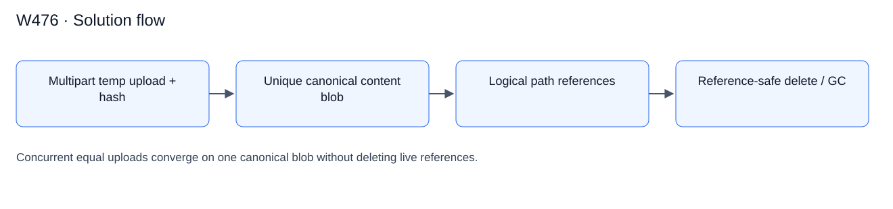

# W476. Design an S3-Style Blob Store with Deduplication

**Priority group:** Fifth 100 — specialized practice

**Category:** Storage, indexes and caching

**Study position:** 476 of 547

[Group list](../FIFTH_100.md) · [All categories](../ALL_CATEGORIES.md) · [Chapter guide](../README.md)

## Question

Design an S3-like blob storage system, scoped down from full S3 and focused on avoiding duplicate file storage to optimize cost.

### Requirements

Client uploads files of arbitrary size; system returns a stable object key.
Storage cost is the optimization target: identical content must be stored only once, regardless of how many logical paths reference it.
Read and delete must keep working on logical paths; the dedup layer is invisible to the client.
Full S3 features (versioning, fine-grained ACLs, regional replication) are out of scope.

## Worked solution

### Logical paths point to content-addressed immutable blobs

Expose multipart `BeginUpload(path)`, `UploadPart(upload_id,part_no,checksum)`, `Complete(upload_id) -> object_key`, GET and DELETE by logical path/key. Files of arbitrary size stream in bounded parts; no server buffers the whole file. Store `LogicalObject(path,id,blob_hash,size,state)`, `Upload(id,parts,state)` and `Blob(hash,size,locations,state,reference_metadata)`. Full-file dedup uses a cryptographic content hash plus size/checksum verification; chunk-level dedup can save edited-file storage but adds a manifest and reference/GC complexity.

Write parts to temporary immutable storage while computing the full hash, verify all checksums/size and atomically create-or-find the canonical blob record. Concurrent equal uploads race on a unique hash identity; losers reference the winner and discard temporary bytes. Compare/verify content metadata and define collision handling instead of assuming a truncated hash proves byte identity. A logical path becomes visible only after canonical bytes are durable and a metadata transaction links it. Crash before linking leaves an orphan eligible for delayed GC, not a corrupt visible path.

GET resolves the logical pointer and streams exact immutable bytes. DELETE removes the logical reference transactionally; it must not delete shared bytes while another path still references them. A simple transactionally maintained reference count works at modest scale, but crash/retry errors require reconciliation; at larger scale use a mark/sweep over immutable manifests with grace epochs. GC and a new reference to a zero-count blob must serialize on blob state so GC cannot delete bytes immediately reused by a concurrent upload.

Assume 1M uploads/day averaging 10 MB, 30% duplicate bytes: gross 10 TB/day becomes about 7 TB/day unique before durability replication, plus logical manifests. These are explicit planning assumptions, not measured dedup ratios. Content hashes are not access capabilities: even with fine ACLs out of scope, authenticate logical access and avoid revealing another user's upload through a public “hash exists” oracle. Keep lifecycle/admission quotas and checksum repair; dedup reduces physical bytes but not necessarily hashing, upload bandwidth or metadata operations. Stable logical keys survive dedup internals, and deleting one path never breaks a different one.

### Follow the diagram

Read left to right: Multipart temp upload + hash → Unique canonical content blob → Logical path references → Reference-safe delete / GC. Concurrent equal uploads converge on one canonical blob without deleting live references.

### Further study

- [F169: Explain backpressure in a multi-stage data pipeline.](../17_distributed_systems_depth.md#f169)
- [F170: Design a cache without serving incorrect data.](../17_distributed_systems_depth.md#f170)
