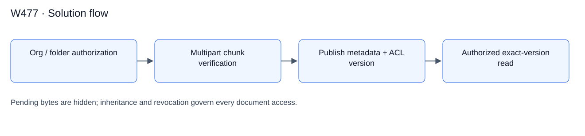

# W477. Design Google Drive / Data Room

**Priority group:** Fifth 100 — specialized practice

**Category:** Storage, indexes and caching

**Study position:** 477 of 547

[Group list](../FIFTH_100.md) · [All categories](../ALL_CATEGORIES.md) · [Chapter guide](../README.md)

## Question

Design Google Drive / Data Room

Design Google Drive / Harvey's Data Room: file-and-folder storage with upload/download, large-file handling, and a heavy focus on access control (organization-level ACLs). Default content is PDFs; multi-device real-time sync is generally out of scope.

### Requirements

Design a document-storage product equivalent to Google Drive — it maps directly onto Harvey's own Data Room / Vault (default content is PDF documents).
Core functional requirements candidates get pushed on:
File and folder hierarchy (create / move / organize folders).
Upload and download flows (interviewers probe the upload path in detail).
Access control — the most-emphasized axis. Model organization-level ACLs / permission management (who can see which documents and folders); some loops spend the whole round here.
Scaling — sharding / throughput for many users and documents.
Storage decomposition: separate a metadata store (paths, names, ownership, permissions) from a blob store (file contents); be explicit about both.
Large-file handling: split large files into chunks for upload (e.g. multipart to S3). Follow-ups: how do you handle very large files, and how do you verify each uploaded chunk is the intended content (integrity)? For chunked storage, add a metadata-store DB where chunks reference their file via a file-id foreign key.
Multi-device real-time syncing is generally not required — emphasis is on access control, upload/download, and scaling, not collaborative sync.
Notes
Clarify scope early: some interviewers steer hard toward access control, others toward scaling — ask which axis to optimize. One candidate hit an interviewer who answered "yes, support that too" to every feature ask, so timebox the clarification phase.
Grounding the design in Harvey's actual product (a document vault with org-level permissions over PDFs) helps frame requirements.

## Worked solution

### Put organization access control before PDF convenience

Scope to an organization document vault with folders, PDF upload/download and organization/role/user grants; real-time device sync is out of scope. Store `Organization`, `Membership(org,user,role)`, `Node(id,org,parent_id,name,kind,version,deleted)`, `FileVersion(file_id,version,blob_manifest,size,checksum,state)`, `Chunk(file_id,file_version,part_no,blob_key,checksum,size)` and `Grant(node,principal,permission,version)`. Unique `(org,parent_id,normalized_name)` prevents sibling collisions. Blob storage contains immutable bytes; metadata owns hierarchy, active version and permissions.

APIs create/list/move folders, begin/complete multipart upload, request download, grant/revoke and inspect audit. Every operation authenticates org membership and evaluates explicit inheritance/permission precedence; choose inherited allow with owner/write/read, no implicit cross-org sharing, and state whether explicit deny exists. Moving a folder must check write permissions on source/target, prevent cycles and recompute inherited access by ancestry/version. A cached effective ACL requires dependency invalidation or a freshness fence; a stale homepage list never authorizes download.

Upload flow: authorize parent → create pending file/version/upload session → issue narrow signed part URLs → client sends concurrent parts → validate per-part and full manifest checksum/size → malware/PDF safety processing → transaction publish active version+audit/outbox. Merely trusting an ETag as a cryptographic checksum is unsafe. A failed/partial upload remains hidden and expires for cleanup. Stable upload completion keys prevent duplicate logical files. Large files use bounded chunk manifests and resumable part status; `Chunk.file_id` is an explicit foreign key to its file/version.

Download checks current ACL, then issues a short-lived exact-version signed URL or streams through an authorization-aware proxy. Revocation cannot erase already downloaded copies; strict immediate revocation of future downloads requires the proxy or sufficiently short URL leases with a stated bound. Encrypted provider/blob credentials stay server-side; audit who read/shared/moved/deleted sensitive documents.

Assume 10M PDFs averaging 5 MB ≈ 50 TB raw, 100M metadata/grant rows at 200 bytes ≈ 20 GB logical before indexes/replicas. Shard by organization for local ACL/hierarchy transactions, with special handling for very large organizations; object bytes scale separately through multipart/CDN. Regionally replicated metadata leaders preserve changes across server failure. Use optimistic version checks for conflicting rename/move/permission edits rather than last-writer-wins. Retain tombstones, process deletes asynchronously and reconcile orphan blobs. Benchmark read/ACL tail latency under deep folders and large groups; many users is not a reason to bypass authorization.

### Follow the diagram

Read left to right: Org / folder authorization → Multipart chunk verification → Publish metadata + ACL version → Authorized exact-version read. Pending bytes are hidden; inheritance and revocation govern every document access.

### Further study

- [F169: Explain backpressure in a multi-stage data pipeline.](../17_distributed_systems_depth.md#f169)
- [F170: Design a cache without serving incorrect data.](../17_distributed_systems_depth.md#f170)
