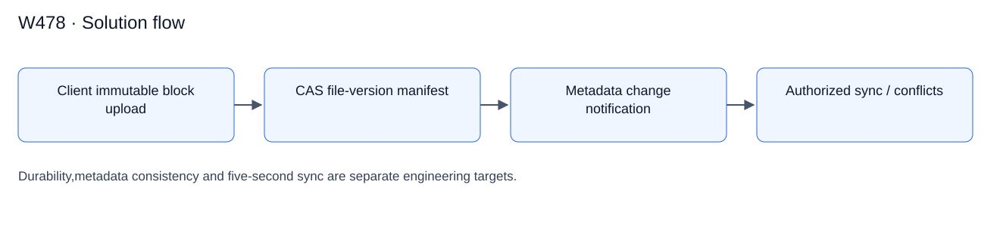

# W478. Design Object Storage / File Sync (Dropbox / S3)

**Priority group:** Fifth 100 — specialized practice

**Category:** Storage, indexes and caching

**Study position:** 478 of 547

[Group list](../FIFTH_100.md) · [All categories](../ALL_CATEGORIES.md) · [Chapter guide](../README.md)

## Question

Design a Dropbox-style file sync / S3-style object storage system. Cover upload, download, sync, share, and versioning.

Non-functional targets:

~11 nines durability; ~5-second sync latency.
PB/day ingest; metadata request rate driven by idle clients, byte throughput driven by real edits.

Address the data model, upload/download/sync APIs, conflict resolution, sharing, block-level storage, and per-layer scaling tradeoffs.

## Worked solution

### Immutable blocks plus a versioned metadata change log

Use `File(file_id,owner,parent,name,head_version)`, immutable `FileVersion(id,base_version,block_manifest,size,checksum)`, content-addressed `Block(hash,length,locations)` and `Share(file_id,principal,permission)`. `POST /uploads` negotiates missing block hashes, clients upload verified chunks/multipart, then `POST /files/{id}/commit` CAS-checks base_version before publishing the manifest. GET metadata/download returns exact version and authorized block URLs; `GET /changes?cursor` or long-poll/push announces metadata changes. Idle clients wait for changes rather than poll every file.

If two offline devices edit the same base, keep both versions and create an explicit conflict copy/branch or ask the user; silent last-writer-wins loses work. Rename/move uses stable file IDs, not content hashes as user-visible identity. Repeated upload/commit keys are idempotent; an old notification cannot move head_version backward. Shared users see versions only after ACL checks, with revocation/tombstone semantics and URL lifetime stated. Deleted or inaccessible blocks must not remain downloadable merely because a hash is known.

PB/day ingest is about 11.6 GB/s average decimal, before replicas/erasure coding and peak headroom. At 4 MB average blocks, that's roughly 2,900 block writes/s but many small files can drive far higher metadata QPS. Assume 100M devices each polling every 30 s would create 3.33M metadata polls/s even when idle; push/long-poll with batched change cursors is therefore a first-class scaling requirement. A 5-second sync budget might allocate 1 s upload/commit visibility, 1 s event propagation and 3 s client scheduling/network, while full PB transfer time is constrained separately by bytes/bandwidth.

Eleven-nines annual durability is an engineering objective requiring measured failure models, independent failure domains, checksums, scrubbing, repair budgets, erasure coding/replication and disaster recovery. It is not obtained by saying “three copies,” especially under correlated deletion/software failure. A complete manifest publishes only after required block durability; crash leaves staged orphan blocks for grace-period GC. References/GC epochs prevent deleting blocks still used by an older version.

Partition metadata by tenant/file hierarchy with a strongly replicated owner for commits, and block placement by hash across storage nodes. Cache immutable blocks/CDN globally while authorization and mutable heads have tighter consistency. Change-log cursors retain enough history for offline devices; if expired, return a rescan requirement rather than silently skip edits. Monitor commit/sync lag, conflicts, orphan/reference health, corruption/repair, regional replication and bandwidth. Explicitly separate metadata availability, object durability and client sync latency; none implies the others.

### Follow the diagram

Read left to right: Client immutable block upload → CAS file-version manifest → Metadata change notification → Authorized sync / conflicts. Durability, metadata consistency and five-second sync are separate engineering targets.

### Further study

- [F169: Explain backpressure in a multi-stage data pipeline.](../17_distributed_systems_depth.md#f169)
- [F170: Design a cache without serving incorrect data.](../17_distributed_systems_depth.md#f170)
