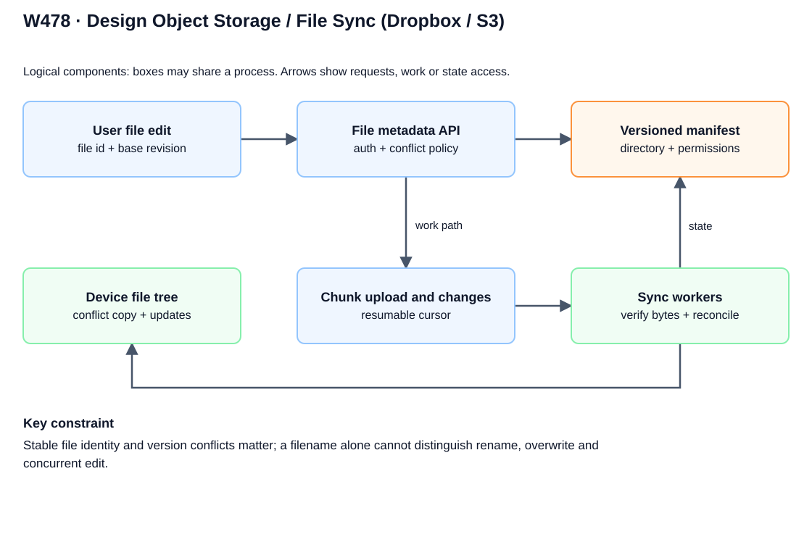

# W478. Design Object Storage / File Sync (Dropbox / S3)

**Priority group:** Fifth 100 — specialized practice

**Category:** Storage, indexes and caching

**Study position:** 478 of 547

[Group list](../FIFTH_100.md) · [All categories](../ALL_CATEGORIES.md) · [Chapter guide](../README.md)

## Question

Design a Dropbox-style file sync / S3-style object storage system. Cover upload, download, sync, share, and versioning.

Non-functional targets:

~11 nines durability; ~5-second sync latency.
PB/day ingest; metadata request rate driven by idle clients, byte throughput driven by real edits.

Address the data model, upload/download/sync APIs, conflict resolution, sharing, block-level storage, and per-layer scaling tradeoffs.

## Worked solution

<!-- architecture:W478:start -->
### Architecture and request flow

[Open the diagram at full size](../diagrams/W478_architecture.svg). This is a baseline component diagram for this question. The boxes describe responsibilities; they do not require a separate microservice for every box.

- **Request and state:** User file edit — file id + base revision → File metadata API — auth + conflict policy. That component consults or updates **Versioned manifest — directory + permissions** under the required access and consistency rules.
- **Work and result:** the work path passes through **Chunk upload and changes — resumable cursor** and **Sync workers — verify bytes + reconcile**, producing **Device file tree — conflict copy + updates**. Bound waiting and retries where a slow dependency can stall this path.
- **Correctness point:** Stable file identity and version conflicts matter; a filename alone cannot distinguish rename, overwrite and concurrent edit.

When explaining the drawing, trace one normal request first, then a duplicate request, an unavailable dependency and recovery from saved state. If the question requires stricter guarantees or a different scope, state the change explicitly rather than treating this baseline as the only possible design.
<!-- architecture:W478:end -->

### Solution outline

1. Store file contents as immutable chunks or objects identified by strong checksums; keep namespace and version metadata separately. A manifest names exactly the committed chunks of one file version.
2. Upload chunks first, verify size/checksum, then atomically publish the manifest. Interrupted uploads stay unreferenced and can be garbage-collected after a safety horizon.
3. Replicate or erasure-code durable data; separate durability acknowledgments from cache availability. Sync clients compare versions and resolve concurrent edits under an explicit policy.
4. Authorize reads and sharing through metadata, support tombstones and retention, and reconcile missing/corrupt chunks. Deduplication must not expose whether another tenant owns a private file.

### Understand why the approach works

#### Separate the authoritative record from an acceleration layer

State whether losing a cache entry is acceptable and whether a successful write must survive a crash. If durability is promised, define the exact write-ahead-log and flush/replication boundary. Memory state can be rebuilt only from information that was actually committed.

For large objects, upload and verify chunks before atomically publishing a manifest. A manifest is a versioned list of complete referenced objects, not a record that merely says an upload started. Keep incomplete/unreferenced uploads separate for later cleanup. Deduplication by content hash does not grant a caller permission to another tenant's object.

An index has its own consistency contract with the base data. Versioned publication can stop a metadata row from pointing to an absent blob; recovery and reconciliation detect remaining gaps. For a KV store, replay WAL entries after a valid checkpoint and preserve tombstones until safe compaction.

Walk through a crash before data write, after data write but before index publication, and after success acknowledgment. Then explain eviction, replication loss and stale reads. Naming a storage engine does not answer these questions, and sharding alone neither provides durability nor makes conflicting writes linearizable.

### Work a small example

A backup is restorable only when its durable manifest and every referenced object are readable; successfully uploading 99 of 100 chunks is not a completed backup.

### Edge cases and common mistakes

Publishing a file before all chunks are committed, or using a hash match alone as authorization to retrieve another user’s content.

### Check your reasoning on related cases

**Explain backpressure in a multi-stage data pipeline.** A producer at 1000 items/s feeding a sustained 800 items/s consumer adds 200 queued items every second.

What should an overload response include? A clear retry policy or status, rather than silent loss or indefinite waiting.

**Design a cache without serving incorrect data.** Two identical question strings from users with different document permissions must not automatically share a retrieved-answer cache entry.

Why can invalidation be preferable to TTL alone? Critical updates may need to take effect sooner than the ordinary expiry window.

### Further study

- [F169: Explain backpressure in a multi-stage data pipeline.](../17_distributed_systems_depth.md#f169)
- [F170: Design a cache without serving incorrect data.](../17_distributed_systems_depth.md#f170)

### Explain it back

Close the answer. State the main invariant or equation, work the example with changed inputs, and explain which assumption would make your solution fail. For a design, walk through a retry or partial failure; for a derivative, check a shape and a finite-difference case.
