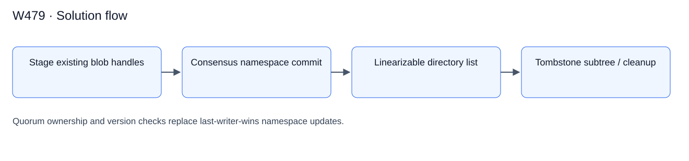

# W479. Distributed File System Metadata Layer with Strong Consistency

**Priority group:** Fifth 100 — specialized practice

**Category:** Storage, indexes and caching

**Study position:** 479 of 547

[Group list](../FIFTH_100.md) · [All categories](../ALL_CATEGORIES.md) · [Chapter guide](../README.md)

## Question

Design the metadata layer of a distributed file system supporting: create-directory, list a directory, put (upload) a file, get (download) a file, delete files and directories, and a recursive folder hierarchy.

Defining requirement — strong consistency: a list must immediately reflect prior puts (unlike eventually-consistent S3). 'Last-writer-wins' is not acceptable. The system must also scale to very large files and stay available under server failures.

Blob storage (like S3) is assumed to already exist to hold the actual file bytes — do not design the byte-storage layer. Focus on metadata modeling, partitioning/indexing, consistency vs. the CAP theorem, recursive deletes, large-file chunking, immutability/versioning, and namenode/high-availability.

## Worked solution

### Strong namespace operations need an authoritative metadata transaction

Assume bytes already live in object storage. Model `Inode(id,kind,owner,version,state)`, `DirEntry(parent_inode,name,child_inode)` with unique `(parent,name)`, immutable `FileVersion(file_inode,version,manifest,size,checksum)` and chunk/manifests pointing to existing blobs. Paths resolve through directory entries; list scans `(parent,name)` at a linearizable read index. PUT stages/validates blobs first, then atomically publishes inode/version and directory entry; an acknowledged subsequent LIST must read at least that commit index.

Expose `mkdir(parent,name,expected_parent_version)`, `list(parent,cursor)`, begin/complete file upload, get exact/latest version and delete. Concurrent same-name creates/puts serialize or fail with conflict; CAS against the expected version prevents last-writer-wins overwrites. A paginated LIST pins a consistent directory snapshot, while a fresh list after PUT sees the committed entry. Chunk manifests are paged so a multi-TB file does not create one enormous metadata row/transaction.

A replicated metadata leader/consensus group replaces a single namenode. Shard by subtree/directory ranges, keeping ordinary parent/child updates local; giant directories may require range partitioning. Cross-shard rename/move needs a coordinated transaction or a restricted API, not independent remove/add that exposes neither/both. Leadership epochs fence old writers; replicas serve strong reads only with a valid leader lease/read-index. Loss of one server is tolerated by quorum, but a network minority cannot remain writable and preserve strong consistency—CAP forces reduced availability during partition.

Recursive deletion can atomically tombstone the subtree root/namespace epoch, immediately hiding it from path resolution/list, then asynchronously delete descendants/manifests with resumable jobs. Every descendant read checks reachable/live ancestry or an equivalent deletion epoch so stale child rows do not leak back. Reference/GC cleanup follows metadata deletion after a grace period; it does not block a huge recursive transaction. Define whether open readers may finish an already authorized immutable version.

Assume 1B metadata nodes at 256 logical bytes ≈ 256 GB before name indexes/version history/replicas. With 64 shards that's 4 GB raw/shard on average, but directory skew and transaction QPS determine placement. For an illustrative 50K metadata ops/s, budget regional consensus/DB/cache work below a 20 ms p99 target and benchmark deep paths/hot directories. Cache path components only with version/lease invalidation; a stale cache cannot satisfy the promised fresh LIST. WAL/snapshots, quorum failover, orphan upload reconciliation and restore drills protect namespace state; byte-store design stays out of scope.

### Follow the diagram

Read left to right: Stage existing blob handles → Consensus namespace commit → Linearizable directory list → Tombstone subtree / cleanup. Quorum ownership and version checks replace last-writer-wins namespace updates.

### Further study

- [F161: Explain CAP during a real network partition.](../17_distributed_systems_depth.md#f161)
- [F162: Design a durable work queue with retries and leases.](../17_distributed_systems_depth.md#f162)
- [F170: Design a cache without serving incorrect data.](../17_distributed_systems_depth.md#f170)
