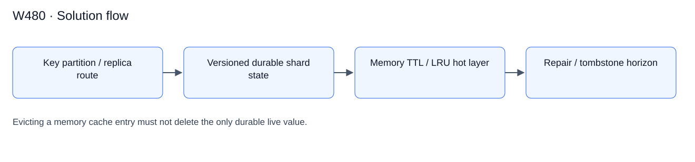

# W480. Distributed Key-Value Store Design

**Priority group:** Fifth 100 — specialized practice

**Category:** Storage, indexes and caching

**Study position:** 480 of 547

[Group list](../FIFTH_100.md) · [All categories](../ALL_CATEGORIES.md) · [Chapter guide](../README.md)

<span class="practice-page"></span>

## Question

Design a horizontally-scalable distributed key-value store supporting get / set / delete with configurable TTL, high availability, and low-latency reads. Appears as both a coding-style 'implement a KV store' prompt and a full SD round emphasizing CAP, consistent hashing, and replication.

### Requirements

Functional
set(key, value, ttl?), get(key), delete(key).
TTL-based eviction; LRU as a secondary eviction policy when memory is full.
Configurable replication factor.
Non-functional
p99 latency under ~10ms for get.
100k+ requests/second per cluster, 1 TB+ aggregate data.
High availability — survive single-node and single-AZ failure.
Eventual consistency acceptable; clarify whether read-your-writes is required.

## Worked solution

### Distinguish a bounded cache core from a durable distributed store

Choose eventual cross-region consistency with optional session read-your-writes. Map keys by a virtual-partition/rendezvous ring; replicate each partition to configurable R nodes placed across AZs (for example R=3 across three AZs). GET/SET/DELETE include value version and absolute expiry; DELETE writes a tombstone and TTL expiry is a logical absence check, not merely delayed cleanup. A region/partition authority or version-vector/conflict policy handles concurrent versions; wall-clock last-writer-wins is an explicit lossy policy, not a universal correctness proof.

For local coding practice, this runnable item-bounded LRU/TTL core uses a hash/OrderedDict plus expiry heap, generation stamps to ignore stale heap entries and one lock for atomic state changes. It returns KeyError on absence, preserves cached None and does not claim cluster replication or durable storage:

```python
import math
from collections import OrderedDict
import heapq
import threading
import time


class LocalTTLCache:
    """Item-count-bounded LRU+TTL core; cluster consistency is a separate design."""

    def __init__(self, capacity, clock=time.monotonic):
        if not isinstance(capacity, int) or isinstance(capacity, bool) or capacity < 1:
            raise ValueError("positive integer capacity required")
        self.capacity, self.clock = capacity, clock
        self.data, self.expiry, self.generation = OrderedDict(), [], 0
        self.lock = threading.Lock()

    def _purge(self, now):
        while self.expiry and self.expiry[0][0] <= now:
            _, generation, key = heapq.heappop(self.expiry)
            if key in self.data and self.data[key][2] == generation:
                self.data.pop(key)
        if len(self.expiry) > 2 * len(self.data) + 100:
            self.expiry = [
                (e, g, k) for k, (v, e, g) in self.data.items() if e is not None
            ]
            heapq.heapify(self.expiry)

    def set(self, key, value, ttl=None):
        if ttl is not None and (
            not isinstance(ttl, (float, int))
            or isinstance(ttl, bool)
            or not math.isfinite(ttl)
            or ttl <= 0
        ):
            raise ValueError("positive finite ttl required")
        with self.lock:
            now = self.clock()
            self._purge(now)
            self.generation += 1
            expiry = now + ttl if ttl is not None else None
            self.data.pop(key, None)
            self.data[key] = (value, expiry, self.generation)
            if expiry is not None:
                heapq.heappush(self.expiry, (expiry, self.generation, key))
            while len(self.data) > self.capacity:
                self.data.popitem(last=False)

    def get(self, key):
        with self.lock:
            self._purge(self.clock())
            if key not in self.data:
                raise KeyError(key)
            self.data.move_to_end(key)
            return self.data[key][0]

    def delete(self, key):
        with self.lock:
            self._purge(self.clock())
            return self.data.pop(key, None) is not None
```

A distributed **store** must not lose the only copy of a live key through LRU. Treat memory eviction as dropping a cached copy backed by durable shard storage, or explicitly call the product an evictable cache; TTL/delete are user-visible lifecycle changes. WAL/LSM/SSTables or a durable backing store support restart recovery. Replication acknowledgment and hinted handoff/anti-entropy determine data-loss/staleness behavior. R/W quorums can improve freshness, but membership changes/sloppy quorums need care and do not automatically yield linearizability. Session version tokens route/wait for a replica at least as new as the client's write.

At 1 TB logical data, R=3 requires 3 TB before indexes/headroom; plan at least ~4–5 TB physical with explicit compaction/repair margin. 100K QPS with 90% reads of 1 KB moves about 90 MB/s payload before replicas/protocol. A 10 ms p99 GET requires regional routing/in-memory hot data; a cross-region quorum may exceed it. Hot keys use immutable/versioned read replication or controlled single-flight, while mutable atomic counters route to one owner/CAS operation. Rebalance gradually with partition epochs so reads/writes do not lose keys; stale tombstones cannot be dropped before the repair horizon or deleted data can resurrect.

Single-node/AZ failure uses surviving replicas, bounded retries and admission control; during partitions choose availability with documented conflicts/staleness, or stricter consistency at lower availability. Monitor hit/store distinction, replica lag, repair, tombstone age, clock health, p99 and skew. Tests cover the local core's expiry overwrite, LRU, None, delete, heap-compaction and concurrent access only; distributed guarantees require fault-injection deployment tests.

### Follow the diagram



Read left to right: Key partition / replica route → Versioned durable shard state → Memory TTL / LRU hot layer → Repair / tombstone horizon. Evicting a memory cache entry must not delete the only durable live value.

### Further study

- [F161: Explain CAP during a real network partition.](../17_distributed_systems_depth.md#f161)
- [F162: Design a durable work queue with retries and leases.](../17_distributed_systems_depth.md#f162)
- [F170: Design a cache without serving incorrect data.](../17_distributed_systems_depth.md#f170)
