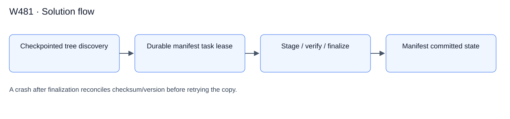

# W481. File Backup System with Durable Manifest

**Priority group:** Fifth 100 — specialized practice

**Category:** Storage, indexes and caching

**Study position:** 481 of 547

[Group list](../FIFTH_100.md) · [All categories](../ALL_CATEGORIES.md) · [Chapter guide](../README.md)

## Question

Design a source→destination file backup that mirrors directory structure, supports full + incremental runs, resumes after crashes, and verifies integrity — anchored on a durable manifest as source of truth and stage-then-commit (.tmp+rename / multipart-complete) for atomic writes.

Functional requirements:
1. Back up a source tree to a destination (another FS, S3, NAS).
2. Mirror directory structure, names, hierarchy; preserve permissions/timestamps where possible.
3. Support full and incremental backups (subsequent runs copy only changes).
4. Resume after failure without restarting from scratch.
5. Verify integrity via checksums recorded in a manifest.

Assume filesystem primitives (listDir, stat, readFile, writeFile, mkdir, rename) are given. Scale: 100M–10B files, tens of TB to PB. Out of scope: restore, encryption at rest, multi-tenant ACLs, deletion semantics, versioning.

## Worked solution

### The durable manifest determines what is committed

Model `Run(id,source_root,destination,snapshot_token,state,cursor)` and sharded `Manifest(path,source_signature,size,checksum,metadata,destination_key,state,attempt,error)`. States such as discovered → copying → verified → committed are persisted; a worker lease/attempt fences stale retries. A full run enumerates the tree incrementally; later runs compare against the prior committed manifest and copy only changed files. Size/mtime are fast hints, not proof of unchanged content; use strong hashes/change journals or accept and document the trade-off. A consistent source snapshot or before/after stat+retry is needed for files modified while reading.

For each file, create required directories, stream bytes to a unique `.tmp`/multipart destination, compute/verify checksum+size, fsync where supported, then atomic rename/multipart-complete. Record the final immutable destination version/checksum as committed in the manifest only after publication succeeds. A crash before finalization leaves a resumable/collectable temporary; after finalization but before manifest commit, recovery checks the final checksum/version and commits the same logical file instead of blindly recopying/overwriting. Filesystem atomic rename assumes the same filesystem; NAS/S3 guarantees differ and must be adapted explicitly.

A run checkpoint records completed enumeration ranges and durable tasks, not merely “last filename” under a changing traversal. Work queues carry stable `(run,path,source_version)` keys; retries cannot corrupt another attempt's temporary. Preserve permissions/timestamps after byte integrity under platform capability/error policy; report unsupported metadata rather than claiming it survived. Bad reads/destination full/checksum mismatch retain actionable failed entries and allow unrelated files to progress. Mark a run complete only when its manifest's required files are committed or an explicitly reported error policy is met.

At 100M files and 200 bytes/manifest row, raw manifest is 20 GB; at 10B it is 2 TB before indexes/history, so no in-memory global set/one giant JSON file. Partition by path hash or subtree, keep ordered scan indexes/checkpoints on disk and bound concurrency by file-descriptor/network/IO budgets. A 1 PB copy at 10 GB/s still takes about 27.8 hours before small-file overhead. Separate metadata enumeration from data transfer workers, batch tiny files carefully and hash while streaming. Monitor discovered/committed/failed counts, bytes/checksum failures, resume progress and oldest pending task. Restore, deletion semantics, encryption and multitenant sharing remain outside the stated scope; do not silently implement destructive destination mirroring.

### Follow the diagram

Read left to right: Checkpointed tree discovery → Durable manifest task lease → Stage / verify / finalize → Manifest committed state. A crash after finalization reconciles checksum/version before retrying the copy.

### Further study

- [F169: Explain backpressure in a multi-stage data pipeline.](../17_distributed_systems_depth.md#f169)
- [F170: Design a cache without serving incorrect data.](../17_distributed_systems_depth.md#f170)
