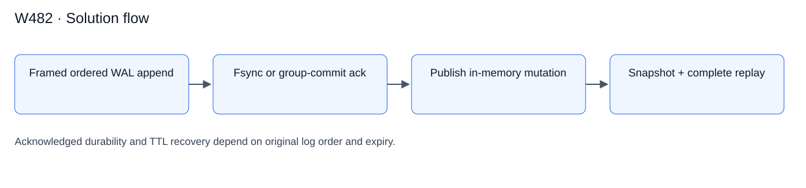

# W482. In-Memory KV Cache with Write-Ahead Log

**Priority group:** Fifth 100 — specialized practice

**Category:** Storage, indexes and caching

**Study position:** 482 of 547

[Group list](../FIFTH_100.md) · [All categories](../ALL_CATEGORIES.md) · [Chapter guide](../README.md)

## Question

Design a single-machine, in-memory key-value cache for a web service. Then extend it:
1. Persistence — add durability via a write-ahead log (WAL) so the cache can be recovered after a crash.
2. Scaling — discuss how to scale the design via sharding and how to reduce lock contention under concurrent access.

Discuss the core data structures, the read/write path, and the tradeoffs of your persistence and concurrency choices.

## Worked solution

### Log a mutation durably before publishing it in memory

The core is a hash map of key → value/version/expiry plus a bounded eviction structure if this is an evictable cache. A mutex or striped locks serialize mutations; GET uses the same synchronization required by the language/runtime. Atomic INCR/CAS is a server operation, not client GET+SET. If acknowledged live entries must survive memory pressure, spill to durable storage rather than silently evicting them and calling the component a persistent store.

Extend SET/DELETE with a WAL record `(sequence,op,key,value,absolute_expiry,length,checksum)`. Under a defined write-order lock, append a framed record, flush/fsync under the durability policy, then publish the map update and acknowledge. A crash after durable append but before reply may replay an operation the client thinks failed; use request IDs if retries must recover the same result. For a durable DELETE, append a tombstone too; otherwise restart resurrects removed keys. A short/torn trailing record is ignored/truncated only at its validated boundary, while a checksum mismatch inside completed history requires investigation rather than silently dropping everything after it.

Recovery loads the latest checksummed snapshot and replays complete newer WAL records in sequence, applying original absolute expiry so TTL does not restart after a crash. Snapshot creation captures a consistent map/sequence, writes/fsyncs a temporary, atomically publishes its manifest, and only then removes covered WAL segments. A crash at any stage leaves at least one valid snapshot+log chain. Background compaction retains tombstones until older state cannot return.

Syncing each write minimizes acknowledged-data loss but adds storage latency; group commit amortizes fsync while each acknowledgment still waits for its batch. Async flush trades a declared loss window for throughput, not equivalent durability. Memory update before WAL fsync can expose data that disappears on crash, so state whether reads of unacknowledged writes are permitted. Snapshot pause/copy-on-write choices trade latency, memory and implementation complexity.

For scale, shard keys and lock domains; each shard may have its own WAL/order, or a shared log needs a separate sequencer. GET-heavy LRU mutation can become a lock hotspot, so use sampled/segmented recency and monitor contention. Horizontal consistent hashing adds ownership/replication/rebalance protocols beyond this single-machine persistence design. For an assumed 100K writes/s with 1 KB values, WAL payload alone is 100 MB/s before framing; benchmark fsync and recovery time on actual disks. Test crash points, duplicate requests, tombstones, torn tails, expiry and snapshot rotation—not just process-restart success after a clean close.

### Follow the diagram

Read left to right: Framed ordered WAL append → Fsync or group-commit ack → Publish in-memory mutation → Snapshot + complete replay. Acknowledged durability and TTL recovery depend on original log order and expiry.

### Further study

- [F161: Explain CAP during a real network partition.](../17_distributed_systems_depth.md#f161)
- [F162: Design a durable work queue with retries and leases.](../17_distributed_systems_depth.md#f162)
- [F170: Design a cache without serving incorrect data.](../17_distributed_systems_depth.md#f170)
