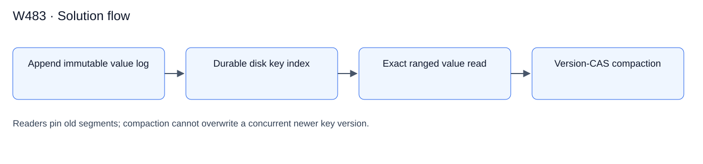

# W483. Single-Machine Key-Value Store with Filesystem Spill

**Priority group:** Fifth 100 — specialized practice

**Category:** Storage, indexes and caching

**Study position:** 483 of 547

[Group list](../FIFTH_100.md) · [All categories](../ALL_CATEGORIES.md) · [Chapter guide](../README.md)

## Question

Design a single-machine KV store that holds a billion keys and MB-scale values. Memory is bounded; on-disk format is append-only files; values cannot live entirely in memory. The round straddles system design and data-structure design — many candidates over-pivot to distributed systems and lose signal.

Functional

get(key) -&gt; value / put(key, value) / delete(key).
Up to 1B keys live; each value is MB-scale.
Persistent across restarts.

Keep it single-node. Discuss the compaction strategy, not Raft.

## Worked solution

### Keep value bytes on disk; the key index may also need disk

At 1B live keys×1 MB values, logical payload is about 1 PB decimal. A single machine needs an unusually large attached storage system and substantial compaction bandwidth; the design can be single-node, but a normal workstation cannot physically hold the stated data. Even a 32-byte in-memory pointer/index per key is 32 GB before key strings/hash overhead, so bounded memory may require a disk-resident sorted/B-tree/LSM index plus a hot cache. Do not promise a full in-memory hash index without its budget.

Append immutable records to segmented files: `(record_length,key_length,key,version,op,value_length,value,checksum)`. The current key index maps key→`(segment,offset,length,version,deleted)`; values are streamed from the referenced file, never loaded wholesale across the database. PUT appends/fsyncs according to acknowledgment policy, then atomically updates/recoverably logs the index mapping. DELETE appends a tombstone and publishes the new version. Recovery replays a checkpointed index plus later segment/index-journal records, rejecting torn tails/checksum errors. Stable request/version IDs define retry behavior.

GET checks the index, reads the exact range and verifies record/key/version/checksum. A reader pins its segment or generation so compaction cannot unlink it mid-read. The OS page cache/hot value cache helps repeated reads, but MB values imply significant random IO/network-copy cost; bound concurrent loads and maximum value/record length to avoid corrupt-length allocations.

Compaction selects segments with high dead-byte ratio, scans them sequentially and copies only records still current according to the index. CAS the index from the old `(segment,offset,version)` to the new location so a concurrent newer PUT cannot be overwritten. Publish the new compacted file/manifest durably before dropping old references; delete old segments only after all reader pins and checkpoints release them. Keep tombstones until every older record they suppress is outside the recovery/compaction horizon, or deleted keys resurrect. Reserve free space for rewrite amplification and throttle compaction so foreground writes do not stall.

Track live/dead bytes, write amplification, index cache hit, recovery time, checksum failures, reader pins and compaction debt. Batch tiny index updates and use a bounded writer queue; stripe locks or serialize one append with independent readers. Durability here covers process restart with intact disks; surviving disk/machine loss requires backups/redundancy outside this single-node exercise. Raft, global sharding and cross-region APIs do not solve the requested on-disk index/compaction problem.

### Follow the diagram

Read left to right: Append immutable value log → Durable disk key index → Exact ranged value read → Version-CAS compaction. Readers pin old segments; compaction cannot overwrite a concurrent newer key version.

### Further study

- [F161: Explain CAP during a real network partition.](../17_distributed_systems_depth.md#f161)
- [F162: Design a durable work queue with retries and leases.](../17_distributed_systems_depth.md#f162)
- [F170: Design a cache without serving incorrect data.](../17_distributed_systems_depth.md#f170)
