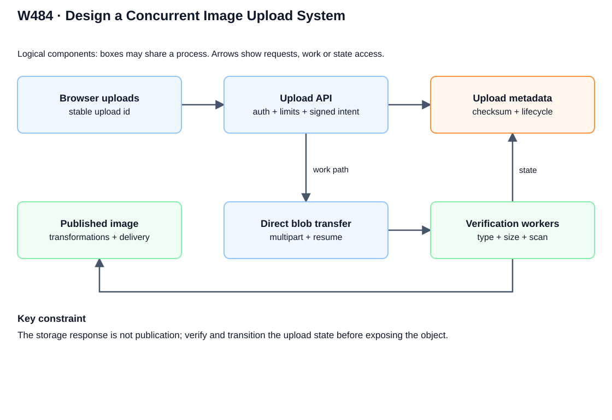

# W484. Design a Concurrent Image Upload System

**Priority group:** Fifth 100 — specialized practice

**Category:** Web services and API design

**Study position:** 484 of 547

[Group list](../FIFTH_100.md) · [All categories](../ALL_CATEGORIES.md) · [Chapter guide](../README.md)

## Question

Design a system (like Craigslist) that accepts a list of images and stores them concurrently, updating the user about the status of each upload as soon as possible.

### Requirements

Accept a batch of images from a client.
Upload/store them concurrently rather than sequentially.
Report per-image status (pending / uploading / succeeded / failed) to the user as early as possible.
Handle partial failures and retries.

## Worked solution

<!-- architecture:W484:start -->
### Architecture and request flow

[Open the diagram at full size](../diagrams/W484_architecture.svg). This is a baseline component diagram for this question. The boxes describe responsibilities; they do not require a separate microservice for every box.

- **Request and state:** Browser uploads — stable upload id → Upload API — auth + limits + signed intent. That component consults or updates **Upload metadata — checksum + lifecycle** under the required access and consistency rules.
- **Work and result:** the work path passes through **Direct blob transfer — multipart + resume** and **Verification workers — type + size + scan**, producing **Published image — transformations + delivery**. Bound waiting and retries where a slow dependency can stall this path.
- **Correctness point:** The storage response is not publication; verify and transition the upload state before exposing the object.

When explaining the drawing, trace one normal request first, then a duplicate request, an unavailable dependency and recovery from saved state. If the question requires stricter guarantees or a different scope, state the change explicitly rather than treating this baseline as the only possible design.
<!-- architecture:W484:end -->

### Solution outline

1. Authenticate upload intent and reserve a unique object id/version. Prefer scoped direct-to-object-storage uploads with size/type limits, expiry and multipart support for large images.
2. After upload, verify content length/checksum and inspect/decode the actual image under resource limits; file extensions alone do not validate type. Publish metadata only after required scanning/transforms succeed.
3. Make completion idempotent and process thumbnails/transcodes through durable jobs. Clients may upload concurrently, but per-user quotas and backend work queues must remain bounded.
4. Serve only authorized committed objects, clean abandoned parts, and test interrupted uploads, duplicate completion, malicious dimensions and overwrite races.

### Understand why the approach works

#### Put validation and completion on the authoritative path

Specify request schema, authentication, response schema and the meaning of each success code. A syntactically valid payload can still contain an unauthorized object id or violate a resource invariant. Validate those meanings on the server even if the UI also validates.

For uploads, distinguish intent creation, byte transfer, verification, processing and publication. Verify content size/type and checksum before making a result visible; use bounded decoding to avoid hostile dimensions or oversized payloads. A successful storage HTTP call is not by itself a complete application-level upload.

For short links or similar mappings, enforce uniqueness atomically rather than relying on random generation alone. Cache reads under an explicit expiry/version policy, and keep analytics off the critical response path when its durability requirement permits.

Work through an interrupted request and a replay. Return an idempotent status or a clear partial/unknown state; never convert uncertainty into a fabricated success. Include quotas, pagination, deletion and tenant isolation. The strongest explanation connects each database constraint and queue to a user-visible guarantee, instead of treating an API as only endpoint names and JSON examples.

### Work a small example

A client disconnect at 90% leaves an incomplete object that must not be advertised as a ready image; resuming should reuse the correct upload id.

### Edge cases and common mistakes

Trusting client MIME headers or letting arbitrary image decodes exhaust memory.

### Check your reasoning on related cases

**Design a durable work queue with retries and leases.** If a worker completes a side effect and crashes before acknowledgment, the task can be delivered again.

How do fencing tokens help? They allow downstream systems to reject writes from an expired owner.

**Design a cache without serving incorrect data.** Two identical question strings from users with different document permissions must not automatically share a retrieved-answer cache entry.

Why can invalidation be preferable to TTL alone? Critical updates may need to take effect sooner than the ordinary expiry window.

### Further study

- [F162: Design a durable work queue with retries and leases.](../17_distributed_systems_depth.md#f162)
- [F170: Design a cache without serving incorrect data.](../17_distributed_systems_depth.md#f170)

### Explain it back

Close the answer. State the main invariant or equation, work the example with changed inputs, and explain which assumption would make your solution fail. For a design, walk through a retry or partial failure; for a derivative, check a shape and a finite-difference case.
