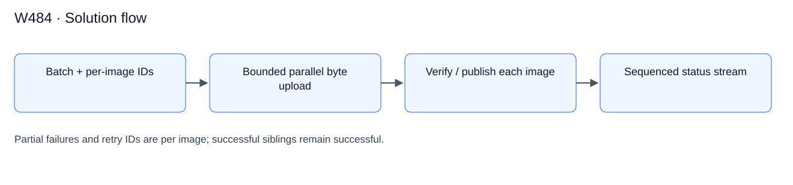

# W484. Design a Concurrent Image Upload System

**Priority group:** Fifth 100 — specialized practice

**Category:** Web services and API design

**Study position:** 484 of 547

[Group list](../FIFTH_100.md) · [All categories](../ALL_CATEGORIES.md) · [Chapter guide](../README.md)

## Question

Design a system (like Craigslist) that accepts a list of images and stores them concurrently, updating the user about the status of each upload as soon as possible.

### Requirements

Accept a batch of images from a client.
Upload/store them concurrently rather than sequentially.
Report per-image status (pending / uploading / succeeded / failed) to the user as early as possible.
Handle partial failures and retries.

## Worked solution

### Give every image its own durable lifecycle

`POST /upload-batches` accepts an authenticated list of `(client_image_id,name,size,type,checksum)` and an idempotency key. Return a batch ID plus per-image IDs and narrow multipart/signed upload URLs. Store `Batch(id,user,key,state)` and `ImageUpload(id,batch,client_id,state,attempt,bytes,checksum,object_key,error,version)`, unique `(batch,client_id)`. The client uploads with a bounded concurrency pool, for example 4–8 images, rather than sequentially or opening hundreds of unbounded streams.

The flow is metadata admission → parallel direct object uploads → completion/checksum validation → safe image decode/scan → publish. Per-image states are pending → uploading → succeeded/failed; define succeeded as verified/publishable, not merely bytes received. Client byte-progress is provisional; server completion events are authoritative. One failed image leaves the others successful. Retry only failed parts/images with stable IDs/keys, and do not create a second image row after a timeout. A cancelled/abandoned pending upload expires and cleans staged bytes.

`GET /batches/{id}/events?after_seq` uses SSE/WebSocket to stream `(image_id,state,version,error_code)` as each transition commits; `GET /batches/{id}` gives a full snapshot for reconnect. An outbox/change stream avoids losing a terminal event between DB commit and publish, and sequence IDs let clients dedup/replay. A stale uploading event cannot overwrite succeeded. Use row-version CAS to fence concurrent retry/completion workers; acknowledge duplicate completes with the current state.

Assume 100 batches/s×10 images×2 MB ≈ 2 GB/s ingress; image bytes should bypass API memory and go to scalable object storage, while workers cap CPU/decompression cost and queue depth. Validate actual magic bytes, dimensions/pixel count, checksums and authorization, not just filename MIME; re-encode/scan before public delivery. Store immutable object versions so a retried upload cannot overwrite another user's image. Report batch status as a summary of image states and return structured per-image failures, not one misleading all-or-nothing success. Monitor time-to-first-status, upload/verification latency, bytes, partial failures, retries and abandoned storage; test one slow image, one invalid image and a lost completion reply.

### Follow the diagram

Read left to right: Batch + per-image IDs → Bounded parallel byte upload → Verify / publish each image → Sequenced status stream. Partial failures and retry IDs are per image; successful siblings remain successful.

### Further study

- [F162: Design a durable work queue with retries and leases.](../17_distributed_systems_depth.md#f162)
- [F170: Design a cache without serving incorrect data.](../17_distributed_systems_depth.md#f170)
