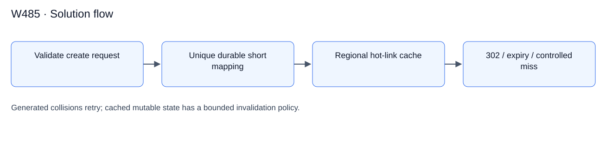

# W485. Design a URL Shortener

**Priority group:** Fifth 100 — specialized practice

**Category:** Web services and API design

**Study position:** 485 of 547

[Group list](../FIFTH_100.md) · [All categories](../ALL_CATEGORIES.md) · [Chapter guide](../README.md)

## Question

URL Shortener

A URL shortener takes a long web address and turns it into a short link. When a user clicks the short link, they are redirected to the original page. Services like Bit.ly and TinyURL are examples of this.

The basic idea is simple, but there is enough depth to challenge a senior design: short-key generation (counter + base62, or hashing with collision handling), the read-heavy redirect path, durable mapping storage, caching the hottest links, and scaling reads globally.

## Worked solution

### Durable code mapping with a cache-heavy redirect path

Expose `POST /links {url}` and `GET /{code}`. Store `Link(code PRIMARY KEY,url,owner,created_at,expires_at?,state,version)` in a durable partitioned database; only HTTP(S) destinations are accepted, with bounded length and no control-character/header injection. The redirect handler resolves code, checks state/expiry and returns 302 Location. It does not fetch the destination, so do not add an unnecessary synchronous preview request.

A counter allocated in durable nonoverlapping ranges plus base62 encoding is collision-free if range ownership survives failover, but exposes sequence/enumeration. Random base62 codes are less predictable and need a unique insert/retry, because hashing/truncation alone is not collision-free. For a demonstration 1M creates/day over 5 years, 1.825B links at 500 bytes ≈ .91 TB logical; eight base62 characters offer 2.18e14 codes with low per-attempt occupancy, though birthday collisions across the population are expected and must be handled.

The hot path is regional edge/load balancer → local/shared hot-code cache → mapping shard. Positive entries carry version/expiry, and negative caches have short TTL to avoid hiding a newly created link. Prewarm/replicate hot links; a single celebrity URL can dominate a shard even when hashes balance normal traffic. Global replicas can be eventually consistent if create responses route early reads to the owner until replication catches up; state a bound and failover policy. Admin disable/delete invalidates caches and uses tombstones so old replica data does not resurrect links.

At an assumed 100M redirects/day, reads ≈ 1,157/s average, perhaps 10K/s peak; size from actual traffic and URL bytes, not just row count. Keep optional click analytics asynchronous and bounded, using stable event IDs if counts require dedup. Mapping writes use idempotency keys when the same client retry must return the same link. On database outage, serve only cached live entries under their policy and shed unsafe misses; a stale disabled link is not acceptable merely to improve availability. Monitor redirect p99, cache-hit rate, unknown/expired codes, abuse/reports and replica/invalidation lag. [W487](W487.md) includes a tested runnable core for collisions, aliases, expiry and create retries.

### Follow the diagram

Read left to right: Validate create request → Unique durable short mapping → Regional hot-link cache → 302 / expiry / controlled miss. Generated collisions retry; cached mutable state has a bounded invalidation policy.

### Further study

- [F165: Design idempotency for an order or booking API.](../17_distributed_systems_depth.md#f165)
- [F170: Design a cache without serving incorrect data.](../17_distributed_systems_depth.md#f170)
