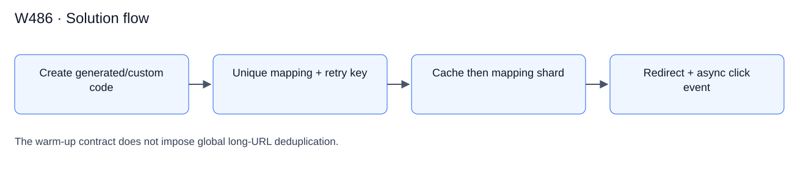

# W486. Design a URL Shortener (TinyURL)

**Priority group:** Fifth 100 — specialized practice

**Category:** Web services and API design

**Study position:** 486 of 547

[Group list](../FIFTH_100.md) · [All categories](../ALL_CATEGORIES.md) · [Chapter guide](../README.md)

## Question

Design a URL shortener (TinyURL). Given a long URL, produce a short code that redirects to the original.

Cover the encoding scheme, collision handling, read-heavy caching, and click analytics. This is often used as a phone-screen warm-up.

## Worked solution

### A phone-screen design with explicit collision behavior

Choose random eight-character base62 codes and a unique code primary key; retry a generated collision, never overwrite its destination. A monotonic ID → base62 alternative is shorter/simpler to guarantee uniqueness but enumerable and requires durable ID allocation. Hashing a URL then truncating does not avoid collisions and does not by itself guarantee repeat submissions map to the same link.

APIs are `POST /links {long_url,idempotency_key?} ->201 {code,short_url}` and `GET /{code} ->302 Location`, with 404 for unknown and 410 for expired/disabled under a stated retention policy. Store code, url, created/expiry, state, owner, version. Validate HTTP(S), length and header safety; enforce ownership for mutation and abuse quotas for public creation. Same URL may mint another code unless one-to-one mapping is explicitly requested as in W489.

A regional cache fronts a durable code-sharded database. Cache entries retain expiry/state/version and cap TTL at expiry; short negative caching handles random scans. Hot-code replication/edge caches reduce read amplification. A created code should be readable immediately through the owner/read-your-writes route, then global replicas converge. Disable/update invalidation needs a bounded consistency promise, not indefinite stale redirects.

Click analytics emits `event_id,code,time,referrer_domain,country` into a bounded queue/outbox path and aggregates per-code/day asynchronously; drop/sampling/error policy is explicit so logging cannot stall redirects. Avoid storing full sensitive referrer URLs and label bot/duplicate estimates. For an illustrative 1M creates/day and 100M redirects/day, average rates are 12 writes/s and 1,157 reads/s; provision peak headroom and code/table retention accordingly. The [W487 implementation](W487.md) demonstrates the small core with real tests, while cache replication and analytics remain system components. This level is enough for the warm-up if you can trace a generated collision and a lost create reply.

### Follow the diagram

Read left to right: Create generated/custom code → Unique mapping + retry key → Cache then mapping shard → Redirect + async click event. The warm-up contract does not impose global long-URL deduplication.

### Further study

- [F165: Design idempotency for an order or booking API.](../17_distributed_systems_depth.md#f165)
- [F170: Design a cache without serving incorrect data.](../17_distributed_systems_depth.md#f170)
