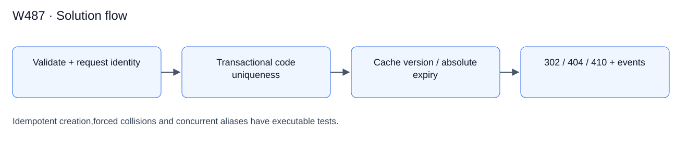

# W487. Design a URL Shortener (TinyURL)

**Priority group:** Fifth 100 — specialized practice

**Category:** Web services and API design

**Study position:** 487 of 547

[Group list](../FIFTH_100.md) · [All categories](../ALL_CATEGORIES.md) · [Chapter guide](../README.md)

<span class="practice-page"></span>

## Question

Design a URL shortener.

Functional

create(long_url, optional_expiry, optional_custom_alias) -&gt; short_url
redirect(short_url) -&gt; 302 long_url
Optional analytics (click counts, geo breakdown) and admin dashboard.

Non-functional

1M creates/day, 1B redirects/day (~1000× read-skewed).
Redirect p99 &lt; 100 ms.
Global multi-region availability ≥ 99.99%.
Handle write bursts up to 1000 QPS on the create path without dropping.

A compressed variant asks for both HLD and LLD plus working code for the core short-code component, then a bug review of AI-generated code (collisions, missing validation, cache inconsistency, expiry bugs, non-idempotent create).

## Worked solution

### HLD: separate durable creation from the regional redirect hot path

1M creates/day ≈ 11.6/s average, with the stated 1,000/s write burst. 1B redirects/day ≈ 11,574/s average; assume 5× peak ≈ 57,870/s for planning. At 500 bytes/link and 5-year assumed retention, 1.825B mappings ≈ .91 TB raw before replicas. Redirect p99<100 ms requires regional caches/replicas, bounded database fallback and hot-key replication.99.99% is an availability target; an uncached partitioned write may be rejected rather than corrupt uniqueness.

`POST /links` accepts URL, optional expiry/custom alias and an idempotency key; `GET /{code}` returns 302/404/410. `Link(code PK,url,expires,state,version)` and `Request(key UNIQUE,payload_hash,code)` are durable. Random generated codes use a unique insert/retry; aliases use the same namespace and first successful insert wins 409. Keys are tenant-bound in a multitenant API (the local demo is a single namespace). Cache key is code plus state/version policy; check expiry on every hit, bound TTL and invalidate updates/disables. Analytics is optional/asynchronous and cannot extend redirect latency unboundedly.

### LLD: runnable collision/expiry/idempotency core

The implementation below is a single SQLite authority with per-operation connections and transactions, not a claimed distributed database. Injected generator/clock make collisions and expiry deterministic in tests. A retried idempotent create returns its original code even after that link expires; a fresh expired-at-create request is invalid. HTTP adapters map AliasTaken to 409, LinkNotFound to 404, LinkExpired to 410 and ValueError to 400.

```python
import time
import json
import math
import re
import secrets
import sqlite3
import string
from contextlib import closing
from urllib.parse import urlsplit


class AliasTaken(ValueError):
    pass


class LinkExpired(LookupError):
    pass


class LinkNotFound(LookupError):
    pass


class ShortCodeStore:
    """Single SQLite authority demo; unique code is the final collision guard."""

    reserved = {"api", "admin", "login", "static"}

    def __init__(self, path, clock=time.time, generate=None):
        self.path, self.clock = path, clock
        self.generate = generate or (
            lambda: "".join(
                secrets.choice(string.ascii_letters + string.digits) for _ in range(8)
            )
        )
        with closing(sqlite3.connect(path)) as db, db:
            db.executescript(
                """CREATE TABLE IF NOT EXISTS links(code TEXT PRIMARY KEY,url TEXT NOT NULL,expires REAL,disabled INTEGER NOT NULL DEFAULT 0);
            CREATE TABLE IF NOT EXISTS requests(key TEXT PRIMARY KEY,payload TEXT NOT NULL,code TEXT NOT NULL);"""
            )

    def create(
        self,
        long_url,
        optional_expiry=None,
        optional_custom_alias=None,
        idempotency_key=None,
    ):
        if (
            not isinstance(long_url, str)
            or len(long_url) > 8192
            or any(c.isspace() or ord(c) < 32 for c in long_url)
        ):
            raise ValueError("invalid URL")
        try:
            parts = urlsplit(long_url)
            port = parts.port
            if (
                parts.scheme not in ("http", "https")
                or not parts.hostname
                or parts.username is not None
                or parts.password is not None
            ):
                raise ValueError("only HTTP(S) URLs without credentials are supported")
        except (ValueError, TypeError):
            raise ValueError("invalid URL")
        if optional_expiry is not None and (
            not isinstance(optional_expiry, (float, int))
            or isinstance(optional_expiry, bool)
            or not math.isfinite(optional_expiry)
        ):
            raise ValueError("expiry must be a future epoch timestamp")
        alias = optional_custom_alias
        if alias is not None and (
            not isinstance(alias, str)
            or not re.fullmatch(r"[A-Za-z0-9_-]{1,64}", alias)
            or alias.lower() in self.reserved
        ):
            raise ValueError("invalid/reserved alias")
        if idempotency_key is not None and (
            not isinstance(idempotency_key, str) or not 1 <= len(idempotency_key) <= 200
        ):
            raise ValueError("invalid idempotency key")
        payload = json.dumps([long_url, optional_expiry, alias], separators=(",", ":"))
        with closing(
            sqlite3.connect(self.path, timeout=10, isolation_level=None)
        ) as db:
            db.execute("BEGIN IMMEDIATE")
            try:
                if idempotency_key is not None:
                    old = db.execute(
                        "SELECT payload,code FROM requests WHERE key=?",
                        (idempotency_key,),
                    ).fetchone()
                    if old:
                        if old[0] != payload:
                            raise ValueError(
                                "idempotency key reused with different request"
                            )
                        db.commit()
                        return old[1]
                if optional_expiry is not None and optional_expiry <= self.clock():
                    raise ValueError("expiry must be in the future")
                for _ in range(32):
                    code = alias if alias is not None else self.generate()
                    if (
                        not re.fullmatch(r"[A-Za-z0-9_-]{1,64}", code)
                        or code.lower() in self.reserved
                    ):
                        if alias is not None:
                            raise ValueError("invalid alias")
                        continue
                    try:
                        db.execute(
                            "INSERT INTO links(code,url,expires) VALUES(?,?,?)",
                            (code, long_url, optional_expiry),
                        )
                        break
                    except sqlite3.IntegrityError:
                        if alias is not None:
                            raise AliasTaken(code)
                else:
                    raise RuntimeError("collision retry budget exhausted")
                if idempotency_key is not None:
                    db.execute(
                        "INSERT INTO requests VALUES(?,?,?)",
                        (idempotency_key, payload, code),
                    )
                db.commit()
                return code
            except BaseException:
                db.rollback()
                raise

    def resolve(self, code):
        with closing(sqlite3.connect(self.path)) as db:
            row = db.execute(
                "SELECT url,expires,disabled FROM links WHERE code=?", (code,)
            ).fetchone()
        if row is None:
            raise LinkNotFound(code)
        url, expiry, disabled = row
        if disabled or (expiry is not None and self.clock() >= expiry):
            raise LinkExpired(code)
        return url
```

The code validates before publication, checks idempotency and inserts mapping/request atomically. A generated collision retries with another code; a custom alias conflict never rewrites the first URL.8-character base62 space is ≈ 2.18e14; randomness is not an authorization mechanism. For larger scale/privacy needs use longer random codes and creation/scan quotas.

When reviewing AI-generated variants, test: forced collision; two concurrent custom aliases; same idempotency key/same body versus changed body; cached expiry exactly at boundary; stale cache after disable; invalid URL/header input; restart persistence; and a lost create response. A read-then-insert collision check, TTL reset on cache refill, memory-only mapping or idempotency row committed separately are concrete bugs. Batch tests execute those core cases (cache/distributed behavior is reasoned separately), with no fabricated high-QPS benchmark.

### Follow the diagram



Read left to right: Validate + request identity → Transactional code uniqueness → Cache version / absolute expiry → 302 / 404 / 410 + events. Idempotent creation, forced collisions and concurrent aliases have executable tests.

### Further study

- [F165: Design idempotency for an order or booking API.](../17_distributed_systems_depth.md#f165)
- [F170: Design a cache without serving incorrect data.](../17_distributed_systems_depth.md#f170)
