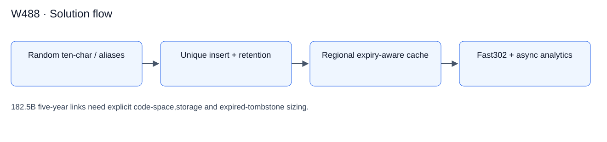

# W488. Design a URL Shortener with Aliases, Expiry and Click Analytics

**Priority group:** Fifth 100 — specialized practice

**Category:** Web services and API design

**Study position:** 488 of 547

[Group list](../FIFTH_100.md) · [All categories](../ALL_CATEGORIES.md) · [Chapter guide](../README.md)

<span class="practice-page"></span>

## Question

Design a public link-shortening service. A user submits a long web address and gets back a short link; anyone who opens the short link is sent on to the original address. Opening links happens far more often than creating them, so the redirect must be fast and almost always available, and short codes should be hard to guess.

### Requirements

1. Create. POST /links {long_url, expires_at?} returns a short link such as https://sho.rt/&lt;code&gt;. The same long URL submitted twice may return two different short links.
2. Redirect. GET /{code} redirects to the long URL. Unknown codes return 404; expired links return 410.
3. Expiration. A link may carry an expiry time; after it, the link stops redirecting.
4. Non-functional. Redirects are on the critical path of every click: p99 under 50 ms and very high availability. Codes should be short and should not be easy to enumerate.
What to deliver
1. Back-of-envelope estimates: write and read rates, total links, storage, and the code length needed.
2. The API and the data model.
3. How short codes are generated without collisions, across many servers.
4. The read path and its caching.
5. How expiration is enforced.
6. Failure modes and how the design scales further.

### Examples

POST /links {"long_url": "https://example.com/a"}            -&gt; 201 {"code": "&lt;generated&gt;"}
GET  /&lt;generated code&gt;                                       -&gt; 302 Location: https://example.com/a
GET  /&lt;code of a link that expired&gt;                          -&gt; 410
The first call mints a fresh generated code; opening it redirects to the stored long URL.
A link past its expiry time no longer redirects and answers 410 Gone, not 404.

With custom aliases (Follow-up 1):

POST /links {"long_url": "https://example.com/c", "custom_alias": "sale"} -&gt; 201 {"code": "sale"}
POST /links {"long_url": "https://example.com/d", "custom_alias": "sale"} -&gt; 409 (alias taken)
GET  /sale                                                   -&gt; 302 Location: https://example.com/c
The first request for an alias wins; a second request for the same alias is refused with 409 Conflict.
Scale assumptions

```text
100 million new links per day.
100 redirects per created link on average, with peaks 3 times the average.
```

Links are kept for 5 years unless they expire earlier.
About 500 bytes per stored link, including indexes.
Follow-up 1: custom aliases

A user may pass custom_alias to ask for a readable code such as sho.rt/sale. Aliases are unique, first come first served, may not have the same length as generated codes, and some words are reserved (api, admin, login, static). How are they stored and checked?

Follow-up 2: click analytics

The owner of a link can see click counts per day, with referrer and country. How are clicks recorded without slowing the redirect?

## Worked solution

### Size the code space for the five-year population

100M creates/day ≈ 1,157/s average and 3,472/s at 3× peak.100 redirects/link gives 10B redirects/day ≈ 115,741/s average and 347,222/s peak under the stated ratio; retention/history can change the actual click-age distribution.5 years×365 days×100M ≈ 182.5B links, at 500 bytes ≈ 91.25 TB logical, or 273.75 TB at 3 replicas before overhead/backups. Eight base62 chars have 2.18e14 possibilities, but choose **ten** (~8.39e17,~59.5 bits) to lower occupancy/guessability. Even this is not a secret-access token; rate-limit enumeration and require separate auth for private destinations.

`POST /links {long_url,expires_at?,custom_alias?}` returns 201 code. Store `Link(code PK,url,owner,created,expires_at,state,version)` with generated/alias codes in one namespace and reserved-word checks (api/admin/login/static). Generate cryptographically random codes on any server and conditionally insert; a collision retries, while an already-taken requested alias returns 409. A preliminary SELECT is insufficient under concurrent creates. The same URL can intentionally mint different codes; an optional idempotency key makes network retries repeat one creation without imposing global URL dedup.

GET resolves through regional edge/L1/L2 cache then durable code shard. A live hit returns 302 Location; missing 404; expired 410. Cache entries include absolute expiry/version, and the handler checks now>=expiry independently of cache TTL. Keep an expired-code tombstone/reservation for the defined retention so cleanup does not turn a promised 410 into 404 or reassign an old link. Cache TTL<=remaining life and response cache policy prevent a browser/CDN replaying a cached redirect after expiry; do not use an indefinitely cached 301 for mutable/expiring links. Negative caches are brief and invalidated on creation.

At 347K peak redirects/s, local cache/network dominate; shard backing storage by code hash, replicate hot links and separate creation quorum capacity from readers. A 50 ms p99 budget might allow 10 ms edge/route, 5 ms cache and 35 ms regional fallback/margin; a distant write quorum is not in every redirect. Replication lag after create needs an owner fallback/read token rather than a false 404. Disable/alias management needs versioned invalidation, audit and an outage policy that does not keep unsafe links live indefinitely.

Click events are emitted asynchronously to a bounded log with event_id, code, time, referrer domain and coarse country, then dedup/aggregate into owner-authorized daily OLAP results. The redirect returns without waiting for a warehouse; declare sampling/loss semantics and protect privacy. A global event stream at the click rate is substantial and deserves its own partitions/retention. Retry failures use stable creation keys; a mapping-store outage serves cached still-live entries and returns a controlled error on unsafe misses. The runnable [W487 core](W487.md) can be configured with a 10-character generator; distributed/cache/retention contracts are explicitly separate.

### Follow the diagram



Read left to right: Random ten-char / aliases → Unique insert + retention → Regional expiry-aware cache → Fast 302 + async analytics. 182.5B five-year links need explicit code-space, storage and expired-tombstone sizing.

### Further study

- [F165: Design idempotency for an order or booking API.](../17_distributed_systems_depth.md#f165)
- [F170: Design a cache without serving incorrect data.](../17_distributed_systems_depth.md#f170)
