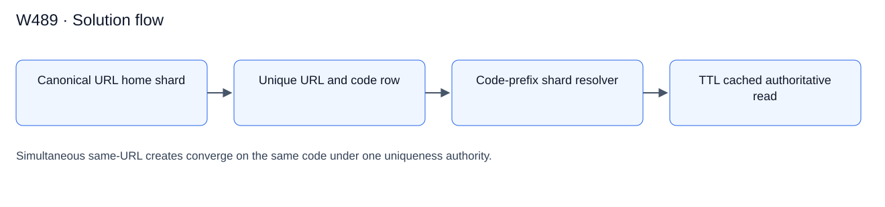

# W489. Design Scalable TinyURL Service with One-to-One URL Mapping

**Priority group:** Fifth 100 — specialized practice

**Category:** Web services and API design

**Study position:** 489 of 547

[Group list](../FIFTH_100.md) · [All categories](../ALL_CATEGORIES.md) · [Chapter guide](../README.md)

## Question

Design Scalable TinyURL Service with One-to-One URL Mapping

Design a TinyURL service where each long URL can only correspond to a single short URL. Consider scalability to support sharding and handling similar to DNS.

Example

### Input

encode(http://example.com)
decode(a)

## Worked solution

### The long URL needs its own uniqueness authority

Unlike the other variants, this service must return the same code for the same long URL, including simultaneous requests from different servers. Define equality first: use exact validated URL bytes or a conservative documented canonicalization (scheme/host case and default ports). Do not lowercase paths, sort arbitrary query parameters or remove fragments/tracking parameters without an explicit semantic policy; they can identify different destinations.

Route create by a strong hash of the canonical URL to a home shard. That shard stores one transactionally unique `UrlMapping(canonical_url UNIQUE,code UNIQUE,url_hash,created,state)`. A hash is an index/routing aid; compare full URLs to handle hash collisions. Under a transaction, insert-or-return the existing mapping. Concurrent callers for the same URL receive the same code; a generated code collision tries another code, never changes an existing URL's code. Store both directions under the same authority rather than dual-writing unrelated URL/code databases.

One practical routing scheme prefixes the code with a stable virtual-shard ID plus random suffix; decode uses that prefix to find the authoritative shard via a versioned routing directory. This keeps URL and code uniqueness local to that shard while the full code remains globally unique. Migrations move virtual shards with ownership epochs/forwarding, not new user-visible codes. A global strongly consistent reverse-URL index is an alternative with different latency/cross-shard transaction costs.

`encode(url)` returns the stable short URL; `decode(code)` returns destination or 404/disabled status. Edge/regional caches resemble DNS in that cached mappings have TTLs and authoritative resolution on miss, but they are HTTP/database records, not necessarily one DNS record per short link. Cache invalidation/tombstones enforce disable policy and bounded staleness. Do not reassign expired/deleted codes if the one-to-one/stability contract is permanent; clarify reactivation and retention separately.

Assume 1M unique URLs/day and 1B resolutions/day: reverse-URL writes average 12/s and resolutions 11.6K/s, with chosen peak headroom. Store URL text once plus two lookup indexes; hash-routing avoids a global sequential counter bottleneck. Tests for this design must include exact duplicates, simultaneous same URL, deliberately colliding hash buckets and shard migration, not merely successful sequential encode/decode. The tiny example does not determine that the first code must literally be “a.”

### Follow the diagram

Read left to right: Canonical URL home shard → Unique URL and code row → Code-prefix shard resolver → TTL cached authoritative read. Simultaneous same-URL creates converge on the same code under one uniqueness authority.

### Further study

- [F165: Design idempotency for an order or booking API.](../17_distributed_systems_depth.md#f165)
- [F170: Design a cache without serving incorrect data.](../17_distributed_systems_depth.md#f170)
