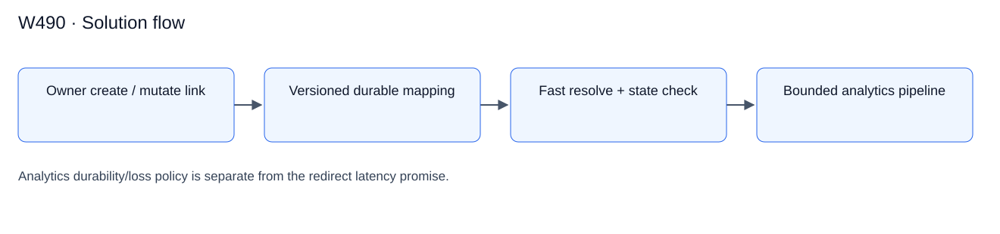

# W490. URL Shortener With Click Tracking

**Priority group:** Fifth 100 — specialized practice

**Category:** Web services and API design

**Study position:** 490 of 547

[Group list](../FIFTH_100.md) · [All categories](../ALL_CATEGORIES.md) · [Chapter guide](../README.md)

## Question

Design a URL-shortening service, then extend it to track clicks. Interviewers usually stay at overall architecture depth: encoding, redirect path, storage, collision handling, latency, and analytics write flow.

### Requirements

Functional requirements:
Create a short URL for a long URL.
Redirect a short URL to the original destination with low latency.
Support custom or generated short codes, with collision handling.
Expire, disable, or update links when required by product policy.
Track each click for analytics as a bonus extension.
Scale / constraints:
Redirect reads dominate writes; design the redirect path as the hot path.
Click tracking should not slow down redirects.
Storage must preserve uniqueness of short codes and support fast lookup by code.
Design decisions to discuss:
random code generation vs counter / base62 encoding
cache placement for hot links
synchronous vs asynchronous analytics writes
abuse / invalid-link handling
Notes
A strong click-tracking extension emits an event after resolving the code, then returns the redirect immediately. Downstream analytics can aggregate by short code, timestamp bucket, user-agent, referrer, or geography.
Clarify whether the interviewer wants an API-level design or a higher-level component diagram. Several JPMorgan interviewers keep this prompt at the overall system level and do not push hard on database schema.
For custom aliases, add a uniqueness check and a reserved-word list; for generated aliases, make collision handling explicit.

## Worked solution

### Resolve first; meter analytics off the critical path

The architecture is client → regional redirect cache → durable mapping shard, with a separate bounded event collector → stream/batch aggregator → owner analytics store. `POST /links` creates generated/custom codes, `GET /{code}` redirects, `PATCH /links/{code}` changes destination/state/expiry under owner authorization and version preconditions, and `GET /links/{code}/stats` returns permitted aggregates. Store code, url, owner, expiry, state, version; a unique code index is the collision authority.

Random base62 codes hide simple sequences but need conditional insert/retry; counter ranges+base62 avoid collisions only if allocation is durable and fenced. Custom aliases share the namespace and reserved-word rules, returning 409 on conflict. Validate URL scheme/length/header safety and rate-limit creation/scan abuse. Same URL may produce distinct codes unless a one-to-one contract is explicitly added.

On GET, check unknown/disabled/expiry before 302, with absolute expiry in cached records and invalidation on update. A concurrent update uses optimistic version/If-Match; stale cache writes cannot republish an old destination indefinitely. Choose a bounded global propagation delay, with immediate local read-your-writes through the authoritative owner. Negative caches are short so new links are not hidden. A durable store outage can serve valid cached entries under policy, while misses return a controlled error rather than an invented destination.

After resolving, enqueue a click event with stable ID, code, time and privacy-minimized dimensions; do not wait for downstream aggregation. If the local buffer/log is unavailable, choose bounded loss/sampling and measure it, or pay a stated durable-enqueue latency budget if exact logging is required. “Emit after redirect” without a durable/bounded mechanism can lose all events on a process crash; “analytics never slows redirects and never loses a click” is not free. Dedup retries, distinguish bots/unique users from raw requests and retain a correction/replay path.

For an illustrative 100M redirects/day at 200 bytes/event, raw analytics is 20 GB/day before replicas; cache hot links and partition analytics independently from mapping writes. Monitor redirect p99/hit rate, stale state, unknown/expired codes, event drops and aggregation lag. [W487](W487.md) supplies a tested core; this prompt stays at API/system depth unless the interviewer requests implementation.

### Follow the diagram

Read left to right: Owner create / mutate link → Versioned durable mapping → Fast resolve + state check → Bounded analytics pipeline. Analytics durability/loss policy is separate from the redirect latency promise.

### Further study

- [F165: Design idempotency for an order or booking API.](../17_distributed_systems_depth.md#f165)
- [F170: Design a cache without serving incorrect data.](../17_distributed_systems_depth.md#f170)
