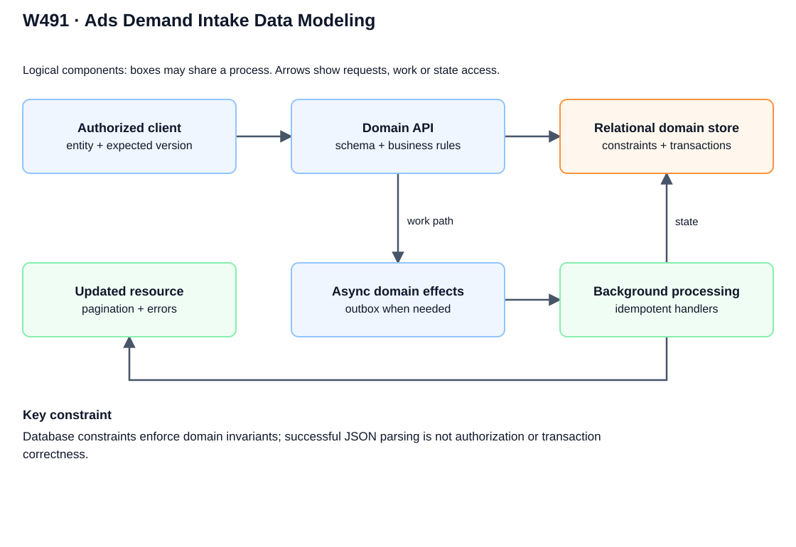

# W491. Ads Demand Intake Data Modeling

**Priority group:** Fifth 100 — specialized practice

**Category:** Web services and object design

**Study position:** 491 of 547

[Group list](../FIFTH_100.md) · [All categories](../ALL_CATEGORIES.md) · [Chapter guide](../README.md)

## Question

Model the demand side of Netflix Ads: advertiser accounts, campaigns, ad groups, creative, targeting, orders, budgets, impressions, and measurement. Proactively cover bidding and targeting rather than waiting to be asked.

### Requirements

Model advertiser / business account ownership and permissions.
Model campaigns, ad groups / line items, creative assets, targeting rules, budgets, pacing, and order type.
Track serving events: eligible request, impression, click, conversion, and measurement attribution.
Support direct-sold demand as a special case where open-auction concepts may not apply.
Explain how config changes propagate to serving systems.
Discuss reporting tables and key campaign-health metrics.

## Worked solution

<!-- architecture:W491:start -->
### Architecture and request flow

[Open the diagram at full size](../diagrams/W491_architecture.svg). This is a baseline component diagram for this question. The boxes describe responsibilities; they do not require a separate microservice for every box.

- **Request and state:** Authorized client — entity + expected version → Domain API — schema + business rules. That component consults or updates **Relational domain store — constraints + transactions** under the required access and consistency rules.
- **Work and result:** the work path passes through **Async domain effects — outbox when needed** and **Background processing — idempotent handlers**, producing **Updated resource — pagination + errors**. Bound waiting and retries where a slow dependency can stall this path.
- **Correctness point:** Database constraints enforce domain invariants; successful JSON parsing is not authorization or transaction correctness.

When explaining the drawing, trace one normal request first, then a duplicate request, an unavailable dependency and recovery from saved state. If the question requires stricter guarantees or a different scope, state the change explicitly rather than treating this baseline as the only possible design.
<!-- architecture:W491:end -->

### Solution outline

1. Identify entities and their stable keys, relationship cardinalities, versioning and lifecycle states. Use constraints to enforce ownership, uniqueness and allowed transitions rather than leaving all rules in UI code.
2. For templates/instances, record the base template version and explicit instance overrides; an update should merge according to a documented conflict policy rather than overwrite local changes blindly.
3. For promotions, memberships or advertising intake, store effective date ranges and a history of state/rule changes. Make retried commands idempotent and separate transactional records from derived analytics.
4. Demonstrate create→update→retire/delete and one concurrent-update example, then add indexes matching real access patterns and tenant-aware authorization.

### Understand why the approach works

#### Derive interfaces from the lifecycle

List the domain objects, their ownership and allowed state transitions before drawing classes. A useful interface expresses operations and invariants, not just getters and setters. A checkout, cancellation, membership update or order confirmation can change several records and therefore needs an atomic boundary.

Separate request parsing, authorization, business logic and persistence adapters. This lets the same transition be tested independently of HTTP and makes failure behavior explicit. Use version checks for conflicting edits, pagination for growing collections and stable ids for related objects.

For asynchronous effects, commit an intent/outbox with the local change, then process it idempotently. A client retry must not create a second logical order merely because the first response was lost. Define not-found, validation, conflict and transient-failure responses separately.

Show one concrete lifecycle and one invalid transition. For a library, a physical copy cannot be checked out by two borrowers; for pizza, order acceptance and kitchen fulfillment are separate states. Scaling should follow the access pattern and bottleneck, not a requirement to create many services. Explain why a simpler initial deployment still preserves the future partition and consistency choices.

### Work a small example

An instance overriding its title should keep that override when an unrelated template field changes; a membership status should be explainable at a historical date.

### Edge cases and common mistakes

Storing an unversioned blob that cannot distinguish inherited defaults from deliberate overrides.

### Check your reasoning on related cases

**Design idempotency for an order or booking API.** A timeout after successful booking should not create a second booking when the client retries the same key.

What if a downstream service is not transactional with your database? Use a durable state machine and reconciliation, not an unsupported exactly-once claim.

**Design a cache without serving incorrect data.** Two identical question strings from users with different document permissions must not automatically share a retrieved-answer cache entry.

Why can invalidation be preferable to TTL alone? Critical updates may need to take effect sooner than the ordinary expiry window.

### Further study

- [F165: Design idempotency for an order or booking API.](../17_distributed_systems_depth.md#f165)
- [F170: Design a cache without serving incorrect data.](../17_distributed_systems_depth.md#f170)

### Explain it back

Close the answer. State the main invariant or equation, work the example with changed inputs, and explain which assumption would make your solution fail. For a design, walk through a retry or partial failure; for a derivative, check a shape and a finite-difference case.
