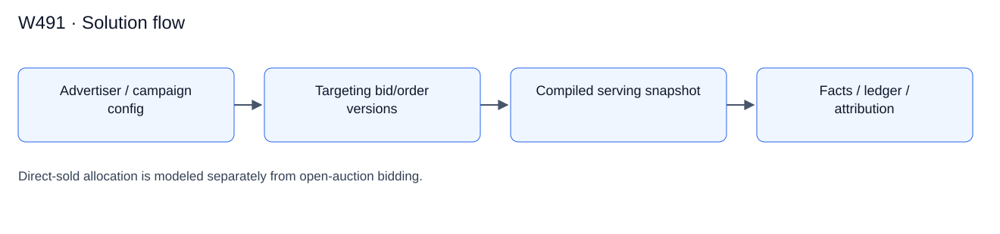

# W491. Ads Demand Intake Data Modeling

**Priority group:** Fifth 100 — specialized practice

**Category:** Web services and object design

**Study position:** 491 of 547

[Group list](../FIFTH_100.md) · [All categories](../ALL_CATEGORIES.md) · [Chapter guide](../README.md)

## Question

Model the demand side of Netflix Ads: advertiser accounts, campaigns, ad groups, creative, targeting, orders, budgets, impressions, and measurement. Proactively cover bidding and targeting rather than waiting to be asked.

### Requirements

Model advertiser / business account ownership and permissions.
Model campaigns, ad groups / line items, creative assets, targeting rules, budgets, pacing, and order type.
Track serving events: eligible request, impression, click, conversion, and measurement attribution.
Support direct-sold demand as a special case where open-auction concepts may not apply.
Explain how config changes propagate to serving systems.
Discuss reporting tables and key campaign-health metrics.

## Worked solution

### Separate advertiser configuration from serving facts and money

Relational configuration starts with `BusinessAccount(id,billing_profile,currency)`, `AccountMember(account,user,role)` and `Campaign(id,account,objective,start,end,status,version)`. Each campaign owns `LineItem(id,campaign,order_type,targeting_version,bid_policy,budget,pacing,priority)` and joins reusable `Creative(id,asset_manifest,duration,format,review_state)` via placements. Store money as integer minor units with explicit currency; never add USD cents to another currency's cents. Budget changes and actual spend are distinct audited records.

Use `TargetingRule(id,version,expression_ast)` over canonical audience/geo/device/content IDs, with validated AND/OR/NOT semantics and a defined eligible-user universe. `BidPolicy(type,max_cpc/max_cpm,score_config)` specifies open-auction strategy; CPM and CPC have different cost units and expected-liability handling. `Order(id,type,contract,guaranteed_quantity,price,dates)` supports direct-sold guaranteed/non-guaranteed inventory where auction bids may be absent. Pacing/priority/allocation determine delivery under contract; do not fabricate a bid for every direct-sold line item.

Serving consumes compiled immutable campaign/targeting/creative snapshots from an outbox/change stream, with version manifests and atomic regional activation. Pause/revoke has a fast deny overlay plus a propagation SLO. The config API uses owner roles, optimistic version checks and approval/audit. Activation requires creative review, budget validity and consistent referenced versions; a partial update must not mix a new targeting rule with an old compliance state.

Record immutable `AdRequest`, `EligibilityDecision`, `Auction/Allocation`, `Impression`, `Click`, `Conversion` with event IDs, request/impression references, event/receive time, source and config version. Measurement attribution is its own versioned policy/window and can assign fractional credit; a conversion is not automatically one click. Dedup/fraud state and privacy/consent apply before billable ledger entries. A double-entry wallet/budget ledger and atomic reservations enforce spend, while event-time rollups support reporting.

Assume 10K advertisers and 100K requests/s: configuration volume is small relative to serving facts, so do not put every impression in one hot campaign row. Partition facts by time/campaign salt and aggregate minute/day totals. Campaign health includes eligible reach, fill/win rate, impressions, frequency, CTR, CVR, spend versus pace, budget remaining, creative rejection and attribution lag. Ratios use matching denominators/windows and disclose provisional late data. Direct-sold delivery/underfulfillment and auction clearing-price metrics remain separate. This is a demand model/design, not a claim of Netflix's internal schema.

### Follow the diagram

Read left to right: Advertiser / campaign config → Targeting bid/order versions → Compiled serving snapshot → Facts / ledger / attribution. Direct-sold allocation is modeled separately from open-auction bidding.

### Further study

- [F165: Design idempotency for an order or booking API.](../17_distributed_systems_depth.md#f165)
- [F170: Design a cache without serving incorrect data.](../17_distributed_systems_depth.md#f170)
